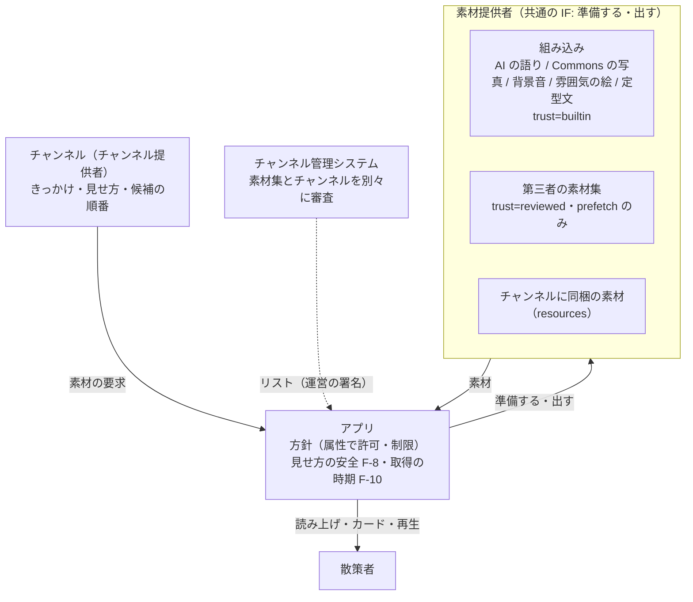

# ADR-002 素材の素材提供者をチャンネルから切り出し、すべての素材提供者を共通のインタフェースで扱う

## 文書情報

| 項目 | 内容 |
|---|---|
| 文書ID | ADR-002 |
| ドキュメント種別 | ADR |
| 対象システム/機能 | SanpoGuide チャンネルの素材（テキスト・画像・音声・映像）と、その素材提供者 |
| 関連Skill | architecture-decision-record |
| 作成日 | 2026-10-11 |
| 作成者 | Claude（開発者との検討） |
| 承認者 | 開発者 |
| ステータス | 承認済 |
| 版 | 1.0 |

## 目的・背景

[API-003](../channel-package-format.md) で、チャンネルは素材を持ち、決まったきっかけと見せ方で出せるようにした（M-1〜M-4、F-8〜F-13）。素材がチャンネルのパッケージの一部（`channel.json` の `resources`）だけだと、審査も更新もチャンネル単位になる。そのため次の問題がある。

1. **審査の重複**: 同じ素材（観光協会の音声ガイドなど）を複数のチャンネルで使うと、チャンネルごとに審査し直す
2. **素材だけの参加ができない**: 観光協会・写真家・語り手は、語り手や話題まで含むチャンネルを作らないと素材を届けられない
3. **更新の波及**: 素材を直すと、使っているチャンネルがすべて申請し直しになる
4. **利用許諾を確かめられない**: その素材を使ってよいかは、チャンネル提供者の自己申告（`license: permission`）でしか示せない

また、アプリがすでに使っている素材（AI の解説・話しかけ、Wikimedia Commons のスポットの写真、合成の背景音、雰囲気の絵、定型文）は、どれも「その場で取得・生成する」もので、第三者の素材とは別々の仕組みで動いている。

開発者から「素材（文字・映像・画像・音声）の素材提供者（Producer）の役割を切り出したい。チャンネルは素材を利用し、散策者に見せる」という方針と、「素材提供者は組み込みと第三者の 2 種類にするが、インタフェースを決めて同じインタフェースで扱いたい」という方針が示された。本書はその決定を記録する。

## スコープ・非スコープ

スコープ:
- 素材提供者・チャンネル（チャンネル提供者）・アプリの役割の分担
- 素材提供者の種類と、共通のインタフェース（IF）の大枠
- 第三者の素材集の審査・公開・版・利用許諾・取り下げの大枠
- 組み込みの素材提供者（アプリがその場で取得・生成する素材）の位置づけ
- 素材提供者の管理（身元・鍵の移し替え・退会・なりすまし・権利の申し立て）のうち、アプリとリストに関わる方針

非スコープ（別の文書で決める）:
- IF の項目・値・エラーの詳細と、素材集の形式（[API-004](../material-producer-api.md)）
- リストに素材集を載せる形式（[API-002](../channel-list-api.md)）
- チャンネルの `cues` からの参照の書き方（[API-003](../channel-package-format.md)）
- 管理システムのデータモデル・画面、素材提供者の役割・上限・依存の記録・外部の素材の確認の詳細（yorisoi-console）
- 素材のテキストを AI の根拠として渡す決まり（[ADR-004](ADR-004-roles-of-ai-and-stakeholders.md) H-3〜H-5、[API-004](../material-producer-api.md)「AI の根拠」）

## 対応元ID（トレーサビリティ）

| 対応元ID | 内容 | 対応状況 |
|---|---|---|
| API-003 | M-1〜M-4（素材・きっかけ・「第三者の媒体」の統合）、F-8〜F-13（見せ方の安全、素材の置き場所・取得の時期・出典・AI の語りとの関係） | 素材の持ち主を素材提供者に移す。F-8・F-10・F-11・F-13 はそのまま全素材提供者に適用する |
| ADR-001 | C-3（更新ごとの審査）、C-4（チャンネル提供者の身元と署名）、C-7（アプリが強制すること）、C-8（審査基準） | 素材提供者にも同じ考え方を当てる |
| API-002 | 承認済みチャンネル・リスト | 素材集を載せる |
| TODO.md「チャンネル」 | 第三者のチャンネルの素材 | 本書で対応 |

## 方針・決定事項

| No. | 論点 | 決定 |
|---|---|---|
| D-1 | 役割の分担 | **素材提供者**は素材を作る（何を: 中身・出典・書き起こし・代替テキスト・何についての素材か・誰に使わせるか）。**チャンネル**は素材を使って見せる（いつ・どう見せるか: きっかけ・見せ方・候補の順番）。**アプリ**は見せ方の安全の決まり（API-003 F-8）と取得の時期（F-10）を強制し、読み上げ・カード・再生を行う |
| D-2 | 素材提供者の種類 | 3 つ。**組み込みの素材提供者**（アプリのコードで動く。AI の語り・Commons の写真・合成の背景音・雰囲気の絵・定型文）、**第三者の素材提供者**（署名した素材集を出す）、**チャンネルに同梱の素材**（`resources`。そのチャンネル専用の素材集として扱う）。役割と責任の上では、AI の語りは素材提供者ではなく実演の層として扱う（ADR-004 H-2）。IF 上は組み込みの素材提供者のまま |
| D-3 | 共通の IF | すべての素材提供者を同じ IF で扱う。IF は 3 つの型（素材提供者の記述・素材の要求・素材）と 2 つの操作（準備する・出す）。詳細は [API-004](../material-producer-api.md) |
| D-4 | 静的・動的の違いの表し方 | IF の形は分けず、素材提供者の記述の属性（`trust`・`fetch`・`exposure`・`generated`）で表す。何を許すかは、属性を見てアプリの方針が決める。方針はチャンネルからも素材提供者からも変えられない |
| D-5 | 第三者の素材提供者に許すこと | `fetch` は前もっての取得（`prefetch`）だけ、`exposure`（外部に題材が伝わること）はなしだけ。第三者が自分の API をその場で呼ばせる形（動的な第三者の素材提供者）は、IF では書けるが方針で禁止する。理由は、その場で取得すると散策者の位置が相手に伝わること（F-10）と、中身が毎回変わり審査できないこと |
| D-6 | 組み込みの素材提供者の増やし方 | アプリの更新だけで増やす。その場で外部の API を呼ぶもの・AI で生成するものの安全（回線の条件、共通の指示、出典の表示）は、アプリのコードと固定の指示で守る |
| D-7 | 素材集の審査と公開 | 素材集は、素材提供者が自分の鍵で署名し、チャンネル管理システムに申請する。運営はチャンネルとは別の単位として審査・承認し、承認済みのリスト（API-002）に載せる。素材集を更新したときは、素材集だけを審査し直す（チャンネルは申請し直さない） |
| D-8 | チャンネルが参照する版 | チャンネルは素材集の ID と、使える最低の版を書く。実際に使う版は、運営が署名するリストが決める。公開中のチャンネルが使っている素材の ID を消す・種類を変える更新は、管理システムが受け付けない |
| D-9 | 利用許諾 | 素材提供者は素材集に、使ってよいチャンネルの範囲（誰でも／指定のチャンネル提供者だけ）を書いて署名する。管理システムはチャンネルの申請時に、アプリは取り込み時に、機械で確かめる |
| D-10 | 何についての素材か | 素材には題材（スポット・地点）を付けられる。チャンネルは、素材の ID で選ぶほかに、題材で選ぶこともできる（「このスポットについての素材があれば出す」）。出すきっかけと見せ方は常にチャンネルが決める |
| D-11 | 候補の順番 | チャンネルは 1 つの見せ方に複数の素材提供者を並べられ、アプリは最初に出せたものを使う（例: 観光協会の解説 → なければ AI の解説）。API-003 F-12 の `replace`／`add` はこの書き方で表せる |
| D-12 | 素材集が取り下げられたとき | その素材集は「出せない」として扱い、次の候補に進む。候補がなければ、そのきっかけは出さない。チャンネル（語り）はそのまま続ける |
| D-13 | 組み込みのチャンネル | 組み込みのチャンネルも、内蔵のリストに載っていて利用許諾が合う素材集を使える |
| D-14 | アカウント | 素材提供者はチャンネル提供者と同じ鍵とアカウントID（`sg1…`）を使う。1 つのアカウントでチャンネル提供者と素材提供者を兼ねられる。登録・鍵の紐づけ・停止（申請を止めるだけで、公開中のものはそのまま）・操作の記録・メールでの通知は、管理システムのチャンネル提供者の仕組みをそのまま使う |
| D-15 | `channel.json` の省略形 | プロンプトのスロット・`guide.length`・`mood.sound` などは**省略形として残す**。アプリは読み込むときに、組み込みの素材提供者（AI の語り・背景音）への指示に展開する |
| D-17 | 素材集の参照と鍵の移し替え | チャンネルは素材集を**素材集の ID だけ**で参照する（素材提供者のアカウントIDを書かない）。素材集の ID はリストの中で一意で、最初に登録した素材提供者が持ち、取り下げ・退会のあとも再利用させない（チャンネルの ID と同じ）。素材提供者が誰かはリストの `collections[].producer` で分かる。鍵の移し替えはアカウント単位で、チャンネルと素材集が一緒に移る。リストには `producerChange` を載せる（API-002 P-9 の `publisherChange` と同じ考え方）。参照は ID だけなので、移し替えでチャンネルの参照は壊れない |
| D-18 | 依存の把握と知らせ | 管理システムは、チャンネルの承認時に、どの素材集のどの版・どの素材を参照しているかを記録する。素材集の取り下げ・更新・利用許諾の縮小のときは、使っているチャンネル提供者にメールで知らせる。素材提供者には、自分の素材集を使っているチャンネル（リストに載っているもの）を見せる |
| D-19 | 素材提供者の退会 | 公開中の素材集を自動で取り下げる。使っているチャンネルは次の候補に進むので壊れない（D-12）。権利を持つ人がいない素材を配り続けないため |
| D-20 | なりすまし | 誰でも登録できる（yorisoi-console ADR-001 D-7）ため、素材提供者の表示名と素材の出典（`credit`）は名乗りにすぎない。初めての素材集の審査で、運営が、名乗っている団体・個人であることと素材の権利を、登録した連絡先など鍵とは別の経路で確かめる。表示名を変えたときも確かめ直す |
| D-21 | 権利の申し立て | 権利者からの申し立て（無断の利用・なりすまし）を、リストの運営の連絡先（案内文書の `contact`）でメールで受け付ける。管理システムに受け付けの画面は作らない（担当者 1 人で件数が少ないうちは、メールで足りるため）。受け付け → 運営の確認（提供者の言い分も聞く）→ 取り下げ・置き換え・退ける、の流れと目安は審査基準「権利の申し立て」に置く。明らかなときは確認を待たずに取り下げ、繰り返し・なりすましは提供者を停止する。チャンネルにも同じ窓口を使う |
| D-22 | 外部の素材の確認 | 管理システムは毎日の公開の処理で、公開中の素材集の外部の素材（URL）を確かめ、取得できない・ハッシュが合わないときは素材提供者に知らせる。アプリ側では、その素材が「今は出せない」になるだけで、次の候補に進む |
| D-23 | 基準で選ぶ素材提供者 | チャンネルは、具体的な素材集・素材を指す代わりに、選ぶ基準（素材の種類・タグ・言語・長さ）を書ける。基準は「選択の素材提供者」として共通の IF で動き、リストに載っている素材集から基準と題材に合う素材を出す。題材を問わないきっかけ（「寺社・史跡に近づいたら」）と組み合わせて使う |
| D-24 | 基準で選ぶときの前もっての取得 | 素材集に地域（`regions`、geohash の 3 文字。約 150km 四方。管理システムが素材の題材から計算する）を載せ、端末が今いる地域とその隣の地域（9 つ）の素材集だけを、従量制でない回線のときに前もって取得する。地域を持たない素材集（場所に結びつかない素材）は地域を問わない。**F-10 を緩める判断**: 取得の要求から 150km 四方ほどの地域が運営に伝わる。IP アドレスから分かる粗さと同じ程度で、近づいてから取得すること（素材の場所が伝わること）はしない |
| D-25 | タグ | 基準に使うタグは、API-004 に置く決まった一覧から選ぶ（自由に書けない）。素材提供者が素材に付け、素材集の審査で正しいかを確かめる |
| D-26 | 複数の素材が当たったとき | チャンネルが優先する素材提供者の順番を書ける。書かないときは、確認済みの素材提供者（未決事項 No.4 で印を付ける場合）→ 承認日の新しい素材集の順。同じ散歩では、同じスポットで出す素材を変えない |
| D-27 | 基準で選ぶときの審査 | チャンネルの審査では、どの素材が出るかではなく、基準（タグ・種類・長さ）と、どのスポットで出すかを確かめる。素材は素材集の審査、見せ方の安全はアプリの強制で守る（AI の語りと同じ考え方）。利用許諾（`grants`）がチャンネル提供者を含まない素材集は、基準に合っても使わない |
| D-16 | 契約と型の置き場所 | IF と素材集の形式は API-004 に置く。型（記述・要求・素材・参照）は `core-format` に入れ、アプリと管理システムの機械審査で同じ定義を使う |

## 判断テーマ

素材を作る役割（素材提供者）を、素材を見せる役割（チャンネル）から分けるか。分けるなら、審査・更新・利用許諾の単位をどうするか。また、アプリがその場で取得・生成する素材と、前もって用意する第三者の素材を、どう同じ仕組みで扱うか。

## 検討した代替案と比較軸

比較軸: ①同じ素材の再利用（審査の重複がないか） ②素材だけの参加ができるか ③利用許諾を確かめられるか ④散策者の安全とプライバシー（F-8・F-10） ⑤変更の費用（形式・アプリ・管理システム）

| 案 | 内容 | 評価 |
|---|---|---|
| 案 A | 素材集を作らない。素材提供者からチャンネル提供者への素材の受け渡しはシステムの外で取り決める | ①× ②× ③× ④◎ ⑤◎ |
| 案 B | `credit` に素材提供者のアカウントIDを書けるようにする。署名・審査・配信はチャンネル単位 | ①× ②× ③△ 名乗れるが確かめられない ④◎ ⑤◎ |
| **案 C（採用）** | 素材集を独立した単位にする。素材提供者が署名し、運営が素材集として審査・承認してリストに載せる。チャンネルは参照して見せるだけ | ①◎ ②◎ ③◎ ④◎ F-8・F-10 は変えない ⑤△ API-002・API-003・管理システムの変更が要る |
| 案 D | 素材集は作るが、審査はチャンネルの申請と一緒。チャンネルが素材集の SHA-256 を固定して参照する | ①× ②△ ③○ ④◎ ⑤○ リストは変えずに済む |

あわせて決めた論点:

| 論点 | 案 | 判定と理由 |
|---|---|---|
| 組み込みと第三者の扱い | 別々の仕組み / 共通の IF | **共通の IF**。違いは属性で表し、方針で制限する。チャンネルは素材提供者の種類を意識せずに候補を並べられる。将来、第三者の動的な素材提供者を審査つきで認める場合も、IF を変えずに方針だけを変えればよい |
| 第三者の動的な素材提供者 | 認める / 認めない | **認めない**（D-5）。位置の漏れと、審査できないため |
| `channel.json` の省略形 | 省略形として残す / すべて素材提供者の形で書く | **省略形として残す**（D-15）。書き手に分かりやすく、書く量が少ない |
| AI の語り | 素材提供者にしない（チャンネルの機能のまま） / 素材提供者にする | **素材提供者にする**。素材集と AI の解説の切り替え（D-11）が同じ書き方になる |
| 素材の指し方 | 具体的な素材集・素材だけ / 基準で選ぶことも認める | **基準で選ぶことも認める**。素材集が後から増えても、チャンネルを申請し直さずに使われる。素材の ID を指さないので、素材集の更新で参照が壊れない。代わりに、前もって取得する範囲（D-24）と、審査で確かめる内容（D-27）が変わる |

## 採用案と採否理由

案 C を採用し、すべての素材提供者を共通の IF で扱う。

- 審査と更新の単位まで分けることで、役割の分離の効果（再利用・素材だけの参加・素材の更新が波及しないこと）が得られる
- 利用許諾を素材提供者の署名で示すので、アプリと管理システムが機械で確かめられる
- 共通の IF で、その場で取得・生成する素材と第三者の素材集を、チャンネルから同じ書き方で使える
- 第三者のチャンネルを公開する前に、素材の単位を決めておける

却下した理由:
- 案 A・案 B: 問題 1〜4 が残る（案 B は利用許諾を名乗れるだけ）
- 案 D: 素材集を直すと、使うチャンネルすべてが申請し直しになる。同じ素材の審査も重複する

利点:
- 観光協会・写真家・語り手が、チャンネルを作らずに素材を届けられる
- 運営は同じ素材を一度審査すればよい
- チャンネルは「観光協会の解説があればそれ、なければ AI」のように、素材提供者を組み合わせられる

注意点:
- 審査の単位が 2 つ（チャンネルと素材集）になり、管理システムの申請・審査・取り下げの仕組みが倍近くになる
- 素材集の取り下げ・更新が、それを使うチャンネルに波及する（D-8・D-12 で抑える）
- 審査はチャンネルと素材集の組み合わせを見ない。素材集が更新されたとき、チャンネルの見せ方と合わなくなるおそれがある（D-8 の範囲の外の、内容の変化）

## 影響範囲・追従タスク

| 観点 | 影響 |
|---|---|
| 実装（アプリ） | `Producer` の IF と方針。組み込みの素材提供者（`SpotPhotos`・AI・`Soundscape`・`MoodScene`・定型文）もその後ろに置く。`ChannelSync` で素材集を取得・確認・前もって取得する。きっかけの候補の順番（D-11） |
| 実装（コア） | `core-format` に IF の型、素材集の形式の確認、利用許諾の確認、参照の確認 |
| 実装（管理システム） | 素材提供者の役割、素材集の申請・機械審査・審査・承認・取り下げ、リストへの掲載、D-8 の更新の制限、利用許諾の確認 |
| 運用 | 運営の審査が、チャンネルと素材集の 2 種類になる。初めての素材提供者の身元と権利の確認（D-20）、権利の申し立ての対応（D-21）、外部の素材の不具合の対応（D-22）が加わる |
| テスト | API-004 の確認観点。組み込みの素材提供者の動き（エミュレータでの写真・背景音・解説の確認） |
| 移行 | 散策者のデータへの影響はない。`channel.json` は省略形のまま読めるので、組み込みのチャンネルは書き換えなくてよい |
| 保守 | API-004 の版、組み込みの素材提供者の一覧を管理する |
| プライバシー | 素材集の取得を README の外部サービスに加える（位置情報は送らない。F-10 のとおりチャンネルを選んだときにまとめて取得） |

| ID | 追従タスク | 担当 | 時期 |
|---|---|---|---|
| T-1 | 権利の申し立ての窓口と手順（D-21）。公開の連絡先、受け付けから取り下げまでの流れ、記録の残し方 | 開発者 | 第三者の素材集・チャンネルの公開の前 |

見直しの条件:
- 権利の申し立てが増え、メールでは受け付けと記録が追いつかなくなったとき（管理システムに受け付けの画面を作る。D-21）
- 第三者の動的な素材提供者（その場で取得する素材）の要望が出たとき（D-5。位置を伝えずに取得する方法と、審査の方法を考える）
- 素材集の取り下げ・更新でチャンネルが壊れる問題が実際に起きたとき（D-8・D-12）
- 素材集の利用に対価が生じる、または素材提供者とチャンネル提供者の取り決めをシステムで扱う必要が出たとき
- 基準で選ぶ素材集が増え、地域ごとの前もっての取得（D-24）が通信量・保存の量の上限に収まらなくなったとき。また、地域が伝わることへの懸念が出たとき

## 制約

- F-8（見せ方の安全）・F-10（取得の時期）・F-11（出典と代替）・F-13（話す順番）は、素材提供者の種類にかかわらず変えない。ただし基準で選ぶ素材提供者の前もっての取得だけは、地域単位にする（D-24）
- 組み込みの素材提供者が外部の API を呼ぶとき（Commons の写真、AI）は、題材（スポットの名前・ID）が外部に伝わる。回線の条件と散策者の設定で抑える
- 素材の中身は機械では確かめられず、人の審査に頼る（API-003 の制約と同じ）

## 未決事項・リスク

| No. | 内容 | 決める時期 |
|---|---|---|
| 2 | 素材集の審査を無料にするか（ADR-001 の未決事項 No.1 と一緒に） | 第三者の公開の前 |
| 3 | 利用許諾を「指定のチャンネル提供者」より細かく（チャンネル単位、期間付き）できるようにするか | 素材提供者の要望が出たとき |
| 4 | 身元を確かめた素材提供者に「確認済み」の印を付け、アプリに表示するか（D-20） | 第三者の公開の前 |

リスク:
- 素材集の更新で、素材の ID と種類は同じでも中身が変わり、チャンネルの意図と合わなくなる
- 管理システムの仕組みが大きくなり、運営の担当者 1 人（ADR-001 C-10）の審査の負担が増える
- 身元の確認（D-20）は運営の手作業で、確かめた後のなりすまし（アカウントの乗っ取り）は防げない。取り下げ（D-21）で補う

## 関連ドキュメント・参照リンク

- [material-producer-api.md（API-004）](../material-producer-api.md): 素材提供者 IF と素材集の形式
- [channel-package-format.md（API-003）](../channel-package-format.md): 素材・きっかけ・見せ方
- [channel-list-api.md（API-002）](../channel-list-api.md): 承認済みチャンネル・リスト
- [ADR-001](ADR-001-third-party-channel-curation.md): 第三者のチャンネルの審査と署名
- [channels.md](https://github.com/duwenji/yorisoi-sanpoguide/blob/main/docs/channels.md): アプリ側の設計
