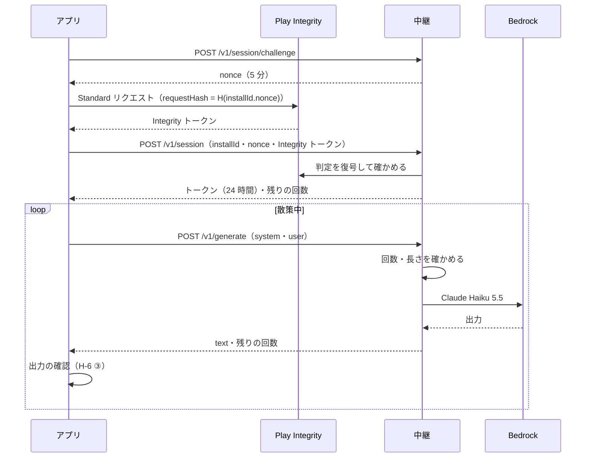

# 運営の AI 中継 API 契約書

## 文書情報

| 項目 | 内容 |
|---|---|
| 文書ID | API-AI-RELAY |
| ドキュメント種別 | API契約書 |
| 対象システム/機能 | yorisoi エコシステムのアプリと、運営の AI の中継（[ADR-AI-RELAY](../decisions/ADR-AI-RELAY.md)） |
| 関連Skill | 020_api-contract-design |
| 作成日 | 2026-10-19 |
| 作成者 | Claude（開発者との検討） |
| 承認者 | 開発者 |
| ステータス | 草案 |

本書は、アプリが運営の AI を使うときの中継との契約を定めます。自分のキーの経路（アプリが AI サービスを直接呼ぶ）は本書の対象外です。

## 目的・背景

ADR-AI-RELAY で、アプリ利用者がキーを用意しなくても、1 台の端末につき 1 日 30 回まで運営の負担で AI を使えるようにすることにした。運営のキーをアプリに入れず、運営の中継が Amazon Bedrock を呼ぶ。本書は、そのための次のことを定める。

1. Play から入れた本物のアプリだけが使えること（Play Integrity）
2. 1 日の回数をサーバーで数えて守ること
3. 散策の語り以外に使っても得にならない長さに抑えること
4. 中継が止まったり上限に達したりしたとき、アプリが定型文に切り替えられるよう、理由をエラーで返すこと

## スコープ・非スコープ

スコープ:
- セッション（端末の確認とトークンの発行）、残りの回数の取得、生成
- 1 日の回数の数え方、入力と出力の長さ
- エラーと、アプリの動き
- 中継が残すもの・残さないもの

非スコープ:
- 中継の AWS の構成と配備（yorisoi-console の文書）
- プロンプトの組み立てと出力の確認（今と同じくアプリで行う。ADR-AI-ROLES H-6）
- アプリの画面（各アプリの文書）

## 対応元ID（トレーサビリティ）

| 対応元ID | 内容 | 対応状況 |
|---|---|---|
| ADR-AI-RELAY R-2 | 1 台の端末につき 1 日 30 回、サーバーで数える | [回数の数え方](#回数の数え方) |
| ADR-AI-RELAY R-5 | Bedrock の Claude Haiku 5.5 | [AI の呼び方](#ai-の呼び方中継の内部) |
| ADR-AI-RELAY R-7 | Play Integrity とインストール ID、24 時間のトークン | [セッション](#post-v1session) |
| ADR-AI-RELAY R-9 | 入力と出力の長さの上限 | [長さの上限](#長さの上限) |
| ADR-AI-RELAY R-10 | 予算を超えたら止める | エラー `relay_paused` |
| ADR-AI-RELAY R-11 | 残りの回数の表示 | `quota` |
| ADR-AI-RELAY R-13 | 中継が残すもの | [中継が残すもの](#中継が残すもの) |

## 方針・決定事項

| No. | 論点 | 決定 |
|---|---|---|
| AR-1 | 接続先 | 接続先の URL はアプリに組み込む。デバッグ版は開発用、リリース版は本番用の中継を使う。アプリ利用者には設定させない |
| AR-2 | インストール ID | アプリが初めて運営の AI を使うときに UUID（v4）を作り、端末に保存する。バックアップと端末間の移行には含めない。中継はインストール ID をそのまま保存せず、中継だけが持つ秘密の鍵での HMAC-SHA256 にして使う |
| AR-3 | 端末の確認 | Play Integrity の Standard リクエスト。`requestHash` に、インストール ID と中継が出した一度きりの値（nonce）を結び付けたハッシュを入れる。中継が確かめる判定は、パッケージ名、`appRecognitionVerdict` が `PLAY_RECOGNIZED`、`deviceRecognitionVerdict` に `MEETS_DEVICE_INTEGRITY` を含むこと、判定の時刻が 5 分以内であること |
| AR-4 | 開発用の中継 | Integrity の判定を確かめない（判定を送らなくてよい）。開発用の Bedrock のクォータと予算で量を抑える |
| AR-5 | トークン | 中身に意味のないランダムな文字列（32 バイトを base64url）。有効期限 24 時間。中継はハッシュだけを保存する |
| AR-6 | プロンプトの扱い | アプリが組み立てた `system` と `user` をそのまま AI に渡す。中継は書き換えない |
| AR-7 | 出力の確認 | 中継はしない。アプリが今と同じ確認をする（ADR-AI-RELAY R-8） |



### 回数の数え方

- 1 台の端末（インストール ID）につき、日本時間の 1 日に 30 回まで。日本時間の 0 時に戻す
- 数えるのは、AI を呼んで応答を受け取った呼び出し（`200`、`model_refused`、`incomplete_output`）。長さの誤りなど中継が受け付けなかった呼び出しと、AI 側の失敗（`upstream_error`）は数えない
- キャッシュ済みの解説はアプリが中継を呼ばないので、数えない
- 上限の値は中継が `quota.limit` で返す。アプリは 30 を組み込まず、この値に従う。アプリ利用者が設定で決めた上限（ADR-AI-ROLES H-9）が少なければ、アプリがそちらで止める

### 長さの上限

| 項目 | 上限 | 理由 |
|---|---|---|
| `system` | 8,000 字 | 固定の指示・チャンネルの語り手と話題・共通の指示を合わせても収まる |
| `user` | 6,000 字 | スポットの情報・状況のまとめ・根拠（素材 3 つ・合計 1,500 字。ADR-AI-ROLES H-3）が収まる |
| 出力（`max_tokens`） | 1,024 トークン | いちばん長い解説（`guide.length` の `long`）と話しかけが収まる |

### AI の呼び方（中継の内部）

- Bedrock の推論プロファイル `jp.anthropic.claude-haiku-5-5`（ap-northeast-1）
- `max_tokens` は 1,024。考える過程（thinking）は使わない
- 出力のテキストのブロックをつないで、前後の空白を取って返す

### 中継が残すもの

| 残す | 残さない |
|---|---|
| インストール ID の HMAC、日付、回数、入力・出力のトークン数、応答時間、エラーの `code` | `system`・`user`・出力の中身、インストール ID そのもの、Integrity の判定の中身、トークンそのもの |

- 回数の記録は 7 日、セッションはトークンの期限、nonce は 5 分で消す（DynamoDB の TTL）
- Bedrock のモデル呼び出しのログは有効にしない
- アクセスログに送信元の IP アドレスが残るのは、WAF と API Gateway の既定の範囲（30 日で消す）に限る

## エンドポイント一覧

| メソッド | パス | 認証 | 用途 |
|---|---|---|---|
| POST | `/v1/session/challenge` | なし | nonce を受け取る |
| POST | `/v1/session` | なし（Integrity の判定） | トークンを受け取る |
| GET | `/v1/quota` | トークン | 今日の残りの回数を知る |
| POST | `/v1/generate` | トークン | AI の出力を受け取る |

トークンは `Authorization: Bearer {token}` で送る。本文はすべて `application/json`（UTF-8）。

## リクエスト・レスポンス仕様

### POST /v1/session/challenge

リクエストの本文はない。

```json
{ "nonce": "q3Jx…（32 バイトを base64url）", "expiresAt": "2026-10-19T12:05:00Z" }
```

nonce は 5 分有効で、一度だけ使える。

### POST /v1/session

```json
{
  "installId": "0b6f3c1e-8a2d-4f0b-9a57-3c2e1d4b5a69",
  "nonce": "q3Jx…",
  "integrityToken": "eyJ…",
  "app": { "package": "io.github.duwenji.yorisoi.sanpoguide", "versionCode": 4 }
}
```

- `integrityToken` は、Standard リクエストに `requestHash` = base64url(SHA-256(UTF-8 の `{installId}.{nonce}`)) を渡して得たもの。開発用の中継では省いてよい（AR-4）
- `app.package` は、中継が許したパッケージ名でなければならない

```json
{
  "token": "Zk9…",
  "expiresAt": "2026-10-20T12:00:00Z",
  "quota": { "limit": 30, "remaining": 30, "resetsAt": "2026-10-19T15:00:00Z" }
}
```

同じインストール ID で 1 日に作れるセッションは 5 つまで。

### GET /v1/quota

```json
{ "limit": 30, "remaining": 12, "resetsAt": "2026-10-19T15:00:00Z" }
```

アプリは、設定画面の「接続テスト」の代わりにも使う（回数を使わない）。

### POST /v1/generate

```json
{ "kind": "guide", "system": "…", "user": "…" }
```

- `kind` は `guide`（スポットの解説）か `chat`（話しかけ）。記録と集計にだけ使い、AI への渡し方は変えない

```json
{
  "text": "…",
  "quota": { "limit": 30, "remaining": 11, "resetsAt": "2026-10-19T15:00:00Z" },
  "usage": { "inputTokens": 1830, "outputTokens": 262 }
}
```

## エラー表

エラーは RFC 9457（`application/problem+json`）で返し、`code` で種類を区別する。上限に達したときは `quota` も付ける。

```json
{ "type": "about:blank", "title": "Daily limit reached", "status": 429, "code": "daily_limit_reached",
  "quota": { "limit": 30, "remaining": 0, "resetsAt": "2026-10-19T15:00:00Z" } }
```

| HTTP | code | 発生条件 | 数える | アプリの動き |
|---|---|---|---|---|
| 400 | `invalid_request` | JSON の形式・必須項目・`kind` の誤り | いいえ | 不具合として記録し、定型文 |
| 400 | `nonce_invalid` | nonce の期限切れ・使用済み・不明 | — | チャレンジからやり直す（1 回だけ） |
| 401 | `token_invalid` | トークンの期限切れ・不明 | いいえ | セッションを作り直して 1 回だけ再送 |
| 403 | `integrity_failed` | Integrity の判定が条件を満たさない、パッケージ名が違う | — | 運営の AI を使えないことと、自分のキーを使えることを示す。その日はセッションを作り直さない |
| 413 | `input_too_long` | `system` か `user` が上限を超えた | いいえ | 不具合として記録し、定型文 |
| 422 | `model_refused` | AI が応答を断った | はい | 定型文 |
| 422 | `incomplete_output` | 出力が `max_tokens` で切れた | はい | 定型文 |
| 429 | `daily_limit_reached` | 今日の回数を使い切った | いいえ | `resetsAt` まで AI を呼ばず、定型文で続ける |
| 429 | `too_many_requests` | 送信元ごとの回数の制限、セッションの作りすぎ | いいえ | しばらく呼ばず、定型文 |
| 502 | `upstream_error` | Bedrock が失敗した | いいえ | 定型文 |
| 503 | `relay_paused` | 予算を超えて中継を止めている | いいえ | 定型文。自分のキーを使えることを示す |

- WAF が返す 429 は `application/problem+json` でないことがある。アプリは `code` のない 429 を `too_many_requests` として扱う
- どのエラーでも、止められない出来事（天気の急変・日の入りなど）の案内は定型文で続ける（ADR-AI-ROLES H-9）

## 確認観点

| No. | 観点 |
|---|---|
| V-01 | 本番の中継で、Integrity の判定がない・条件を満たさないと `integrity_failed` になる |
| V-02 | 使用済みの nonce・5 分を過ぎた nonce は `nonce_invalid` になる |
| V-03 | 31 回目の生成は `daily_limit_reached` になり、`resetsAt` は次の日本時間 0 時 |
| V-04 | 日本時間 0 時を過ぎると回数が戻る |
| V-05 | `input_too_long`・`upstream_error` は回数に数えない。`model_refused`・`incomplete_output` は数える |
| V-06 | 24 時間を過ぎたトークンは `token_invalid` になり、セッションを作り直して続けられる |
| V-07 | 中継を止めると `relay_paused` になる |
| V-08 | 中継のログと DynamoDB に、プロンプト・出力・インストール ID そのもの・トークンそのものが残らない |
| V-09 | アプリが、どのエラーでも定型文に切り替わり、止められない出来事の案内が続く |
| V-10 | 自分のキーの経路では、中継に何も送らない |
| V-11 | アプリ利用者の上限が 30 より少ないとき、アプリがその回数で止める |

## 互換性方針・移行メモ

- パスは `/v1`。応答に項目を足すことは互換の変更とし、アプリは知らない項目を無視する
- エラーの `code` を足すことは互換の変更とする。アプリは知らない `code` を、HTTP の状態に合わせて上の表の近いものとして扱い、定型文に切り替える
- 項目の削除・意味の変更・数え方の変更は `/v2` で行う

## 制約

- 中継は Bedrock の Claude Haiku 5.5 だけを呼ぶ（ADR-AI-RELAY R-5）
- 中継はプロンプトと出力を保存しない（ADR-AI-RELAY R-13）
- アプリは中継の URL・上限の値・モデル名を、アプリ利用者に変えさせない

## 未決事項・リスク

| No. | 内容 | 決める時期 |
|---|---|---|
| 1 | Play Integrity の Standard リクエストの 1 日の上限（Google の割り当て）が、アプリ利用者の数に足りるか | 本番に出す前 |

リスク:
- 長さの上限は、チャンネルの語り手の文章や根拠が長くなると足りなくなることがある（`input_too_long` の数で見る）
- インストールし直すと、その日の回数が戻る（ADR-AI-RELAY のリスク）

## 関連ドキュメント・参照リンク

- [ADR-AI-RELAY](../decisions/ADR-AI-RELAY.md)
- [ADR-AI-ROLES](../decisions/ADR-AI-ROLES.md)（H-3・H-6・H-9）
- [API-CHANNEL-PACKAGE](API-CHANNEL-PACKAGE.md)（`guide.length`）
- [RFC 9457](https://www.rfc-editor.org/rfc/rfc9457)
