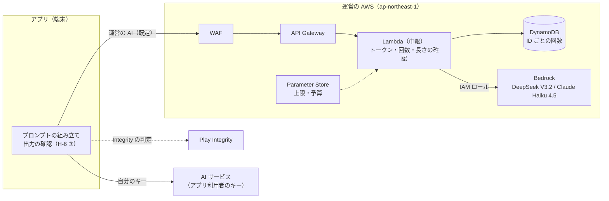
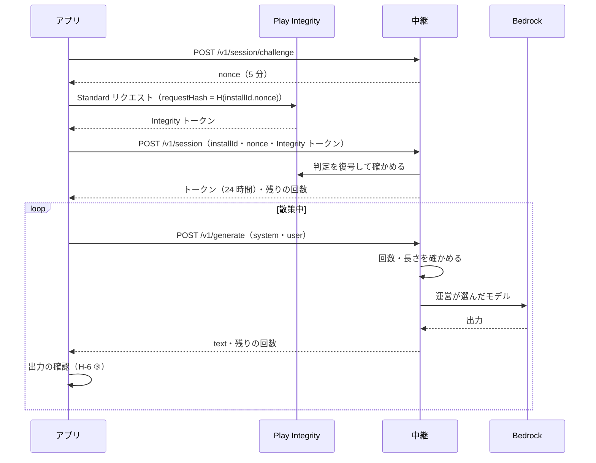

# 運営の AI 中継 API 契約書

## 文書情報

| 項目 | 内容 |
|---|---|
| 文書ID | API-AI-RELAY |
| ドキュメント種別 | API契約書 |
| 対象システム/機能 | yorisoi エコシステムのアプリと、運営の AI の中継（[API-AI-RELAY](API-AI-RELAY.md)） |
| 承認者 | 開発者 |
| ステータス | 承認済 |

本書は、アプリが運営の AI を使うときの中継との契約を定めます。自分のキーの経路（アプリが AI サービスを直接呼ぶ）は本書の対象外です。

## 目的・背景

API-AI-RELAY で、アプリ利用者がキーを用意しなくても、1 台の端末につき、運営が決めた 1 日の上限（既定 30 回、5〜100 回）まで運営の負担で AI を使えるようにすることにした。運営のキーをアプリに入れず、運営の中継が Amazon Bedrock を呼ぶ。本書は、そのための次のことを定める。

1. Play から入れた本物のアプリだけが使えること（Play Integrity）
2. 1 日の回数をサーバーで数えて守ること
3. 散策の語り以外に使っても得にならない長さに抑えること
4. 中継が止まったり上限に達したりしたとき、アプリが定型文に切り替えられるよう、理由をエラーで返すこと

## スコープ・非スコープ

スコープ:
- セッション（端末の確認とトークンの発行）、残りの回数の取得、生成
- 1 日の回数の数え方、入力と出力の長さ
- エラーと、アプリの動き
- 中継が残すもの・残さないもの

非スコープ:
- 中継の AWS の構成と配備（yorisoi-console の文書）
- プロンプトの組み立てと出力の確認（今と同じくアプリで行う。AI-ROLES H-6）
- アプリの画面（各アプリの文書）

## 対応元ID（トレーサビリティ）

| 対応元ID | 内容 | 対応状況 |
|---|---|---|
| API-AI-RELAY R-2・R-14 | 1 台の端末につき 1 日の上限まで、サーバーで数える。上限は運営が変える | [回数の数え方](#回数の数え方) |
| API-AI-RELAY R-5 | Bedrock のモデル（運営が DeepSeek V3.2 と Claude Haiku 4.5 から選ぶ） | [AI の呼び方](#ai-の呼び方中継の内部) |
| API-AI-RELAY R-7 | Play Integrity とインストール ID、24 時間のトークン | [セッション](#post-v1session) |
| API-AI-RELAY R-9 | 入力と出力の長さの上限 | [長さの上限](#長さの上限) |
| API-AI-RELAY R-10 | 予算を超えたら止める | エラー `relay_paused` |
| API-AI-RELAY R-11 | 残りの回数の表示 | `quota` |
| API-AI-RELAY R-13 | 中継が残すもの | [中継が残すもの](#中継が残すもの) |

## 運営の AI の方針

### 経路と費用

| No. | 論点 | 決定 |
|---|---|---|
| R-1 | AI を呼ぶ経路 | 2 つの経路を持つ。**運営の AI**: アプリが運営の中継サーバーに送り、中継が運営の負担で AI を呼ぶ。**自分のキー**: 今と同じく、アプリ利用者のキーで端末から AI サービスを直接呼ぶ。運営を通らない |
| R-2 | 運営の AI の上限 | 1 台の端末につき 1 日の上限まで（日本時間の 0 時に戻す）。上限は**既定 30 回**で、運営が中継の設定で **5〜100 回**の範囲で変えられる（R-14）。キャッシュ済みの解説は数えない（AI-ROLES H-9 と同じ数え方）。回数は中継のサーバーで数えて守る。アプリ利用者が決める上限（AI-ROLES H-9）は使わない（費用がアプリ利用者にかからないため）。上限に達したら、AI-ROLES H-9 と同じく、固定の素材と定型文だけで続ける |
| R-3 | 自分のキーの上限 | AI-ROLES H-9 のまま（アプリ利用者が決める。既定 100 回） |
| R-4 | 既定の経路 | 新しく入れたアプリは運営の AI を使う。すでに自分のキーを入れているアプリ利用者は、更新しても自分のキーのまま（勝手に切り替えない） |

### 中継のサーバー

| No. | 論点 | 決定 |
|---|---|---|
| R-5 | 呼び先とモデル | **Amazon Bedrock** のモデルを、ap-northeast-1 から、日本の中で処理する形（東京リージョンで動くモデルか jp 推論プロファイル）で、Converse API で呼ぶ。中継の設定に、呼んでよいモデルの一覧（**DeepSeek V3.2**（`deepseek.v3.2`、東京）と **Claude Haiku 4.5**（`jp.anthropic.claude-haiku-4-5-20251001-v1:0`））とその単価を持ち、どれを使うかは運営が Parameter Store で選ぶ（R-14 と同じく、配備し直さずに 5 分で効く。一覧にない値では既定のモデルで動かして運営に知らせる）。既定は DeepSeek V3.2（Haiku 4.5 の約半分の費用）。Haiku 4.5 は事実の扱いがやや良く、切り替え先として残す。日本の外で処理するモデルは一覧に入れない。AI サービスのキーを持たず、Lambda の IAM ロールで呼び、ロールは一覧のモデルしか呼べない。請求は運営の AWS にまとまる。モデルは中継のサーバーで決め、アプリからは選ばせない |
| R-6 | 置き場所 | 運営の AWS アカウント（管理システムと同じ。開発用と本番用、ap-northeast-1。console ARCH-001 A-2）に、管理システムとは別のスタックとして置く。管理システムが止まっても運営の AI は動き、運営の AI が止まっても管理システムは動くようにする。構成は API Gateway の REST API（AWS WAF を付けられる。HTTP API には付けられない）・Lambda・DynamoDB（回数）・Parameter Store（上限と予算）。コードと配備は yorisoi-console の `infra/` に置き、CDK と GitHub Actions の配備の仕組みを共用する |
| R-7 | 端末の確認 | **Play Integrity API** で、Play から入れた本物のアプリかを確かめる。アプリはインストールごとにランダムな ID を作り、Integrity の判定と一緒に送る。中継は判定を確かめてから、その ID に有効期限 24 時間のトークンを出す。以後の呼び出しはトークンで受け、回数は ID ごとに数える。開発用のスタックでは、開発者モードのアプリから判定なしで使えるようにする |
| R-8 | 出力の確認 | 今のままアプリで行う（AI-ROLES H-6 ③）。2 つの経路で同じ確認を通すため、サーバーには移さない |

### 悪用と費用への備え

| No. | 論点 | 決定 |
|---|---|---|
| R-9 | 汎用の AI として使わせない | ① 1 回の入力の長さと出力の上限（`max_tokens`）を中継で決める。出力の上限は、いちばん長い解説の長さ（`guide.length`）に収まる値にする（値は [API-AI-RELAY](API-AI-RELAY.md)） ② 送られたプロンプトはそのまま AI に渡すが、R-2 の回数と ① の長さで、散策の語り以外に使っても得にならない量に抑える ③ AWS WAF で送信元ごとの要求の回数を制限する |
| R-10 | 全体の費用の上限 | 運営の AI 全体で 1 か月の予算を決め、Parameter Store に置く。中継が、呼び出しごとのトークン数と単価から月の費用を足し上げ、予算の 80% で運営に知らせ、100% でその場で止める（`relay_paused`。日本時間で月が変われば戻る）。AWS Budgets は請求の反映が数時間〜1 日遅れ、その間に使われすぎるので、止める判断には使わない。止まっている間、アプリは AI を使えないときと同じく定型文で続け、設定で自分のキーに切り替えられることを知らせる |
| R-14 | 上限の変え方 | 運営は、中継の設定（AWS Systems Manager の Parameter Store）で上限の回数を変える（モデルも同じ場所で変える。R-5）。配備し直さずに、遅くとも 5 分で中継に効く。5〜100 の整数でない値は使わず、既定の 30 回で動かして運営に知らせる。その日の途中で変えたときは、その日に使った回数はそのままで、新しい上限との差が残りになる（下げて使った回数を下回れば、その日はもう使えない） |

### 情報の扱い

| No. | 論点 | 決定 |
|---|---|---|
| R-11 | アプリでの表示 | 運営の AI を使っているときは、今日の残りの回数と、上限に達したら定型文で続くことを出す。自分のキーへ切り替える入口を設定に置く |
| R-12 | 中継を通るもの | アプリは、今 AI サービスに送っているものと同じプロンプトを中継に送る。緯度経度と歩いた経路は、今と同じく、アプリ利用者が「AI に緯度経度と歩いた経路を送る」をオンにしたときだけ入る（既定はオフ） |
| R-13 | 中継が残すもの | プロンプトと AI の出力は保存せず、ログにも書かない。Bedrock のモデル呼び出しのログは有効にしない。残すのは、インストール ID のハッシュ・日付・回数・トークン数・応答時間・エラーの種類だけ。回数の記録は 7 日で消す（DynamoDB の TTL） |



## 方針・決定事項

| No. | 論点 | 決定 |
|---|---|---|
| AR-1 | 接続先 | 接続先の URL はアプリに組み込む。デバッグ版は開発用、リリース版は本番用の中継を使う。アプリ利用者には設定させない |
| AR-2 | インストール ID | アプリが初めて運営の AI を使うときに UUID（v4）を作り、端末に保存する。バックアップと端末間の移行には含めない。中継はインストール ID をそのまま保存せず、中継だけが持つ秘密の鍵での HMAC-SHA256 にして使う |
| AR-3 | 端末の確認 | Play Integrity の Standard リクエスト。`requestHash` に、インストール ID と中継が出した一度きりの値（nonce）を結び付けたハッシュを入れる。中継が確かめる判定は、パッケージ名、`appRecognitionVerdict` が `PLAY_RECOGNIZED`、`deviceRecognitionVerdict` に `MEETS_DEVICE_INTEGRITY` を含むこと、判定の時刻が 5 分以内であること |
| AR-4 | 開発用の中継 | Integrity の判定を確かめない（判定を送らなくてよい）。開発用の Bedrock のクォータと予算で量を抑える |
| AR-5 | トークン | 中身に意味のないランダムな文字列（32 バイトを base64url）。有効期限 24 時間。中継はハッシュだけを保存する |
| AR-6 | プロンプトの扱い | アプリが組み立てた `system` と `user` をそのまま AI に渡す。中継は書き換えない |
| AR-7 | 出力の確認 | 中継はしない。アプリが今と同じ確認をする（API-AI-RELAY R-8） |



### 回数の数え方

- 1 台の端末（インストール ID）につき、日本時間の 1 日に上限の回数まで。日本時間の 0 時に戻す
- 上限は既定 30 回で、運営が中継の設定で 5〜100 回の範囲で変える（API-AI-RELAY R-14）。その日の途中で変えたときは、使った回数はそのままで、`remaining` は新しい上限との差（0 未満にはしない）になる
- 数えるのは、AI を呼んで応答を受け取った呼び出し（`200`、`model_refused`、`incomplete_output`）。長さの誤りなど中継が受け付けなかった呼び出しと、AI 側の失敗（`upstream_error`）は数えない
- キャッシュ済みの解説はアプリが中継を呼ばないので、数えない
- 上限の値は中継が `quota.limit` で返す。アプリは上限の値を組み込まず、この値に従う。アプリ利用者が設定で決める上限（AI-ROLES H-9）は、運営の AI では使わない（API-AI-RELAY R-2）

### 長さの上限

| 項目 | 上限 | 理由 |
|---|---|---|
| `system` | 8,000 字 | 固定の指示・チャンネルの語り手と話題・共通の指示を合わせても収まる |
| `user` | 6,000 字 | スポットの情報・状況のまとめ・根拠（素材 3 つ・合計 1,500 字。AI-ROLES H-3）が収まる |
| 出力（`max_tokens`） | 1,024 トークン | いちばん長い解説（`guide.length` の `long`）と話しかけが収まる |

### AI の呼び方（中継の内部）

- 運営が選んだ Bedrock のモデルを、ap-northeast-1 から Converse API で呼ぶ。DeepSeek V3.2（`deepseek.v3.2`、東京で処理）か Claude Haiku 4.5（`jp.anthropic.claude-haiku-4-5-20251001-v1:0`、東京・大阪で処理）。モデルを変えても、この契約（入出力・エラー・数え方）は変わらない
- `max_tokens` は 1,024。考える過程（thinking）は使わない
- 出力のテキストのブロックをつないで、前後の空白を取って返す

### 中継が残すもの

| 残す | 残さない |
|---|---|
| インストール ID の HMAC、日付、回数、入力・出力のトークン数、応答時間、エラーの `code` | `system`・`user`・出力の中身、インストール ID そのもの、Integrity の判定の中身、トークンそのもの |

- 回数の記録は 7 日、セッションはトークンの期限、nonce は 5 分で消す（DynamoDB の TTL）
- Bedrock のモデル呼び出しのログは有効にしない
- アクセスログに送信元の IP アドレスが残るのは、WAF と API Gateway の既定の範囲（30 日で消す）に限る

## エンドポイント一覧

| メソッド | パス | 認証 | 用途 |
|---|---|---|---|
| POST | `/v1/session/challenge` | なし | nonce を受け取る |
| POST | `/v1/session` | なし（Integrity の判定） | トークンを受け取る |
| GET | `/v1/quota` | トークン | 今日の残りの回数を知る |
| POST | `/v1/generate` | トークン | AI の出力を受け取る |

トークンは `Authorization: Bearer {token}` で送る。本文はすべて `application/json`（UTF-8）。

## リクエスト・レスポンス仕様

### POST /v1/session/challenge

リクエストの本文はない。

```json
{ "nonce": "q3Jx…（32 バイトを base64url）", "expiresAt": "2026-10-19T12:05:00Z" }
```

nonce は 5 分有効で、一度だけ使える。

### POST /v1/session

```json
{
  "installId": "0b6f3c1e-8a2d-4f0b-9a57-3c2e1d4b5a69",
  "nonce": "q3Jx…",
  "integrityToken": "eyJ…",
  "app": { "package": "io.github.duwenji.yorisoi.sanpoguide", "versionCode": 4 }
}
```

- `integrityToken` は、Standard リクエストに `requestHash` = base64url(SHA-256(UTF-8 の `{installId}.{nonce}`)) を渡して得たもの。開発用の中継では省いてよい（AR-4）
- `app.package` は、中継が許したパッケージ名でなければならない

```json
{
  "token": "Zk9…",
  "expiresAt": "2026-10-20T12:00:00Z",
  "quota": { "limit": 30, "remaining": 30, "resetsAt": "2026-10-19T15:00:00Z" }
}
```

同じインストール ID で 1 日に作れるセッションは 5 つまで。

### GET /v1/quota

```json
{ "limit": 30, "remaining": 12, "resetsAt": "2026-10-19T15:00:00Z" }
```

アプリは、設定画面の「接続テスト」の代わりにも使う（回数を使わない）。

### POST /v1/generate

```json
{ "kind": "guide", "system": "…", "user": "…" }
```

- `kind` は `guide`（スポットの解説）か `chat`（話しかけ）。記録と集計にだけ使い、AI への渡し方は変えない

```json
{
  "text": "…",
  "quota": { "limit": 30, "remaining": 11, "resetsAt": "2026-10-19T15:00:00Z" },
  "usage": { "inputTokens": 1830, "outputTokens": 262 }
}
```

## エラー表

エラーは RFC 9457（`application/problem+json`）で返し、`code` で種類を区別する。上限に達したときは `quota` も付ける。

```json
{ "type": "about:blank", "title": "Daily limit reached", "status": 429, "code": "daily_limit_reached",
  "quota": { "limit": 30, "remaining": 0, "resetsAt": "2026-10-19T15:00:00Z" } }
```

| HTTP | code | 発生条件 | 数える | アプリの動き |
|---|---|---|---|---|
| 400 | `invalid_request` | JSON の形式・必須項目・`kind` の誤り | いいえ | 不具合として記録し、定型文 |
| 400 | `nonce_invalid` | nonce の期限切れ・使用済み・不明 | — | チャレンジからやり直す（1 回だけ） |
| 401 | `token_invalid` | トークンの期限切れ・不明 | いいえ | セッションを作り直して 1 回だけ再送 |
| 403 | `integrity_failed` | Integrity の判定が条件を満たさない、パッケージ名が違う | — | 運営の AI を使えないことと、自分のキーを使えることを示す。その日はセッションを作り直さない |
| 413 | `input_too_long` | `system` か `user` が上限を超えた | いいえ | 不具合として記録し、定型文 |
| 422 | `model_refused` | AI が応答を断った | はい | 定型文 |
| 422 | `incomplete_output` | 出力が `max_tokens` で切れた | はい | 定型文 |
| 429 | `daily_limit_reached` | 今日の回数を使い切った | いいえ | `resetsAt` まで AI を呼ばず、定型文で続ける |
| 429 | `too_many_requests` | 送信元ごとの回数の制限、セッションの作りすぎ | いいえ | しばらく呼ばず、定型文 |
| 502 | `upstream_error` | Bedrock が失敗した | いいえ | 定型文 |
| 503 | `relay_paused` | 予算を超えて中継を止めている | いいえ | 定型文。自分のキーを使えることを示す |

- WAF が返す 429 は `application/problem+json` でないことがある。アプリは `code` のない 429 を `too_many_requests` として扱う
- どのエラーでも、止められない出来事（天気の急変・日の入りなど）の案内は定型文で続ける（AI-ROLES H-9）

## 確認観点

| No. | 観点 |
|---|---|
| V-01 | 本番の中継で、Integrity の判定がない・条件を満たさないと `integrity_failed` になる |
| V-02 | 使用済みの nonce・5 分を過ぎた nonce は `nonce_invalid` になる |
| V-03 | 上限を超える生成は `daily_limit_reached` になり、`resetsAt` は次の日本時間 0 時 |
| V-04 | 日本時間 0 時を過ぎると回数が戻る |
| V-05 | `input_too_long`・`upstream_error` は回数に数えない。`model_refused`・`incomplete_output` は数える |
| V-06 | 24 時間を過ぎたトークンは `token_invalid` になり、セッションを作り直して続けられる |
| V-07 | 中継を止めると `relay_paused` になる |
| V-08 | 中継のログと DynamoDB に、プロンプト・出力・インストール ID そのもの・トークンそのものが残らない |
| V-09 | アプリが、どのエラーでも定型文に切り替わり、止められない出来事の案内が続く |
| V-10 | 自分のキーの経路では、中継に何も送らない |
| V-11 | アプリ利用者の上限が `quota.limit` より少ないとき、アプリがその回数で止める |
| V-12 | 中継の設定で上限を変えると、5 分以内に `quota.limit` が変わる。5〜100 の整数でない値では 30 回で動き、運営に知らせが届く |

## 互換性方針・移行メモ

- パスは `/v1`。応答に項目を足すことは互換の変更とし、アプリは知らない項目を無視する
- エラーの `code` を足すことは互換の変更とする。アプリは知らない `code` を、HTTP の状態に合わせて上の表の近いものとして扱い、定型文に切り替える
- 項目の削除・意味の変更・数え方の変更は `/v2` で行う

## 制約

- 中継は Bedrock の、設定の一覧にあるモデルだけを呼ぶ（API-AI-RELAY R-5）
- 中継はプロンプトと出力を保存しない（API-AI-RELAY R-13）
- アプリは中継の URL・上限の値・モデル名を、アプリ利用者に変えさせない。上限の値は運営だけが中継の設定で変える
- 運営は AI サービスのキーを持たず、運営の AWS アカウントの Bedrock だけを呼ぶ
- 安全に関わる決まり（固定の指示・出力の確認・止められない出来事）は、運営の AI と自分のキーの 2 つの経路で同じ（AI-ROLES H-6）
- 運営の担当者は 1 人（CHANNELS C-10）。運用は警報の知らせと自動の停止で回す

## 見直しの条件

- 全体の予算を超えて中継が止まることが続いたとき（上限の回数・予算・収益化を見直す）
- 散策の語り以外に使われていることが、回数やトークン数の偏りから見つかったとき（R-9 を厚くする。プロンプトを中継で組み立てる形を考える）
- Bedrock で一覧のモデルが使えなくなった、または価格が大きく変わったとき（一覧を見直す）
- 有料プランを始めるとき

## 未決事項・リスク

| No. | 内容 | 決める時期 |
|---|---|---|
| 1 | Play Integrity の Standard リクエストの 1 日の上限（Google の割り当て）が、アプリ利用者の数に足りるか | 本番に出す前 |
| 2 | 運営の AI 全体の 1 か月の予算（R-10） | 本番に出す前 |

リスク:
- 長さの上限は、チャンネルの語り手の文章や根拠が長くなると足りなくなることがある（`input_too_long` の数で見る）
- インストールし直すと、その日の回数が戻る。Integrity の判定に回数の上限があるので大量にはできないが、ゼロにはならない
- Play Integrity は、改造された端末やエミュレータでは通らないことがある。通らないアプリ利用者は自分のキーを使うしかない
- Integrity をすり抜けられた場合、全体の予算まで使われうる（R-10 で止まる）
- 運営の AI が止まると、自分のキーを入れていないアプリ利用者全員が定型文だけになる
- 既定の DeepSeek V3.2 は、根拠がないときにも年代や見ていないものを言い切ることがある（AI-ROLES H-6 ① を守り切れない）。出力の機械の確認（H-6 ③）では見つけられないので、通報（AI-ROLES H-11）とモデルの切り替えで対応する

## 関連ドキュメント・参照リンク

- [API-AI-RELAY](API-AI-RELAY.md)
- [AI-ROLES](../overview/ai-roles.md)（H-3・H-6・H-9）
- [API-CHANNEL-PACKAGE](API-CHANNEL-PACKAGE.md)（`guide.length`）
- [RFC 9457](https://www.rfc-editor.org/rfc/rfc9457)
