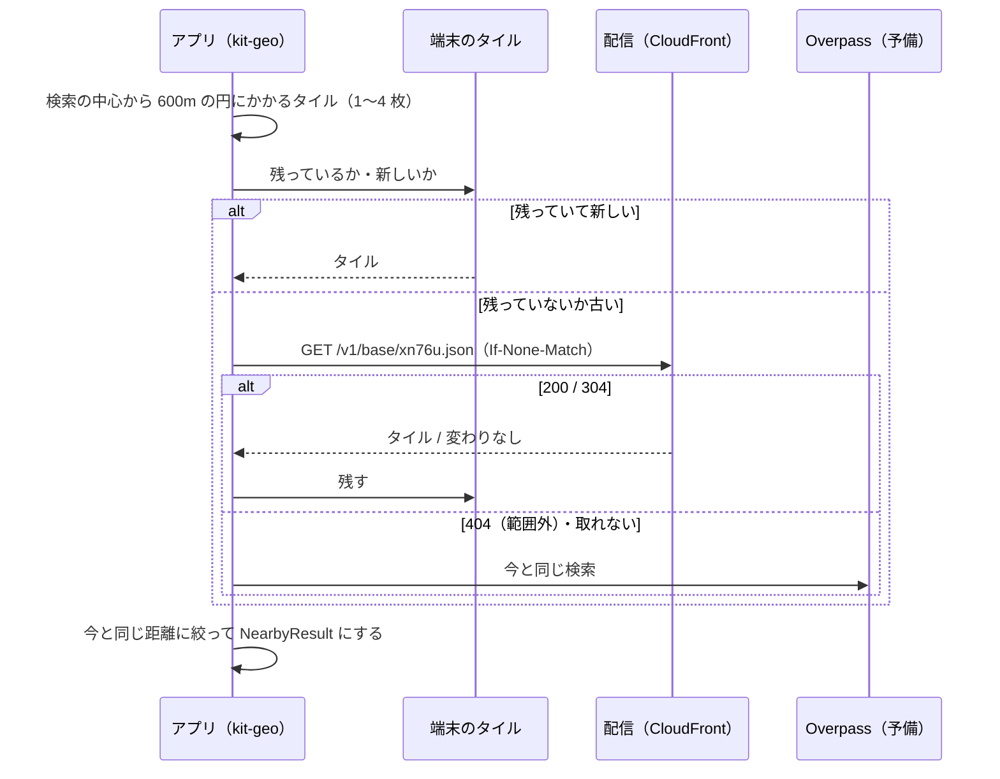

# スポットのタイル 配信契約書

## 文書情報

| 項目 | 内容 |
|---|---|
| 文書ID | API-SPOT-TILES |
| ドキュメント種別 | API契約書 |
| 対象システム/機能 | yorisoi エコシステムのアプリ（`kit-geo`）と、運営のスポットのタイルの配信（[ADR-SPOT-TILES](../decisions/ADR-SPOT-TILES.md)） |
| 関連Skill | 020_api-contract-design |
| 作成日 | 2026-10-29 |
| 作成者 | Claude（開発者との検討） |
| 承認者 | 開発者 |
| ステータス | 承認済 |

本書は、運営が作るスポットのタイルの置き場所・形式・取り方を定めます。タイルを作るバッチと配信の AWS の構成は、yorisoi-console の文書で定めます。

## 目的・背景

ADR-SPOT-TILES で、アプリはスポット・施設・お店・信号を、公開の Overpass に問い合わせる代わりに、運営が週 1 回作る geohash 5 桁のタイルから取ることにした。本書は、作る側（バッチ）と読む側（`kit-geo`）が同じものを前提にできるよう、次のことを定める。

1. タイルの URL と、層ごとの JSON の形
2. どの OSM の要素を、どの形で入れるか（今の `OverpassClient` と同じ答えになるように）
3. 取り直し（ETag）と、取れないときのアプリの動き
4. 互換性とライセンスの表示

## スコープ・非スコープ

スコープ:
- タイルの URL・層・JSON の形・HTTP の応答
- 抜き出しの条件と、位置・輪郭の作り方
- アプリの取り方・残し方・予備の Overpass に戻る条件
- 互換性の方針

非スコープ:
- バッチと配信の AWS の構成・配備・警報（yorisoi-console の文書。ADR-SPOT-TILES T-2）
- スポットの種類の表示名や、話す判断での使い方（今と同じく `kit-geo`・`kit-companion` で決める）
- スポットの写真（`SpotPhotos`）

## 対応元ID（トレーサビリティ）

| 対応元ID | 内容 | 対応状況 |
|---|---|---|
| ADR-SPOT-TILES S-2 | geohash 5 桁、中心があるタイルに丸ごと入れる | [タイルの単位と位置](#タイルの単位と位置) |
| ADR-SPOT-TILES S-3 | 基本とお店の 2 層 | [URL と層](#url-と層) |
| ADR-SPOT-TILES S-4 | 今の Overpass の条件、上限なし、座標 5 桁、輪郭 5m | [抜き出しの条件](#抜き出しの条件)・[JSON の形](#json-の形) |
| ADR-SPOT-TILES S-5 | 日本全体、週 1 回 | ST-3・ST-4 |
| ADR-SPOT-TILES S-8 | 版を含まない URL、ETag で取り直し | ST-5・[HTTP の応答](#http-の応答) |
| ADR-SPOT-TILES S-9 | 円にかかるタイル、端末で今と同じ距離に絞る、取れないときは Overpass | [アプリの取り方](#アプリの取り方) |
| ADR-SPOT-TILES S-10 | 端末に残す期間、先読み | [アプリの取り方](#アプリの取り方) |
| ADR-SPOT-TILES S-12 | 運営に届くのはタイルの番号だけ | ST-7 |
| ADR-SPOT-TILES S-13 | ODbL 1.0 と出典 | ST-8 |
| ADR-SPOT-TILES 未決事項 1 | 形式の置き場所 | ST-9 |

## 方針・決定事項

| No. | 論点 | 決定 |
|---|---|---|
| ST-1 | 接続先 | 配信の基点の URL はアプリに組み込む。デバッグ版は開発用の配信を使う。リリース版は本番用の配信を使い、本番用ができるまでは開発用を使う。アプリ利用者には設定させない |
| ST-2 | 層 | `base`（スポット・施設・信号）と `shops`（お店）。どちらも同じタイルの番号で置く |
| ST-3 | 範囲 | Geofabrik の日本の抽出の範囲（`japan.poly`）に少しでもかかるタイルは、中身が空でもすべて置く。範囲にかからないタイルは置かない（404） |
| ST-4 | 新しさ | 週に 1 回作り直す。作り直したタイルは、遅くとも 1 時間で配信に反映される |
| ST-5 | 取り直し | URL は版を含まない。中身が変わったタイルだけ `ETag` が変わる。アプリは残っているタイルの `ETag` を `If-None-Match` で送り、変わっていなければ 304 を受ける |
| ST-6 | 圧縮 | タイルは gzip で置き、`Content-Encoding: gzip` で返す。アプリの HTTP クライアントが展開する |
| ST-7 | 送るもの | アプリが送るのは、URL（層とタイルの番号）・`If-None-Match`・アプリ名と版の `User-Agent` だけ。クエリ文字列・インストール ID・位置は送らない。配信はアクセスログを残さない |
| ST-8 | ライセンス | 各タイルに `license`（`ODbL-1.0`）と `attribution`（`© OpenStreetMap contributors`）を入れる。基点に `LICENSE.txt`（ODbL 1.0 で配っていること、出典、もとのデータの取得元と日時）を置く |
| ST-9 | 形式の置き場所 | タイルを読むのはアプリだけなので、読み込みは `kit-geo` に置き、core-format には置かない。機械可読な形は JSON Schema [`api/spot-tile.schema.json`](../api/spot-tile.schema.json) とし、バッチは書き出したタイルをこれで確かめる |



## エンドポイント一覧

基点の URL を `{base}` と書く（例: `https://tiles.dev.example/`。実際の値は yorisoi-console の文書）。

| メソッド | パス | 内容 |
|---|---|---|
| GET | `{base}/v1/base/{geohash}.json` | 基本の層 |
| GET | `{base}/v1/shops/{geohash}.json` | お店の層 |
| GET | `{base}/LICENSE.txt` | ライセンスと出典 |

`{geohash}` は geohash の 5 桁（小文字、`0-9b-hjkmnp-z`）。

## リクエスト・レスポンス仕様

### URL と層

アプリは、チャンネルが店の種類を探すとき（`searchedKinds` が空でないとき）だけ `shops` を取る。`base` はいつも取る。

### HTTP の応答

| 状態 | 意味 | アプリの動き |
|---|---|---|
| 200 | タイル。`ETag`・`Content-Encoding: gzip`・`Content-Type: application/json` | 使い、`ETag` と取った時刻と一緒に残す |
| 304 | `If-None-Match` のタイルから変わっていない | 残っているタイルを使い、取った時刻を新しくする |
| 404 | 範囲外のタイル（ST-3） | 残っているそのタイルを消す。その検索は Overpass に問い合わせる |
| その他（5xx・通信の失敗・10 秒の時間切れ） | 取れない | 残っていれば古くても（90 日まで）使う。なければ Overpass に問い合わせる |

配信は、範囲外のタイルに 404 を返す（403 を返さない）。

### JSON の形

1 つのタイルは 1 つの JSON オブジェクト。

共通の項目:

| 項目 | 型 | 内容 |
|---|---|---|
| `format` | 文字列 | `yorisoi-spot-tile` |
| `version` | 整数 | `1`。互換の変更（項目を足す）では上げない |
| `layer` | 文字列 | `base` か `shops` |
| `tile` | 文字列 | geohash の 5 桁 |
| `osmTimestamp` | 文字列 | もとの OSM データの時刻（ISO 8601、UTC） |
| `generatedAt` | 文字列 | タイルを作った時刻（ISO 8601、UTC） |
| `license` | 文字列 | `ODbL-1.0` |
| `attribution` | 文字列 | `© OpenStreetMap contributors` |

`base` の層:

| 項目 | 型 | 内容 |
|---|---|---|
| `spots` | 配列 | スポット（下の「要素」）。輪郭を持てる |
| `facilities` | 配列 | 施設（下の「施設」） |
| `signals` | 数値の配列 | 信号の位置を `[緯度, 経度, 緯度, 経度, …]` と並べたもの |

`shops` の層:

| 項目 | 型 | 内容 |
|---|---|---|
| `shops` | 配列 | お店（下の「要素」）。輪郭は持たない |

要素（スポット・お店）:

| 項目 | 型 | 内容 |
|---|---|---|
| `id` | 文字列 | `node/123`・`way/123`・`relation/123`（今の `Poi.id` と同じ形。話した記録・よく通る道の記録がそのまま使える） |
| `lat`・`lon` | 数値 | 位置（[タイルの単位と位置](#タイルの単位と位置)） |
| `tags` | オブジェクト | OSM のタグをすべて（文字列から文字列） |
| `shape` | オブジェクト | スポットだけ、輪郭があるとき。`area`（真偽。面か線か）と `lines`（線の配列。各線は `[緯度, 経度, …]`、2 点以上） |

施設:

| 項目 | 型 | 内容 |
|---|---|---|
| `id` | 文字列 | 要素と同じ形 |
| `kind` | 文字列 | `FacilityKind` の名前（`TOILETS` など。[抜き出しの条件](#抜き出しの条件)） |
| `lat`・`lon` | 数値 | 位置 |
| `name` | 文字列 | `name:ja`、なければ `name`。どちらもなければ項目を置かない |
| `publicTransport` | 真偽 | `SHELTER` で `shelter_type=public_transport` のとき `true`。それ以外は項目を置かない |

例（`base`、一部）:

```json
{
  "format": "yorisoi-spot-tile",
  "version": 1,
  "layer": "base",
  "tile": "xn70z",
  "osmTimestamp": "2026-10-28T20:21:03Z",
  "generatedAt": "2026-10-29T03:10:44Z",
  "license": "ODbL-1.0",
  "attribution": "© OpenStreetMap contributors",
  "spots": [
    {
      "id": "way/123456",
      "lat": 35.31902,
      "lon": 139.55066,
      "tags": { "name": "鶴岡八幡宮", "amenity": "place_of_worship", "religion": "shinto" },
      "shape": { "area": true, "lines": [[35.3201, 139.5492, 35.3203, 139.5521, 35.3179, 139.5523, 35.3201, 139.5492]] }
    }
  ],
  "facilities": [
    { "id": "node/987", "kind": "TOILETS", "lat": 35.31871, "lon": 139.55102 },
    { "id": "node/988", "kind": "SHELTER", "lat": 35.31702, "lon": 139.55311, "name": "八幡宮前", "publicTransport": true }
  ],
  "signals": [35.31655, 139.55012, 35.31591, 139.54977]
}
```

## タイルの単位と位置

- 位置: ノードはその座標。ウェイとリレーションは、外接する四角形の中心（Overpass の `center` と同じ）。小数 5 桁に丸める
- タイル: 位置が入る geohash 5 桁のタイルに入れる。輪郭がタイルの外に出ていても、中心があるタイルに丸ごと入れ、ほかのタイルには入れない
- 輪郭: ウェイは自分の形。リレーションはメンバーのウェイごとの線（組み立てた輪でもよい。アプリは線の集まりとして扱う）。Douglas-Peucker で 5m に間引き、小数 5 桁に丸める
- 面か線か（`area`）: ウェイは、閉じていて `area` が `no` でなければ面。リレーションは、`type` が `multipolygon` か `boundary` なら面。今の `OverpassClient.shapeOf` と同じ
- 同じ場所がノードと面の両方にあるとき、施設が建物とノードの両方にあるときの重複は、バッチでは除かない。アプリが今と同じ規則で除く

## 抜き出しの条件

今の `OverpassClient.query` と同じ条件で抜き出す。件数の上限はかけない。条件を変えるときは、`OverpassClient` とバッチを同時に変え、本書を改める。

スポット（`base` の `spots`。`name` があるもの）:

| 条件 |
|---|
| `historic` がある |
| `tourism` が `attraction`・`museum`・`viewpoint`・`artwork`・`gallery` |
| `amenity=place_of_worship` |
| `leisure` が `park`・`garden` |
| `natural` が `tree`・`peak`・`spring`・`water`・`beach` |

施設（`base` の `facilities`）。上から順に、最初に合う種類にする:

| `kind` | 条件 |
|---|---|
| `TOILETS` | `amenity=toilets`、`access` が `private`・`no` でない |
| `DRINKING_WATER` | `amenity=drinking_water`、`access` が `private`・`no` でない |
| `VENDING_MACHINE` | `amenity=vending_machine`、`vending` が `ticket`・`parking`・`cigarette`・`excrement`・`condom`・`newspaper`・`fuel`・`photo` を含まない |
| `SHELTER` | `amenity=shelter`、`access` が `private`・`no` でない |
| `BENCH` | `amenity=bench` |
| `BICYCLE_PARKING` | `amenity=bicycle_parking`、`access` が `private`・`no` でない |
| `CONVENIENCE_STORE` | `shop=convenience` |
| `BICYCLE_SHOP` | `shop=bicycle` |
| `BICYCLE_PUMP` | `amenity=bicycle_repair_station` で `service:bicycle:pump=yes`、または `amenity=compressed_air` で `access` が `private`・`no` でない |

施設の条件に合う要素は、スポットやお店に入れない。

信号（`base` の `signals`）: ノードで `highway=traffic_signals`。

お店（`shops` の `shops`。`name` があり、`brand` も `brand:wikidata` もないもの）:

| 店の種類（API-CHANNEL-PACKAGE） | 条件 |
|---|---|
| `restaurant` | `amenity=restaurant` |
| `cafe` | `amenity` が `cafe`・`ice_cream` |
| `market` | `amenity=marketplace` |
| `sweets` | `shop` が `confectionery`・`pastry`・`bakery`・`chocolate` |
| `food_shop` | `shop` が `deli`・`tea`・`coffee`・`alcohol`・`wine`・`seafood`・`butcher`・`greengrocer`・`cheese`・`spices`・`tofu`・`rice` |
| `crafts` | `shop` が `craft`・`gift`・`antiques`・`art` |
| `shop` | `shop` が `books`・`second_hand`・`stationery`・`fabric`・`clothes`・`shoes`・`bag`・`jewelry`・`leather`・`musical_instrument`・`music`・`toys`・`florist`・`kitchen`・`interior_decoration` |

スポットの条件とお店の条件の両方に合う要素は、スポットに入れる。

## アプリの取り方

| No. | 決まり |
|---|---|
| AP-1 | 検索の中心から 600m の円にかかるタイル（1〜4 枚）を取る。同時に取ってよい |
| AP-2 | 取ったタイルを合わせ、今と同じ距離で絞る: スポット 600m、`near` の施設（自販機・ベンチ）250m、そのほかの施設 600m、お店 400m、信号 600m。そのうえで今の `OverpassClient.parse` と同じ規則で重複を除き、種類を決め、`NearbyResult` にする |
| AP-3 | お店はチャンネルの店の種類（`searchedKinds`）に合うものだけ、施設はアプリが探す種類（`facilityKinds`）だけ、信号は `signals` を求めるアプリだけ使う |
| AP-4 | 残っているタイルは、取った時刻から設定の期間（`freshMs`。既定 7 日）までは取り直さずに使う。過ぎたら `If-None-Match` で取り直す。取れなければ 90 日まで使う。90 日を過ぎたタイルは消す |
| AP-5 | 残すかどうか・期間・消すは、今の設定（スポットの答えを残す）に従う。残さない設定では、取ったタイルを端末に保存せず、アプリが動いている間だけメモリに置く |
| AP-6 | よく通る道の先読み（REQ-FREQUENT-WAYS F-6）は、道から 600m 以内にかかるタイルのうち、新しいものが残っていないタイルを取る。間を空けなくてよい |
| AP-7 | 1 つでもタイルが使えないとき（AP-1 の円にかかるタイルのうち、取れず残ってもいないものがあるとき）は、その検索は今と同じく Overpass に問い合わせる |
| AP-8 | 知らない項目・知らない `kind` は無視する。`format` が違う、`version` が 1 でない、JSON として読めないタイルは、取れなかったものとして扱う |

## エラー表

| 場面 | アプリの動き |
|---|---|
| 404 | 範囲外。残っているそのタイルを消し、Overpass に問い合わせる |
| 5xx・通信の失敗・時間切れ | 残っているタイルを使う。なければ Overpass |
| 読めないタイル（AP-8） | 取れなかったものとして扱い、残さない |
| Overpass も失敗 | 今と同じ（待ってから問い合わせ直す、近くの残っている答えを使う） |

## 確認観点

| No. | 観点 |
|---|---|
| CK-1 | 同じ地点で、タイルから作った `NearbyResult` と Overpass の答えが、上限を除いて同じ種類・件数になる（スポット・施設・お店・信号） |
| CK-2 | タイルの境目の近くで、隣のタイルの要素も距離の中に入る |
| CK-3 | 304 で残っているタイルを使い、中身を送られない |
| CK-4 | 404 のタイルでは Overpass に問い合わせ、残っているそのタイルを消す |
| CK-5 | 配信が止まっているとき、残っているタイル、なければ Overpass で今と同じに動く |
| CK-6 | `searchedKinds` が空のチャンネルでは `shops` を取らない |
| CK-7 | バッチの書き出したタイルが `spot-tile.schema.json` に合う |
| CK-8 | アプリの要求にクエリ文字列・インストール ID・位置が入らない |

## 互換性方針・移行メモ

- パスは `/v1`、タイルの `version` は `1`。項目を足すこと、施設の `kind` を足すこと（`FacilityKind` に種類を足すとき）は互換の変更とし、アプリは知らないものを無視する
- 抜き出しの条件を広げること（スポットやお店の種類を足す）は互換の変更とする。アプリは自分が知る条件で分け、合わない要素を使わない
- 項目の削除・意味の変更・タイルの単位の変更は `/v2` で行い、`/v1` は古いアプリが残る間置き続ける（期間は運営が決める）
- 移行: `kit-geo` がタイルを読めるようになるまでは、アプリは今のまま Overpass を使う。タイルを読めるアプリでも、タイルが取れなければ Overpass に戻るので、配信を作る前に出してよい

## 制約

- バッチは公開の Overpass を使わない（ADR-SPOT-TILES）
- 配信はアクセスログを残さない（ST-7）
- 抜き出しの条件は `OverpassClient.query` と同じに保つ

## 未決事項・リスク

未決事項はない。

リスク:
- 端末で 1〜4 枚を合わせて絞るので、都心では 1 回の検索で数 MB の JSON を読むことがある（gzip 前で 1 枚 約 500KB）。読み込みの時間とメモリを T-3 で測る
- 抜き出しの条件が `OverpassClient` とずれると、予備に戻ったときと答えが変わる（CK-1 で確かめる）

## 関連ドキュメント・参照リンク

- [ADR-SPOT-TILES](../decisions/ADR-SPOT-TILES.md)
- [API-CHANNEL-PACKAGE](API-CHANNEL-PACKAGE.md)（店の種類）
- [REQ-FREQUENT-WAYS](../requirements/REQ-FREQUENT-WAYS.md)（F-6）
- [`api/spot-tile.schema.json`](../api/spot-tile.schema.json)
- [geohash](https://en.wikipedia.org/wiki/Geohash)
- [OpenStreetMap の著作権とライセンス](https://www.openstreetmap.org/copyright)
