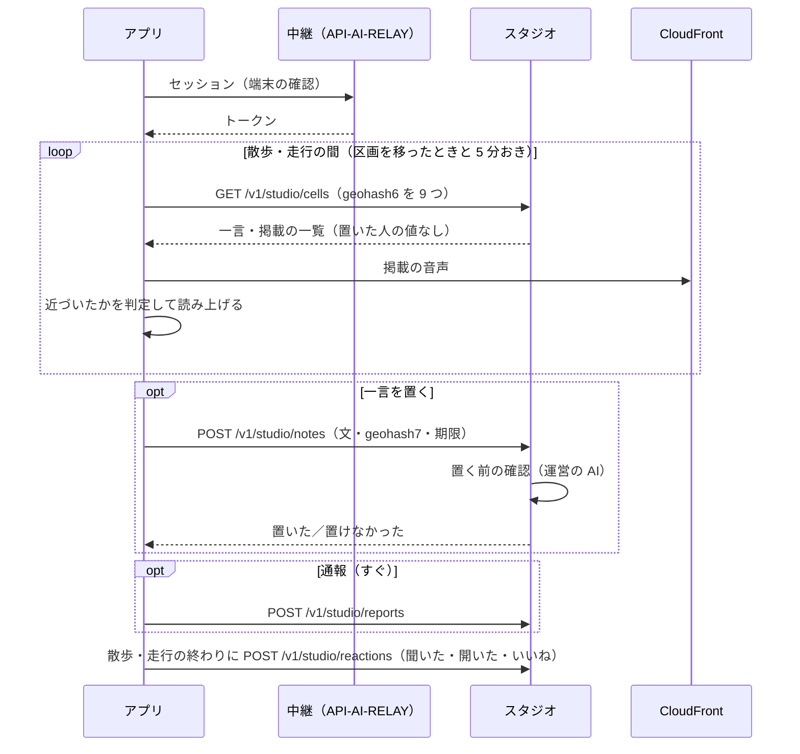

# スタジオ API 契約書

## 文書情報

| 項目 | 内容 |
|---|---|
| 文書ID | API-STUDIO |
| ドキュメント種別 | API契約書 |
| 対象システム/機能 | yorisoi エコシステムのアプリと、スタジオのサーバー（一言と掲載の置き場と配信。[REQ-STUDIO](../requirements/REQ-STUDIO.md)、[ADR-STUDIO](../decisions/ADR-STUDIO.md)） |
| 関連Skill | 020_api-contract-design |
| 作成日 | 2026-10-31 |
| 作成者 | Claude（開発者との検討） |
| 承認者 | 開発者 |
| ステータス | 草案（未承認） |

本書は、アプリがスタジオのサーバーと交わす契約を定めます。掲載者と運営が使う管理システムの画面と API は yorisoi-console の中の境界なので、本書では掲載の状態のうちアプリに見えるものだけを定めます。

## 目的・背景

スタジオでは、アプリ利用者が一言を置き、運営が承認した提供者（チャンネル提供者・素材提供者）が掲載を載せ、近くに来た人のアプリが区画ごとに取って読み上げる（REQ-STUDIO）。本書は、そのための次のことを定める。

1. 運営の AI の中継と同じ端末の確認で、一言を置く・聞く・通報する・ブロックすること（ADR-STUDIO S-4・S-7）
2. 区画の一覧に置いた人を表す値を入れないこと（ADR-STUDIO S-5）
3. サーバーが知る位置を、取るときの区画（geohash6）までにとどめること
4. 置けなかった・使えないときに、アプリが理由に合わせて動けるよう、理由をエラーで返すこと

## スコープ・非スコープ

スコープ:
- 区画の一覧の取得、一言を置く・消す・自分の一言の一覧
- 聞いた・開いた・いいねの送信、通報、ブロック
- 掲載のうちアプリに届く項目と、届く条件
- エラーと、アプリの動き
- サーバーが残すもの・残さないもの

非スコープ:
- 端末の確認とトークンの発行（[API-AI-RELAY](API-AI-RELAY.md) のセッションをそのまま使う）
- 掲載を作る・載せる・止める、運営の担当者の確認、運営の操作の画面と API（yorisoi-console の文書）
- 一言と掲載の確認の中身（REQ-STUDIO D-6・D-18。サーバーの内部）
- アプリの画面、読み上げの順番と上限（REQ-STUDIO D-21・F-9。アプリで行う）
- サーバーの AWS の構成と配備（yorisoi-console の文書）

## 対応元ID（トレーサビリティ）

| 対応元ID | 内容 | 対応状況 |
|---|---|---|
| ADR-STUDIO S-4・S-7 | インストール ID と API-AI-RELAY のセッション | [認証](#認証) |
| ADR-STUDIO S-5 | 一覧に置いた人の値を入れない。ブロックと自分の一言はサーバーで判定 | [GET /v1/studio/cells](#get-v1studiocells)、[ブロック](#post-v1studioblocks) |
| REQ-STUDIO D-3〜D-6、F-1〜F-4 | 一言の長さ・区画・期限・置く前の確認・上限 | [POST /v1/studio/notes](#post-v1studionotes) |
| REQ-STUDIO D-7・D-8・D-22・N-6 | 区画ごとの取得、5 分おき、掲載の音声を一緒に取る | [GET /v1/studio/cells](#get-v1studiocells) |
| REQ-STUDIO D-9・D-15・D-23 | 聞いた数・いいねの概数 | [概数](#概数)、[POST /v1/studio/reactions](#post-v1studioreactions) |
| REQ-STUDIO D-24・F-22・F-23 | 利用規約の同意、ブロック | `termsVersion`、[ブロック](#post-v1studioblocks) |
| REQ-STUDIO F-5 | 自分の一言の一覧と、期限の前に消す | [GET /v1/studio/notes/mine](#get-v1studionotesmine)、[DELETE](#delete-v1studionotesid) |
| REQ-STUDIO F-12・F-13 | 通報、3 台以上で届けない | [POST /v1/studio/reports](#post-v1studioreports) |
| REQ-STUDIO F-14・F-15 | 締め出し、置けない区画 | エラー `author_banned`・`area_closed` |
| REQ-STUDIO N-1・N-2 | 送るもの・残すもの | [サーバーが残すもの](#サーバーが残すもの) |
| REQ-STUDIO N-5 | 中継が予算で止まっている間は一言を置けない | エラー `relay_paused` |

## 方針・決定事項

| No. | 論点 | 決定 |
|---|---|---|
| ST-1 | 接続先 | 接続先の URL はアプリに組み込む（API-AI-RELAY AR-1 と同じ）。デバッグ版は開発用、リリース版は本番用。アプリ利用者には設定させない |
| ST-2 | 認証 | API-AI-RELAY の `POST /v1/session` で受け取ったトークンを、`Authorization: Bearer {token}` で送る。サーバーはトークンのハッシュから中継のセッションを引き、インストール ID の HMAC を得る。セッションの作り方・期限・エラー（`token_invalid`・`integrity_failed`）は API-AI-RELAY に従う |
| ST-3 | 位置 | アプリが送る位置は、取るときの区画（geohash6）と、一言を置くときの区画（geohash7）だけ。緯度・経度は送らない |
| ST-4 | 置いた人の値 | 区画の一覧の一言には、置いた人を表す値を入れない。自分の一言かどうかは `mine` で返す（ADR-STUDIO S-5） |
| ST-5 | 聞いた・開いた・いいねを送る時期 | 散歩・走行を終えたとき（と、終えたときに送れなかった分を次の散歩・走行を始めたとき）にまとめて送る。その場で送ると、送った時刻から約 150 m の区画にいたことが分かるため |
| ST-6 | 通報を送る時期 | すぐに送る。安全のため、届けるのを早く止めることを優先する |
| ST-7 | 一言の確認と AI の回数 | 一言の確認は運営の AI を使うが、API-AI-RELAY の 1 日の回数には数えない。運営の月の予算（ADR-AI-RELAY R-10）には含める |
| ST-8 | 読み上げの判断 | 近づいたか、読み上げの順番と上限、同じものを読み上げないことは、アプリが判定する。サーバーは、届けてよいものを一覧で返すだけ |



### 一言の項目

| 項目 | 型 | 説明 |
|---|---|---|
| `id` | string | 一言の ID（サーバーが作る。ULID） |
| `text` | string | 60 字まで（Unicode のコードポイントで数える）。改行を含まない |
| `cell` | string | 置いた場所の geohash7 |
| `spotName` | string | 近くのスポットの名前（任意。40 字まで） |
| `expiresAt` | string | 期限（RFC 3339、UTC） |
| `mine` | boolean | この端末が置いた一言なら `true` |

### 掲載の項目

| 項目 | 型 | 説明 |
|---|---|---|
| `id` | string | 掲載の ID（ULID） |
| `providerName` | string | 掲載者の名前（40 字まで。個人は屋号・活動名のことがある）。読み上げの「〇〇からのお知らせです。」に使う。契約上の `publisher`（チャンネル提供者）・`producer`（素材提供者）のどちらでも同じ項目に入れる |
| `text` | string | 200 字まで |
| `audio` | object | 任意。`url`（CloudFront の URL）、`durationSec`（30 以下）、`bytes`、`contentType`（`audio/mp4`。AAC）、`sha256` |
| `cells` | string[] | 載せる区画の geohash6（1〜9 個） |
| `startsAt`・`endsAt` | string | 期間（RFC 3339、UTC）。1 日から 30 日 |
| `hours` | object | 任意。読み上げてよい時間帯（日本時間）。`{ "from": "10:00", "to": "18:00" }` |

アプリに届くのは、「載っている」状態で、期間の中にあり、取った区画の一つ以上を `cells` に含む掲載だけ。管理システムの中の状態（自動の確認中・確認に当たって掲載者に返した・掲載者の申し出を運営が確かめている・掲載者が止めた・通報で止めた・運営が消した・掲載者の承認を取り消した）は、アプリには見えない。`hours` の外では、アプリは読み上げない。

### 概数

聞いた数・開いた数・いいねの数は、3 未満のとき `null`、3 以上のとき次の区切りの下限を `atLeast` で返す: 3、10、30、100、300、1,000。たとえば 47 人なら `{ "atLeast": 30 }`。

### サーバーが残すもの

| 残す | 残さない |
|---|---|
| 一言（期限まで）、掲載（期間まで）とその音声、置いた人のインストール ID の HMAC と置いた日時（ブロックのため、一言の期限から 7 日まで） | インストール ID そのもの、トークンそのもの、緯度・経度 |
| 一言・掲載ごと・日ごとの、聞いた数・開いた数の合計。一言ごとのいいねの合計 | だれがどの一言・掲載を聞いた・開いたか |
| いいねと通報の重複を防ぐ組（インストール ID の HMAC と一言・掲載の ID。一言・掲載の期限まで、通報は 30 日） | 取った区画の記録 |
| ブロックの組（ブロックした人とされた人の HMAC。解くまで、最長 1 年） | ログの一言・掲載の本文、区画、ブロックの組 |
| 締め出し（決めた期間） | |

- 期限が来た一言・掲載と音声は、DynamoDB の TTL と S3 のライフサイクルで消す（遅れは最長 2 日）
- アクセスログに送信元の IP アドレスが残るのは、WAF と API Gateway の既定の範囲（30 日で消す）に限る

## エンドポイント一覧

| メソッド | パス | 認証 | 用途 |
|---|---|---|---|
| GET | `/v1/studio/cells` | トークン | 区画の一言と掲載の一覧を取る |
| POST | `/v1/studio/notes` | トークン | 一言を置く |
| GET | `/v1/studio/notes/mine` | トークン | 自分の一言の一覧を見る |
| DELETE | `/v1/studio/notes/{id}` | トークン | 自分の一言を消す |
| POST | `/v1/studio/reactions` | トークン | 聞いた・開いた・いいねをまとめて送る |
| POST | `/v1/studio/reports` | トークン | 通報する |
| POST | `/v1/studio/blocks` | トークン | 一言の置いた人をブロックする |
| GET | `/v1/studio/blocks` | トークン | ブロックの一覧を見る |
| DELETE | `/v1/studio/blocks/{id}` | トークン | ブロックを解く |
| GET | `/v1/studio/terms` | なし | 一言の利用規約の版と URL を知る |

本文はすべて `application/json`（UTF-8）。掲載の音声は、一覧の `audio.url` から認証なしで取る。

## リクエスト・レスポンス仕様

### GET /v1/studio/cells

```
GET /v1/studio/cells?cells=xn76ur,xn76us,…（geohash6 を 1〜9 個、カンマ区切り）&kinds=note,placement
```

- `kinds` は、聞く設定（REQ-STUDIO D-12）で選んだものだけを指定する。`note`・`placement` のどちらか、または両方
- 区画を移ったとき以外は、5 分に 1 回まで（N-6）

```json
{
  "notes": [
    { "id": "01JBX…", "text": "この坂の上から富士山が見えた", "cell": "xn76ury",
      "spotName": "富士見坂", "expiresAt": "2026-11-01T03:00:00Z", "mine": false }
  ],
  "placements": [
    { "id": "01JBY…", "providerName": "谷中銀座商店会", "text": "今日 15 時から、夕やけだんだんで豆まきをします。",
      "audio": { "url": "https://…/placements/01JBY…/audio.m4a", "durationSec": 24, "bytes": 196000,
                 "contentType": "audio/mp4", "sha256": "…" },
      "cells": ["xn77h2"], "startsAt": "2026-10-31T00:00:00Z", "endsAt": "2026-11-02T15:00:00Z",
      "hours": { "from": "10:00", "to": "18:00" } }
  ],
  "fetchedAt": "2026-10-31T05:00:00Z",
  "refetchAfterSec": 300
}
```

- 一言と掲載を合わせて 50 件まで。超えるときは、掲載は区画の数の少ない順（狭く載せたもの）と期限の近い順、一言はいいねの多い順と新しい順に選ぶ
- 一言は、運営が確かめるまで届けないもの（3 台以上の通報。F-13）と、この端末がブロックした人のものを除く。1 つの geohash7 に 20 件を超えるときは、期限の近いものから除く（F-4）
- 一覧の順番は、上の選び方の順。アプリはこれを読み上げの優先の参考にしてよい
- 音声を合わせて 3 MB を超えないよう、サーバーは掲載の件数を絞る

### POST /v1/studio/notes

```json
{ "text": "この坂の上から富士山が見えた", "cell": "xn76ury", "spotName": "富士見坂",
  "ttl": "24h", "termsVersion": 1 }
```

- `ttl` は `1h`・`24h`・`7d`
- `termsVersion` は、アプリ利用者が同意した一言の利用規約の版。今の版（`GET /v1/studio/terms`）より古いと `terms_not_accepted`
- サーバーは、長さ・形式を確かめたあと、運営の AI で置く前の確認（REQ-STUDIO D-6）をして、結果を返す。確認は 5 秒以内（N-4）

```json
{ "id": "01JBX…", "expiresAt": "2026-11-01T05:00:00Z", "remainingToday": 9 }
```

確認に当たったときは `422 note_rejected`。理由の種類は返さない（どこを直せば通るかを探れないようにする）。

### GET /v1/studio/notes/mine

```json
{
  "notes": [
    { "id": "01JBX…", "text": "この坂の上から富士山が見えた", "cell": "xn76ury", "spotName": "富士見坂",
      "expiresAt": "2026-11-01T05:00:00Z", "state": "active",
      "heard": { "atLeast": 3 }, "likes": null }
  ],
  "remainingToday": 9
}
```

- `state` は `active`（届いている）、`hidden`（通報で、運営が確かめるまで届けていない）、`removed`（運営が消した）。期限が来た一言は返さない
- `heard`・`likes` は [概数](#概数)

### DELETE /v1/studio/notes/{id}

自分の一言を消す。`204`。自分のものでない・期限が来た・ない一言は `404 not_found`。消した一言は、すぐに一覧から外れる。音声はないので、ほかに消すものはない。

### POST /v1/studio/reactions

```json
{
  "heard":  [ { "type": "note", "id": "01JBX…" }, { "type": "placement", "id": "01JBY…" } ],
  "opened": [ { "type": "placement", "id": "01JBY…" } ],
  "liked":  [ "01JBX…" ]
}
```

- 散歩・走行を終えたときにまとめて送る（ST-5）。1 回に合わせて 200 件まで
- `heard` は読み上げた、`opened` は画面で開いた一言・掲載。同じものは 1 回の送信に 1 回だけ入れる。アプリは送ったものを覚えておき、同じ一言は二度と、同じ掲載は同じ日に二度と送らない
- `liked` は一言だけ。サーバーは同じ端末からの同じ一言へのいいねを 1 回だけ数える
- 期限が来た・ない ID は、エラーにせず無視する
- 応答は `202`（本文なし）。数は日ごとの合計にだけ足し、だれが送ったかは残さない

### POST /v1/studio/reports

```json
{ "type": "note", "id": "01JBX…", "reason": "danger" }
```

| `reason` | 意味 |
|---|---|
| `danger` | 安全を損なう誘い（私有地・線路・立入禁止の場所に入らせるなど） |
| `harassment` | 人や店を攻撃する言葉、個人を特定する情報、つきまとい |
| `ad` | 宣伝・勧誘（一言） |
| `rights` | 権利の侵害（著作権・肖像など） |
| `inappropriate` | 性的・暴力的など、聞かせるのに合わない |
| `other` | そのほか |

- 応答は `202`。同じ端末から同じ一言・掲載への通報は 1 回だけ数える
- 一言は、3 台以上から通報されると、運営が確かめるまで届けない（F-13）。掲載は、3 台以上から、または `danger`・`rights` で通報されると、運営が確かめるまで届けない
- 通報は位置を持たない。本文には、一言・掲載の ID と `reason` しか入れない

### POST /v1/studio/blocks

```json
{ "noteId": "01JBX…" }
```

```json
{ "id": "blk_01JBZ…", "createdAt": "2026-10-31T05:10:00Z" }
```

- サーバーは、その一言の置いた人を、この端末のブロックに足す。以後、その人の一言を一覧から除く。置いた人には知らせない
- 一言の期限が来たあとでもブロックできるよう、アプリが聞いた一言の ID は、その散歩・走行の画面に出ている間、使える（サーバーは、期限が来てから 7 日まで置いた人の HMAC を引ける）
- 自分の一言はブロックできない（`400 invalid_request`）

### GET /v1/studio/blocks

```json
{ "blocks": [ { "id": "blk_01JBZ…", "createdAt": "2026-10-31T05:10:00Z", "expiresAt": "2027-10-31T05:10:00Z" } ] }
```

ブロックした人がだれかは返さない。アプリは、ブロックしたときの一言の文を端末に覚えておき、設定の一覧で見せてよい。

### DELETE /v1/studio/blocks/{id}

ブロックを解く。`204`。ないものは `404 not_found`。

### GET /v1/studio/terms

```json
{ "version": 1, "url": "https://…/studio-terms/1.html", "updatedAt": "2026-11-15T00:00:00Z" }
```

アプリは、初めて一言を置く前と、版が上がったときに利用規約を見せ、同意を得てから `termsVersion` に入れる。

## エラー表

エラーは RFC 9457（`application/problem+json`）で返し、`code` で種類を区別する（API-AI-RELAY と同じ）。

| HTTP | code | 発生条件 | アプリの動き |
|---|---|---|---|
| 400 | `invalid_request` | JSON の形式・必須項目・geohash の桁・`ttl`・`reason` の誤り、`cells` が 10 個以上 | 不具合として記録する |
| 401 | `token_invalid` | トークンの期限切れ・不明 | 中継のセッションを作り直して 1 回だけ再送 |
| 403 | `terms_not_accepted` | `termsVersion` がない、または今の版より古い | 利用規約を見せ、同意を得てから置き直す |
| 403 | `author_banned` | この端末は締め出されている（応答に `until` を付ける） | 一言を置けないことと、その期限を出す。聞くことは続ける |
| 403 | `area_closed` | 運営が置けないようにした区画（F-15） | 「この辺りには置けません」と出す |
| 404 | `not_found` | 消す・解く対象がない、自分のものでない | 一覧を取り直す |
| 413 | `text_too_long` | 一言が 60 字を超えた | 送る前に止めているはずなので、不具合として記録する |
| 422 | `note_rejected` | 置く前の確認に当たった | 「置けませんでした」と出す。理由は出さない |
| 429 | `daily_note_limit` | 今日の一言（10 件）を使い切った（応答に `resetsAt`） | 一言を置くボタンを `resetsAt` まで止める |
| 429 | `too_many_requests` | 取得が 5 分に 1 回を超えた、送信元ごとの回数の制限 | `Retry-After` まで待つ |
| 503 | `relay_paused` | 運営の AI が予算で止まっていて、一言の確認ができない | 一言を置けないことを出す。取得と読み上げは続ける |
| 503 | `studio_paused` | 運営がスタジオを止めている | 取得をやめ、一言・掲載なしで散歩・走行を続ける |

- WAF が返す 429 は `application/problem+json` でないことがある。アプリは `code` のない 429 を `too_many_requests` として扱う
- どのエラーでも、散歩・走行と語りは続ける。スタジオはなくても困らない機能として扱う

## 確認観点

| No. | 観点 |
|---|---|
| V-01 | 一覧の一言に、置いた人を表す値（HMAC・端末・時刻の細かい値）が入っていない。自分の一言だけ `mine: true` |
| V-02 | 端末 B がブロックすると、端末 A の別の一言が端末 B の一覧から消え、端末 C の一覧には残る。解くと戻る |
| V-03 | 3 台から通報された一言は、ほかの端末の一覧から消え、置いた端末の `mine` の一覧では `hidden` になる |
| V-04 | 11 件目の一言は `daily_note_limit` になり、`resetsAt` は次の日本時間 0 時 |
| V-05 | 古い `termsVersion` では `terms_not_accepted` になる |
| V-06 | 期間の外・`hours` の外・管理システムで止めた掲載は、一覧に入らない（`hours` の外はアプリが読み上げない） |
| V-07 | `reactions` を送っても、サーバーの記録とログに送った端末と ID の組が残らない。聞いた数は日ごとの合計にだけ足される |
| V-08 | 聞いた数が 2 のとき `heard` は `null`、3 のとき `{ "atLeast": 3 }`、47 のとき `{ "atLeast": 30 }` |
| V-09 | 一覧が 50 件・3 MB を超えない |
| V-10 | ログに一言・掲載の本文、区画、ブロックの組が残らない。期限が来た一言・掲載と音声が 2 日以内に消える |
| V-11 | `relay_paused`・`studio_paused`・通信の失敗のとき、アプリが散歩・走行と語りを続ける |
| V-12 | アプリが `reactions` を散歩・走行の終わりにだけ送っている（通信の記録で確かめる） |

## 互換性方針・移行メモ

- パスは `/v1`。応答に項目を足すことは互換の変更とし、アプリは知らない項目を無視する
- エラーの `code`、通報の `reason`、一覧の種類（`kinds`）を足すことは互換の変更とする。アプリは知らない `code` を HTTP の状態で扱い、知らない種類を無視する
- 画像・映像・即時の配信（REQ-STUDIO U-10）は、項目とエンドポイントを足す形で `/v1` に入れる
- 項目の削除・意味の変更は `/v2` で行う

## 制約

- 認証は API-AI-RELAY のセッションに頼る。中継のセッションの決まり（1 日 5 つまで、24 時間）がそのまま及ぶ
- サーバーは yorisoi-console の新しいスタックに置く（ADR-STUDIO S-7）
- 運営の AI は Bedrock を東京で使う（ADR-AI-RELAY R-5）

## 未決事項・リスク

| No. | 内容 | 決める時期 |
|---|---|---|
| 1 | 機械可読な定義（OpenAPI）を作るか | 実装のとき |
| 2 | 掲載を有料にするとき、聞いた数をごまかされない仕組み（同じ端末からの送りすぎ、作り物の端末）が要るか（REQ-STUDIO U-9） | 有料にする前 |
| 3 | 散歩・走行の終わりにまとめて送ると、アプリを強制終了したときの分が次の散歩・走行まで遅れる。数の遅れが掲載者に問題になるか | 検証のとき |

リスク:
- インストールし直すと、締め出し・1 日の上限・ブロックが効かなくなる（ADR-STUDIO の注意点）
- 一覧から一言の場所（geohash7）と期限が分かるので、多くの区画を取って集めれば、一言の置かれた場所の地図は作れる。置いた人はつながらないが、一言の中身に個人の情報があると問題になる（置く前の確認 D-6 ③と通報で防ぐ）

## 関連ドキュメント・参照リンク

- [REQ-STUDIO](../requirements/REQ-STUDIO.md)
- [ADR-STUDIO](../decisions/ADR-STUDIO.md)
- [API-AI-RELAY](API-AI-RELAY.md)（セッション、トークン、エラーの形）
- [ADR-AI-RELAY](../decisions/ADR-AI-RELAY.md)（予算 R-10、Bedrock R-5）
- [RFC 9457](https://www.rfc-editor.org/rfc/rfc9457)
