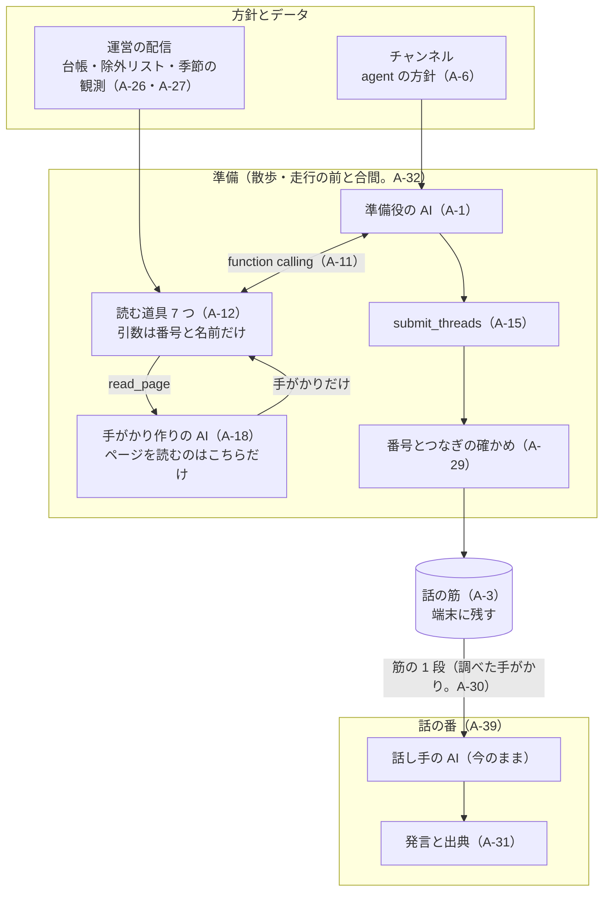
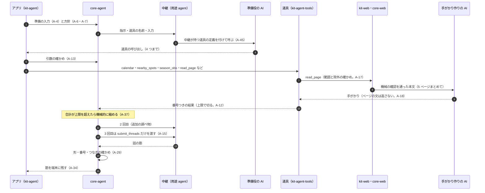
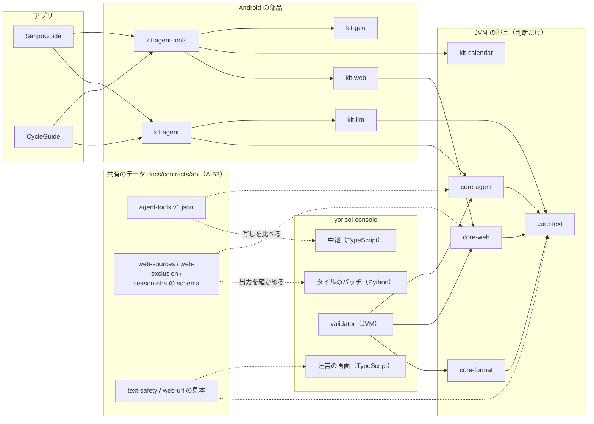

# ADR-AGENT 準備役の AI が、チャンネルの方針に従って道具で調べ、その日・その地域の「話の筋」を作る

## 文書情報

| 項目              | 内容                                                                                                                                                                                                                                     |
| ----------------- | ---------------------------------------------------------------------------------------------------------------------------------------------------------------------------------------------------------------------------------------- |
| 文書ID            | ADR-AGENT                                                                                                                                                                                                                                |
| ドキュメント種別  | ADR                                                                                                                                                                                                                                      |
| 対象システム/機能 | 準備役の AI が道具で調べて話の筋を前もって作り、話す AI がそれを話す仕組み。platform（新しい部品・共有のデータ・関連文書の改訂）、yorisoi-console（中継・タイルのバッチ・運営の画面・validator）、yorisoi-sanpoguide、yorisoi-cycleguide |
| 関連Skill         | architecture-decision-record                                                                                                                                                                                                             |
| 作成日            | 2026-11-22                                                                                                                                                                                                                               |
| 作成者            | Claude（開発者との検討）                                                                                                                                                                                                                 |
| 承認者            | 開発者                                                                                                                                                                                                                                   |
| ステータス        | 検討中                                                                                                                                                                                                                                   |

## 目的・背景

開発者の要望（2026-11-22）:

- 小雪の日に、暦の仕組み・地域の暮らしやなりわいのこれから・地域の催しと、話をつなげたい
- アプリに AI エージェントを持たせたい。チャンネルの方針に従い、道具を使ってウェブサイトなどから情報を取りながら、アプリ利用者に寄り添う話を作る

今、AI に渡す事実は、アプリが計算したもの（暦・日の入り・天気）と、運営がバッチで配るもの（スポットのタイル・Wikidata・Wikipedia の要約・地域の催し）だけです。どちらも「その日・その地域ならでは」の様子（初雪、紅葉の見ごろ、収穫の時期、自治体のお知らせ）を持ちません。話し手は 1 回の呼び出しで 1 つの発言を作るので、いくつかの事実を調べてつなぐこともできません。AI が自分の知識で補うと、地域や日付を取り違えます（AI-ROLES H-6 ①）。

### 課題と主な対策

| 課題                              | 中身                                                                                                                       | 主な対策                                                                                                             |
| --------------------------------- | -------------------------------------------------------------------------------------------------------------------------- | -------------------------------------------------------------------------------------------------------------------- |
| K-1 正しさ                        | ページに古い記事・誤りが混ざる。AI が事実を言い換えて誤る・結果にない事実を足す                                            | 公の出どころに限る（A-21）、準備役に事実の文を書かせず元の結果を番号で引く（A-29）、出どころで話し方を変える（A-30） |
| K-2 プライバシー                  | 歩いている場所がサイトと中継に届く。AI が引数に位置を入れる                                                                | 座標を渡さず、引数は番号だけ（A-14・A-17）、共有の範囲（A-47）                                                       |
| K-3 注入                          | ページの文やリンクの題名に、指示のような文が混ざる                                                                         | 道具を持つ AI にページの文を見せない（A-18）、機械の確認（A-52 の core-text）                                        |
| K-4 権利                          | ページごとにライセンスが違う                                                                                               | 文を写さず手がかりにする（A-18）、出典（A-31）、`robots.txt`（A-19）                                               |
| K-5 待ち時間                      | 道具の往復に 10〜30 秒かかる。圏外では使えない                                                                             | 前もって準備する（A-1・A-32）、筋がなければ今のまま（A-5）                                                           |
| K-6 費用と負荷                    | AI の呼び出しと読み取りが増える。多くの端末が同じサイトを読む                                                              | 回数の上限（A-33）、キャッシュ（A-34）、同時の数（A-20）                                                             |
| K-7 説明                          | 何を調べたかを前もって決められない                                                                                         | 記録（A-49）                                                                                                         |
| K-8 不向きな話                    | 宣伝、口コミ、事件・事故が混ざる                                                                                           | 手がかり作りで除く（A-18）、除外リスト（A-24）                                                                       |
| K-9 チャンネルとの食い違い        | チャンネルが今の項目で止めたことを、道具を通して話に入れる                                                                 | 今の項目で道具を絞る（A-7）                                                                                          |
| K-10 出どころの中の不向きなページ | 信用できるサイトにも口コミの欄・広告・入札などのページがある。サイトが後で変わる。共用のサービスの別の人のページへたどれる | 除外リスト（A-24・A-25）、同じサイトの決め方（A-17）                                                                 |
| K-11 見つからない                 | 検索をしないので、台帳にない町ではページから分かることがない                                                               | 今ある事実で筋を組む、台帳を広げる（R-5）                                                                            |

## スコープ・非スコープ

スコープ: 準備役と話し手の分け方、チャンネルの方針 `agent`、道具、ページの読み方、出どころの台帳と除外リスト、気象庁の季節の観測、事実の扱いと話し方、準備の実行（いつ・上限・キャッシュ）、コンテキスト、話し手での使い方、プロンプト、中継、共有と保存、部品の分け方、審査。市区町村の決め方（REQ-KOYOMI D-6 の見直し）を含む。

非スコープ:

- 検索サービス（ウェブ検索の API）を使うこと（開発者の決定）
- 台帳とチャンネルの出どころの外のサイトを読むこと
- 利用者の問いかけに、その場で道具を使って答えること（U-3）
- 書き込み・送信をする道具、画像・PDF を読む道具
- 運営がページを読み、結果を利用者をまたいで配ること（R-4 で決め直す。審査の見本 A-54 は除く）

## 対応元ID（トレーサビリティ）

| 対応元                                             | 内容                                                                 | 本書                         |
| -------------------------------------------------- | -------------------------------------------------------------------- | ---------------------------- |
| 開発者の要望（2026-11-22）                         | 暦・暮らし・催しとつなげて話したい                                   | A-3・A-39                    |
| 開発者の要望（2026-11-22）                         | チャンネルの方針に従い、道具で調べて寄り添う話を作る AI エージェント | A-1・A-4・A-6・A-11          |
| 開発者の決定（2026-11-22）                         | 道具の呼び出しは function calling で行う                             | A-11・A-15                   |
| 開発者の決定（2026-11-22）                         | 検索サービスは使わない。ウェブのページは活かす                       | A-17・A-21〜A-23             |
| 開発者の決定（2026-11-22）                         | 除外リストとその運用を持つ。最初の版は空にし、運用で足す             | A-24・A-25                   |
| 開発者の指示（2026-11-22）                         | 市区町村の公式サイトの一覧を生成 AI で取れるかを検討する             | A-22                         |
| 開発者の決定（2026-11-22）                         | 気象庁の季節の観測は公開のデータから読む                             | A-27・A-28                   |
| 開発者の決定（2026-11-22）                         | 自分のキーでは準備役のモデルを別に選べる                             | A-46                         |
| 開発者の指示（2026-11-22）                         | コンテキストの制御と共有のポリシー、共有すべき部分の部品化           | A-36〜A-38・A-47・A-51〜A-53 |
| AI-ROLES H-1・H-5・H-6                             | 役割の分け方・根拠の安全・実演の枠                                   | A-2・A-18・A-29・A-30        |
| API-CHANNEL-PACKAGE F-1・G-3・スロットの組み立て方 | 固定部分・知らない値・プロンプトの組み立て                           | A-7・A-8・A-42・A-43         |
| REQ-SPOT-REFERENCES D-4・D-6・D-7                  | 参考の文章の区分・出典・使わない選択                                 | A-7・A-30・A-31              |
| REQ-KOYOMI D-6・D-9・F-17                          | 地域を調べない・チャンネルの制御・確かさの種類                       | A-7・A-14・A-30              |
| REQ-LOCAL-EVENTS D-1・D-9                          | 自治体の公開データ・位置参照情報                                     | A-14・A-22                   |
| REQ-NEARBY-TALK F-15・D-22・F-37・F-38             | 雑談の話題・取り置き・捨てる決まり・解説の続き                       | A-39〜A-41                   |
| REQ-NARRATOR-STYLE F-2・F-14                       | 型のプロンプトの置き場所・validator の見本                           | A-42・A-54                   |

## 全体の形

### 流れ

### 1 回の準備

### 部品のつながり

## 決定

### 1. 役割と流れ

| ID  | 決定                                                                                                                                                                                                                                                                                                                                                                                                                                                                                              | 理由                                                                                                                     |
| --- | ------------------------------------------------------------------------------------------------------------------------------------------------------------------------------------------------------------------------------------------------------------------------------------------------------------------------------------------------------------------------------------------------------------------------------------------------------------------------------------------------- | ------------------------------------------------------------------------------------------------------------------------ |
| A-1 | AI の仕事を 2 つに分ける。**準備役**: 散歩・走行の前と合間に、道具で調べて話の筋を作る。**話し手**: 今の AI のまま。話の番に、筋の 1 段を受け取って話す                                                                                                                                                                                                                                                                                                                               | 道具の往復を話の番に待たない（K-5）。話し手の作りは今のまま使える                                                        |
| A-2 | 準備役は「実演」の層に入れる。何を調べてよいか・どこを読んでよいか・どんな筋を目指すかはチャンネルの方針（A-6）が決め、準備役はその中で調べ物と順番だけを選ぶ。AI-ROLES H-1 にこの役を足す                                                                                                                                                                                                                                                                                                        | 演出はチャンネル、実演は AI という分け方（AI-ROLES H-1）を保つ                                                           |
| A-3 | 成果は**話の筋**。散歩・走行の始まりと市区町村が変わったときの準備では、筋を 3 本まで作る。1 本は 2〜4 段で、段は話題（20 字以内）・使う道具の結果の番号（R1 など。3 つまで）・前の段とのつなぎ（30 字以内）を持つ。事実の文は持たない（A-29）。筋は使える範囲（その日・その市区町村）と目指した型を持つ。スポットの準備では、段 1 つ（そのスポットの結果の番号の束）だけを作る                                                                                                             | 「暦 → 暮らし → 催し」のように事実をつなぎ、話の番ごとに 1 段ずつ話せる。事実を番号で持てば、言い換えの誤りが入らない  |
| A-4 | 準備役に渡すもの。**場所と時**: 日付・時間帯・市区町村の名前。**状況**: 散歩か走行か、経った時間、距離（100 m 単位）、天気の要約、とどまっているか。**話したこと**: その日の筋の話題、直近 10 回の発言の話題、同じ市区町村で 7 日以内に話した筋の話題（話題だけ。本文は渡さない）。**チャンネルの性格**: `name`・`summary`・`genres`・審査済みの `companion/topics`（データの区切りで囲む）・`agent` の `scenes`・`paths`・`topics`。**読める出どころ**: 場面に合う台帳とチャンネルの出どころ（A-21〜A-23）の番号（P1 など）・名前・種類（20 件まで）。語り手の型は渡さない | 寄り添う話には、その日の状況と話したことが要る。チャンネルに合う調べ物を選べる。出どころを初めから渡せば、1 回目の呼び出しからページを読める（X-1 の試しで、一覧を道具で取る形ではページを読んだ場面が 8 つのうち 1〜2 つだったのが、7〜8 つになった）。型は話しぶりなので話し手だけに効けばよい |
| A-5 | 筋がまだない・使える範囲を外れた・準備に失敗したときは、今の話し方のまま話す                                                                                                                                                                                                                                                                                                                                                                                                                      | 準備役がなくても今と同じに動く（K-5）                                                                                    |

### 2. チャンネルの方針（`agent`）

| ID   | 決定                                                                                                                                                                                                                                                                                                                                                                                                                                                                                                                                                                                                                                                                                                                                                                                                                                                                                                                          | 理由                                                                                                                       |
| ---- | ----------------------------------------------------------------------------------------------------------------------------------------------------------------------------------------------------------------------------------------------------------------------------------------------------------------------------------------------------------------------------------------------------------------------------------------------------------------------------------------------------------------------------------------------------------------------------------------------------------------------------------------------------------------------------------------------------------------------------------------------------------------------------------------------------------------------------------------------------------------------------------------------------------------------------- | -------------------------------------------------------------------------------------------------------------------------- |
| A-6  | チャンネルの最上位に任意の `agent` を足す。**`mode`**: `off`（使わない）／`plan`（使う）。書かなければ `off`。組み込みのチャンネルには `plan` を書く。**`web`**: `off`（ページを読まない）／`on`（台帳とチャンネルの出どころを読む）。書かなければ `on`。**`scenes`**: 調べてよい場面。`calendar`（暦）・`season`（季節の様子）・`livelihood`（暮らし・なりわい）・`events`（催し）・`spot`（スポット）。書かなければ全部。**`paths`**: 目指す筋の型。場面を `>` でつなぐ（例: `"calendar>livelihood>events"`）。0〜5 個、`spot` は入れない。書かなければ準備役が選ぶ。**`sources`**: チャンネルの出どころ（A-23）。**`skip`**: 使わない台帳の出どころの種類か、読まないドメイン・URL の前方一致。0〜20 個。**`topics`**: 調べ物に足す言葉。0〜10 個、1 つ 20 字まで。自由な文の指示は足さない。語彙は core-format の共通の一覧に置く | 今のチャンネルを変えずに、演出（何を・どの順で・どこから）をチャンネルが選べる。決まった語彙なら審査と機械の確認がしやすい |
| A-7  | 今の項目が `agent` より先に効く。**場面**: `calendar` は `talk.events.calendar`、`events` は `talk.events.localEvent`、`spot` は `talk.events.spot` が真のときだけ使い、偽の場面を含む `paths` は使わない。**道具の結果**: `calendar.prefer`・`calendar.skip`、`spots.prefer`・`spots.skip`、参考の文章の可否（REQ-SPOT-REFERENCES D-7）、`agent.skip` で、道具が先に絞る。**準備しないとき**: `talk.level` が `quiet`、または `talk.events.chat` が偽で `spot` も使えないとき。`chat` が偽で `spot` を使えるときは、スポットの準備だけをする                                                                                                                                                                                                                                                                                                                         | チャンネルが止めたことを道具を通して入れない（K-9）。話す番が来ない準備に費用を使わない                                    |
| A-8  | 知らない値（API-CHANNEL-PACKAGE G-3）。`mode`・`web` の知らない値は `off`。知らない場面と、それを含む `paths` は使わない。`skip` に知らない出どころの種類があれば、台帳の出どころを使わない。古いアプリは `agent` を無視して準備役を使わない。どれも制限が緩まないので、必要な版（API-CHANNEL-LIST P-20）は上げない                                                                                                                                                                                                                                                                                                                                                                                                                                                                                                                                                                                               | 知らない値で、チャンネル提供者の意図より広く調べない（ECOSYSTEM E-12）                                                     |
| A-9  | 確かめる仕組み（core-format の `StationValidator`、yorisoi-console）は、知らない値、`scenes` にない場面か `spot` を含む `paths`、形の誤った `sources`・除外リストに当たる `sources`、形の誤った `skip`、数・長さを超える値を拒む。A-7 で外れる場面を書いたもの、準備しないチャンネルの `plan` は警告にする                                                                                                                                                                                                                                                                                                                                                                                                                                                                                                                                                                                                    | 誤りを公開の前に止め、今の項目との食い違いに気づけるようにする                                                             |
| A-10 | `plan` のチャンネルは、アプリのチャンネルの説明に「その場で調べて話します」と、`web` が `on` なら「自治体などのウェブのページも読みます」と出す                                                                                                                                                                                                                                                                                                                                                                                                                                                                                                                                                                                                                                                                                                                                                                         | 利用者が選ぶ前に分かる                                                                                                     |

### 3. 道具

| ID   | 決定                                                                                                                                                                                                                                                                                                                                                                                                                        | 理由                                                                                                                                                                                                                                                                                                                                                                                                                                                                                        |
| ---- | --------------------------------------------------------------------------------------------------------------------------------------------------------------------------------------------------------------------------------------------------------------------------------------------------------------------------------------------------------------------------------------------------------------------------- | ------------------------------------------------------------------------------------------------------------------------------------------------------------------------------------------------------------------------------------------------------------------------------------------------------------------------------------------------------------------------------------------------------------------------------------------------------------------------------------------- |
| A-11 | 道具は自前で作り、アプリの中で実行する（AI サービスの検索・取得の道具は使わない）。呼び出しは function calling で行い、道具の定義（JSON Schema）は共有のデータ（A-52）に 1 つ置く。kit-llm が経路ごとの形に直す（中継: Bedrock Converse の `toolConfig`、Claude: `tools`、DeepSeek・OpenAI・Gemini: OpenAI 互換の `tools`）。往復の会話は端末が持って呼ぶたびに全部送り、中継は残さない                               | 方針・除外・確かめ・上限を道具の中で必ずかけられる。道具の呼び出しのために学習した形なので崩れにくい。中継は状態を持たないまま                                                                                                                                                                                                                                                                                                                                                              |
| A-12 | 道具は下の「道具の一覧」の 8 つ（読む道具 7 つと提出 1 つ）。すべて読むだけで、引数は場面・番号・名前だけ。返す量に上限を持ち、超えた分は切って、切ったことと残りの数を書く。結果には準備の中で通しの番号（R1、R2…）を付ける。結果の 1 つは、話し手にそのまま渡せる 1 つの事実（1 文、60 字以内）にする                                                                                                                    | 外に文を送る道具がないので、注入の文に動かされても出せるものがない（K-2・K-3）。結果を 1 つの事実に切っておけば、筋は番号だけで事実を指せる（A-29）                                                                                                                                                                                                                                                                                                                                         |
| A-13 | 頼まれた道具は、引数を JSON Schema で確かめてから実行する。形の合わない引数・知らない道具・知らない番号は実行せず、理由を返す。1 回の返答で実行するのは 4 つまで。読める出どころは準備の入力で渡し（A-4）、一覧を取る道具は持たない | 誤った引数で動かさず、理由を返して頼み直させる。一覧を取る道具があると、準備役が場面ごとに何度も頼み、読む前に提出してしまう（X-1 の試し） |
| A-14 | 準備役に座標・住所・経路を渡さない。場所は市区町村の名前とスポットの名前・番号、距離（100 m 単位）と向き（8 方位）だけ。市区町村は端末の中で、運営が配る代表点の表（位置参照情報。REQ-LOCAL-EVENTS D-9 と同じデータ）から決める。REQ-KOYOMI D-6 を「市区町村まで、端末の中で決める」に改める                                                                                                                                | 位置を外に出さずに市区町村を使える（K-2）                                                                                                                                                                                                                                                                                                                                                                                                                                                   |
| A-15 | 筋は提出の道具 `submit_threads` で出させ、形を JSON Schema で確かめてから受け取る。型（`path`）は場面を `>` でつないだ形だけを pattern で受ける。最後の呼び出しには提出の道具だけを渡し、道具を使うよう指定する（Converse の `toolChoice`。DeepSeek は `any`、Claude は道具の名前）。準備役の返事の文は、筋にも記録にも使わず捨てる                                                                               | 文から読み取らずに形を確かめられ、上限に達しても必ず筋か「なし」が返る。2026-11-22 の試しで、DeepSeek V3.2 は型を自由な文で書き、返事の文にモデルの内部の印（`<｜DSML｜function_calls`）が漏れた                                                                                                                                                                                                                                                                                          |
| A-16 | 道具の呼び出しに対応しない AI では準備役を使わない（A-5）。運営の AI では、中継が用途ごとにモデルを持てるようにし（API-AI-RELAY R-5・R-14）、運営が用途ごとに選ぶ。既定は、話し手（`guide`・`chat`）が DeepSeek V3.2（今のまま）、準備役（`agent`）が Claude Haiku 4.5、手がかり作り（`hints`）が DeepSeek V3.2。準備役の既定は X-1 で確かめて決める（U-1）。自分のキーでは、利用者が準備役のモデルを選べる（A-46） | 2026-11-22 に開発用の Bedrock（東京）で確かめ、DeepSeek V3.2 も Claude Haiku 4.5 も Converse の `toolConfig` と `toolChoice` に対応した。1 つの見本では、筋の提出に DeepSeek V3.2 は 10.1 秒かかり型を守らず、Claude Haiku 4.5 は 2.3 秒で型を守った。準備役は道具の確かさと速さが要り、回数は端末ごとに 1 日 20 回まで（A-33）なので、単価が上がっても額は小さい。手がかり作りは道具を使わず取り出すだけなので、安いモデルで足りる見込み。話し手は回数が最も多いので、安いモデルのまま |

#### 道具の一覧

| 道具               | 返すもの                                                                                                         | 1 回の上限                                  | 部品                             |
| ------------------ | ---------------------------------------------------------------------------------------------------------------- | ------------------------------------------- | -------------------------------- |
| `calendar`       | その日と前後 7 日の暦・節気・候・行事                                                                            | 800 字                                      | kit-calendar                     |
| `weather`        | 今日と明日の天気・気温・日の入り                                                                                 | 400 字                                      | 今の計算                         |
| `nearby_spots`   | 周り 1 km と前方のスポットの名前・種類・地図データと Wikidata の情報・距離と向き                                 | 20 件                                       | kit-geo                          |
| `materials`      | スポットか話題についての素材・参考の文章                                                                         | 5 件・1,500 字                              | kit-channel・kit-local-materials |
| `local_events`   | 市区町村の今日から 14 日の催し                                                                                   | 10 件                                       | REQ-LOCAL-EVENTS                 |
| `season_obs`     | 今いる都道府県と隣の都道府県の 14 日以内の季節の観測（種類・所・日付・平年差・昨年差）と近くの山の初冠雪（A-27） | 20 件                                       | kit-calendar                     |
| `read_page`      | 出どころの番号（A-4）かリンクの番号（5 つまで）のページの手がかりと、たどれるリンク（A-17・A-18）                                               | 5 ページ（手がかり 3 つ・リンク 10 個ずつ） | kit-web・core-web                |
| `submit_threads` | （提出）話の筋。段は話題・結果の番号・つなぎ（A-3・A-15）                                                        | 筋 3 本                                     | core-agent                       |

### 4. ページの読み方

| ID   | 決定                                                                                                                                                                                                                                                                                                                                                                                                                                               | 理由                                                                                                                      |
| ---- | -------------------------------------------------------------------------------------------------------------------------------------------------------------------------------------------------------------------------------------------------------------------------------------------------------------------------------------------------------------------------------------------------------------------------------------------------- | ------------------------------------------------------------------------------------------------------------------------- |
| A-17 | 読むのは、台帳とチャンネルの出どころのページと、そこから同じサイトのリンクを 2 回までたどったページだけ。同じサイトは Public Suffix List で決め、共用のサービスの上の出どころは、そのホストとパスの下に限る。除外リスト（A-24）に当たるものは読まない。リンクは URL を見せず番号で渡し、読む前に kit-web がこの範囲にあることを確かめる                                                                                                            | 検索をせずに、お知らせの一覧から個々のページへたどれ、信用の範囲から出ない（K-2・K-10）                                   |
| A-18 | 準備役にページの生の文を見せない。本文から最大 2,000 字を取り出し、機械の確認でかかった文を捨て、残りから別の AI 呼び出し 1 回で（5 ページまとめて）手がかりを作る。手がかりは 1 文 60 字以内で、文・出どころ・題名・URL・発行日・出どころの種類を持つ。使ってよいのは、その日の様子・季節・暮らし・催し・スポットのことだけで、手続き・入札・採用・税・防災の連絡・宣伝・事件と事故・人の名前（公の立場の人を除く）は除き、ページにない一般論を足さない。発行日・更新日が分からないページと、30 日より古いページの手がかりは、場面 `spot` にだけ使う（スポットは 3 年まで）。リンクの題名は 40 字で切り、機械の確認にかかったら空にする | 道具を持たない AI だけがページを読むので、注入の文が道具を動かせない（K-3）。文を写さない（K-4）。X-1 の試しでは、観光の分類のページから日付のない一般論（「季節の景観を楽しめる」）が、お知らせから名刺交換会や防災講座が手がかりになった（K-8） |
| A-19 | ページは端末から直接読む（中継を通さない）。`robots.txt` を確かめ（1 日残す）、拒まれたページは読まない。インストール ID・利用者を見分ける値・クッキーを付けず、User-Agent はアプリ名・版・運営の問い合わせ先の URL だけにする。利用規約が機械での読み取りや AI での要約を禁じるサイトは台帳に載せない。プライバシーポリシーと設定の説明に「調べるときに、自治体などのサイトに通信します」と書く                                                 | サイトの決まりを守り、届くのは IP と読んだページだけにする（K-2・K-4）                                                    |
| A-20 | 同時に読むのは 2 つまで、同じサイトには 1 つずつ。待ち時間はページ 5 秒・準備役の AI 15 秒。HTML とテキストだけを読み、1 MB を超えたらやめる。失敗したら間をあけて 1 回だけやり直す。運営は台帳の行ごとの読まれる数を記録の集計で見て、多ければキャッシュの期間を延ばすか、運営が先に読んで配るか（R-4）を決める                                                                                                                                   | 通信と電池を食わず、サイトに負荷をかけない（K-6）                                                                         |

### 5. 出どころと除外リスト

| ID   | 決定                                                                                                                                                                                                                                                                                                                                                                                                                                                                                                                                                                                                                                                                                       | 理由                                                                                                                                                        |
| ---- | ------------------------------------------------------------------------------------------------------------------------------------------------------------------------------------------------------------------------------------------------------------------------------------------------------------------------------------------------------------------------------------------------------------------------------------------------------------------------------------------------------------------------------------------------------------------------------------------------------------------------------------------------------------------------------------------ | ----------------------------------------------------------------------------------------------------------------------------------------------------------- |
| A-21 | 運営が**出どころの台帳**を持つ。1 行は、名前・種類・範囲（全国・都道府県・市区町村の団体コード）・読むもの（1〜5 個。新着の RSS・Atom があればそれを先にし、なければお知らせ・新着・イベントの一覧のページ）・使ってよい場面・確かめた日。種類は、国の機関、都道府県、市区町村、観光協会と団体（農協・漁協など。運営が確かめたもの）。RSS・Atom は、項目の題名と日付をリンクとして渡す（A-17） | 検索をしないので読むものを先に決める。公の出どころに限れば正しさを保ちやすい（K-1）。RSS・Atom は日付つきで、新しいお知らせを選びやすい（X-1 の 10 市では約半数が出していた）。種類で話し方を変えられる（A-30） |
| A-22 | 市区町村の行は、タイルのバッチが候補を作り、運営が運営の画面で決める（行ごとに、だれがいつ何をしたかを残す）。**公式サイト**: Wikidata の公式ウェブサイト（P856。団体コード P429 で結ぶ）を、機械で確かめる（開ける、題名か見出しに名前がある、ドメインが自治体の形）。確認に通れば**確か**、通らなければ**要確認**として運営が見る。生成 AI には URL を答えさせない。**読むもの**: 確かな公式サイトのトップから、RSS・Atom（`<link rel="alternate">` と、`rss`・`.xml` を含むリンク）を探し、新着の RSS・Atom を候補にする。なければ、リンクの文が「新着」「一覧」「お知らせ」「イベント」を含み、日付を含まないリンク（個々の記事でない）を候補にし、生成 AI に番号で順位を付けさせる（URL は作らせない）。読み取りを拒むサイト（`robots.txt`・機械の読み取りへの 403・接続できない）は使えない印を付ける。REQ-LOCAL-EVENTS の出どころも同じ行に添える。年に 1 回と、確認に通らなくなったときに作り直す | X-1 の 100 市区町村の試しで、Wikidata は実質すべて正しく（96 件が確認に通り、残る 4 件はサイトが機械の読み取りを拒んだだけ）、Bedrock の生成 AI の答えは DeepSeek V3.2 が 72 件、Claude Haiku 4.5 が 49 件しか正しくなかった。生成 AI にトップのリンクから一覧を選ばせると、個々の記事（被災のお知らせ・図書館の休館）を選んだので、規則で候補を絞ってから順位だけを付けさせる |
| A-23 | チャンネルは `agent.sources` に出どころを 0〜10 個書ける。1 つは名前（1〜20 字）・URL（`https://`、1〜3 個）・使う場面。書けるのは、チャンネル提供者自身のサイトか公の出どころのページだけで、審査で確かめる（channel-review に足す）。種類は「チャンネル」                                                                                                                                                                                                                                                                                                                                                                                                                            | 地域のチャンネルが自分の便りを使える。台帳の外なので人が確かめる                                                                                            |
| A-24 | 運営が**除外リスト**を持つ。最初の版は空。1 行は、範囲（ドメインと下位のドメイン、または URL の前方一致）・種類・理由・きっかけ・日付。種類は、まとめ・アフィリエイト・量産記事、口コミ・Q&A・掲示板・SNS・個人のブログの集まり、誤情報・詐欺、成人・賭け事・違法、事件・事故・ゴシップが中心、AI で作った記事の量産、知らせで誤りが続いたもの、話に向かないページ（入札・採用・手続き・議事録など）。台帳・チャンネルの出どころ・たどったリンクのすべてに、どのチャンネルでもかける。チャンネルの `skip` は足すだけで減らせない                                                                                                                                                   | 出どころに限っても、不向きなページ・変わったサイト・共用のサービスの別の人のページが残る（K-10）。守りの下限はチャンネルから外せない（AI-ROLES H-6 ④）     |
| A-25 | 除外リストは運営の画面で持ち、公開ごとに版を上げる。足す候補は、① 利用者の知らせ（A-50）の同じドメイン・パスの数、② 2 つ以上のチャンネルの `skip`、③ 開発者の記録で誤った手がかりに使われたページ、④ 読んでも手がかりが 0 のことが続くパス、から集め、運営が見て足す（自動では足さない）。急ぎのとき（詐欺・違法、危ない場所へ誘う手がかり、サイトの乗っ取り）はすぐ公開する。外してほしい・読まないでほしいという申し立ては権利の申し立てと同じ窓口で受け、読まないでほしいサイトは台帳から外して除外リストにも足す。基準は運営の決まり（`docs/policies/web-exclusion.md`、新規）に書いて公開する                                                                                 | 一度で完全なリストは作れないので運用で育てる。誤って外さないよう、足すのは人。基準を公開して恣意的に見えないようにする                                      |
| A-26 | 台帳（都道府県ごと）と除外リスト（1 つ）は、スポットのタイルと同じ配信で版つきのファイルにして配る。アプリは、台帳を散歩・走行を始めたとき（7 日以内に取っていれば取らない）、除外リストを 1 日 1 回と始めたとき（6 時間を過ぎていれば）取り直し、取れなければ前の版を使う。台帳が一度も取れていなければチャンネルの出どころだけを読む。除外リストが一度も取れていなければ、台帳の URL だけを読み、チャンネルの出どころは読まず、リンクもたどらない                                                                                                                                                                                                                                        | 通信が少なく圏外でも前の版で守れる。運営が確かめていないページへ、守りなしで出ない                                                                          |

### 6. 気象庁の季節の観測

| ID   | 決定                                                                                                                                                                                                                                                                                                                                                                                                                                                                                        | 理由                                                                                                                |
| ---- | ------------------------------------------------------------------------------------------------------------------------------------------------------------------------------------------------------------------------------------------------------------------------------------------------------------------------------------------------------------------------------------------------------------------------------------------------------------------------------------------- | ------------------------------------------------------------------------------------------------------------------- |
| A-27 | 季節の観測は公開のデータから、タイルのバッチが取り込む。**初雪・初霜など**: 防災情報 XML の「季節観測」（VGSK50。観測所・日付・平年差・昨年差）。**生物季節観測**: 防災情報 XML の「生物季節観測」（VGSK55。種目（例: かえでの紅葉日）・観測所・所在地・平年差・昨年差・標本木の場所）。**初冠雪**: 「初冠雪の記録等」のページ（2026 年度の冬から解析積雪深）。長期のフィード（`other_l.xml`。毎時更新）は 1 時間に 1 回、初冠雪のページは 1 日 1 回読み、一度取った電文は取り直さない。観測所を都道府県・市区町村に結び（位置参照情報）、寒候年ごとの 1 つのファイルにして配る。端末は気象庁を読まない | 構造のあるデータなので確かで、手がかり作りの AI が要らない（K-1・K-6）。気象庁は、1 日 10 GB を超える取得をした IP を遮断し、同じファイルを取り直さないよう求めている。運営が 1 か所で取れば負荷をかけない |
| A-28 | アプリは散歩・走行を始めたときにファイルを取る（1 時間以内に取っていれば取らない。取れなければ前の版）。`season_obs` は場面 `season` か `calendar` を使えるときだけ使う。出典は「出典：気象庁ホームページ（防災情報 XML「季節観測」「生物季節観測」）を加工して作成」とし、編集の責任が運営にあることを、アプリの「情報の出どころ」に書く。観測の値は変えず、独自の予想や予報にしない | 気象庁のコンテンツは公共データ利用規約（第 1.0 版）で使え、編集・加工したときは、そのことと編集の責任が編集者にあることを示すよう求めている（防災情報 XML の利用の留意事項）。地域ごとに要素を選んで切り出すことと、分かりやすい説明を付けることは、許される編集に挙がっている。独自の予報は気象業務法の予報業務になる |

### 7. 事実の扱いと話し方

| ID   | 決定                                                                                                                                                                                                                                                                                                                                                                                                                                                                                                         | 理由                                                                                                                                                                                                                                                                      |
| ---- | ------------------------------------------------------------------------------------------------------------------------------------------------------------------------------------------------------------------------------------------------------------------------------------------------------------------------------------------------------------------------------------------------------------------------------------------------------------------------------------------------------------ | ------------------------------------------------------------------------------------------------------------------------------------------------------------------------------------------------------------------------------------------------------------------------- |
| A-29 | 準備役に事実の文を書かせない。筋の段は道具の結果を番号で指し、話し手には番号が指す**元の結果の文**をそのまま渡す。core-agent は、番号がその準備の結果にあること、つなぎが 30 字以内で数字を含まないことを確かめ、合わない番号は外し、合わないつなぎは空にする。段の場面に合わない道具の結果も外す（`calendar`: `calendar`、`season`: `season_obs`・`weather`・`calendar`、`livelihood`: `read_page`・`materials`、`events`: `local_events`・`read_page`、`spot`: `nearby_spots`・`materials`・`read_page`）。同じ筋の中で前の段と同じ番号も外す。番号が残らない段、段が 2 つ未満になった筋は捨てる（スポットの段 1 つは除く）。準備役の指示で、つなぎと話題に事実を書かないよう頼む                                                                                                      | 2026-11-22 の試しで、両モデルとも結果を言い換えて誤った（DeepSeek V3.2 が「昨年差 −11 日」を「昨年と同じ日」、Claude Haiku 4.5 が結果にない候の説明を足した）。つなぎにも結果にない事実が入った。数・日付・名前での照らしでは止まらないので、言い換えの段をなくす（K-1） |
| A-30 | 筋が指す結果の文は、新しい区分「調べた手がかり」として話し手に渡す（区切りで囲み、データとして扱い、中の指示に従わない）。段の話題とつなぎは、事実ではなく話の運びとして渡す。参考の文章とは別の区分で、使うかは `agent` が決める。出どころを添えて話す。国の機関（季節の観測を含む）・都道府県・市区町村は事実として話してよい。観光協会・団体・チャンネルは「〜と紹介されていました」と言い切らない。今ある事実（暦・天気・素材・地図データ）は今の話し方のまま。AI-ROLES H-5 と `shared/facts` に足す | だれが言ったかを添えれば利用者が確かめられる（REQ-KOYOMI F-17 と同じ考え）。参考の文章を止めたチャンネルでも、調べた話を使える                                                                                                                                            |
| A-31 | ページや季節の観測の手がかりを使った発言には、画面に出典（出どころ・題名・リンク・発行日）を出す                                                                                                                                                                                                                                                                                                                                                                                                             | AI-ROLES H-6 ②・H-15 と同じ（K-4）                                                                                                                                                                                                                                       |

### 8. 準備の実行

| ID   | 決定                                                                                                                                                                                                                                                                                                                                                                                                                                                                                                | 理由                                                                            |
| ---- | --------------------------------------------------------------------------------------------------------------------------------------------------------------------------------------------------------------------------------------------------------------------------------------------------------------------------------------------------------------------------------------------------------------------------------------------------------------------------------------------------- | ------------------------------------------------------------------------------- |
| A-32 | 準備するのは、① 散歩・走行を始めたとき、② 市区町村が変わったとき（同じ日に前にいた市区町村に戻ったら筋のキャッシュを使う）、③ 前方にスポットを見つけたとき（予告と同じ時。`spot` を使えるときだけ）、④ 途中でチャンネルを変えたとき（前のチャンネルの筋は使わない）。①②④ を先にする                                                                                                                                                                                                        | 話の番にたいてい揃っているようにする（K-5）。境目の行き来で準備し直さない       |
| A-33 | 回数の上限。**1 回の準備**: 準備役の AI 3 回（計画・追加の調べ物・提出）、手がかり作り 2 回。スポットの準備は準備役 2 回・手がかり作り 1 回。**1 回の散歩・走行**: 準備 4 回、AI 16 回、ページの読み取り 20 回（キャッシュに当たったものは数えない）。**1 日**: 準備役と手がかり作りの AI は 1 日の上限の 2 割まで（既定の 100 回なら 20 回）。AI の 1 回として数える（API-AI-RELAY R-2・AI-ROLES H-9）。どれかに達したら準備をやめる                                             | 準備のために話す回数が減らない（K-6）。散歩 1 回の上限が 1 日の枠に収まる       |
| A-34 | 端末のキャッシュは 3 段。① ページの取り出し（鍵: URL。本文・リンク・発行日・`ETag`・`Last-Modified`。一覧のページは 6 時間、たどったページは 7 日。期限後は条件付きで取り直す） ② 手がかり（鍵: URL と本文のハッシュ。① と同じ期間） ③ 筋（鍵: チャンネルと版・市区町村・日付。季節・暮らし・催しは日付が変わるまで、スポットは 7 日）。合わせて 20 MB まで。除外リストとチャンネルの方針は読み出すときにかけ、除外に当たった手がかりを使った筋は捨てる。設定の「キャッシュを消す」で消せる | ① ② はチャンネルによらず使い回せる。除外を足すと、残った分にもすぐ効く（K-6） |
| A-35 | 既定はモバイル通信でも準備する。設定で「Wi-Fi のときだけ」にでき、そのときは充電中で Wi-Fi の朝に、よく通る道（REQ-FREQUENT-WAYS）の市区町村 3 つまでの筋を先に作る（季節の歌の曲を取る設定 REQ-NEARBY-TALK F-33 と同じ考え）                                                                                                                                                                                                                                                                       | 散歩中は多くがモバイル通信。通信量を気にする人の道も残す                        |

### 9. コンテキスト

| ID   | 決定                                                                                                                                                                                                                                                                                                                                     | 理由                                                                                                                                                                                                                |
| ---- | ---------------------------------------------------------------------------------------------------------------------------------------------------------------------------------------------------------------------------------------------------------------------------------------------------------------------------------------- | ------------------------------------------------------------------------------------------------------------------------------------------------------------------------------------------------------------------- |
| A-36 | 準備役のコンテキストは部分ごとに上限を持つ。固定の指示 3,000 字、準備の入力（A-4）2,000 字、道具の結果 10,000 字。道具の定義は中継が持ち数えない。合わせて中継の 16,000 字（A-45）に収める。固定の指示と道具の定義は毎回同じ並びで先頭に置く。プロンプトのキャッシュの印（Converse の `cachePoint`）は、対応するモデルのときだけ付ける | どこが長くなってもほかを押し出さない。2026-11-22 の試しで、DeepSeek V3.2 は `cachePoint` を付けると拒んだ（AccessDenied）。Claude Haiku 4.5 は受けるが、今の長さ（約 1,200 トークン）ではキャッシュが効かなかった |
| A-37 | 道具の結果が上限を超えたら、core-agent が機械的に縮める（AI に要約させない）。捨てる順は、たどり終えたリンクの一覧、手がかりが 0 のページ、筋の下書きに使われていない古い結果。番号つきの手がかりと今ある事実は最後まで残し、提出の呼び出しには残った結果の一覧だけを渡す                                                                | 要約を挟むと元の結果の文とずれ、番号で引く（A-29）意味がなくなる                                                                                                                                                    |
| A-38 | 準備は毎回白紙から始める。次の準備に持ち越すのは、話したことの話題（A-4）とキャッシュの手がかりだけ。話し手には筋の 1 段だけ、手がかり作りの AI には本文・場面・日付だけを渡し、どちらにも準備役の会話を渡さない                                                                                                                         | コンテキストが伸び続けず、前の準備に引きずられない。それぞれに要るものだけを渡す                                                                                                                                    |

### 10. 話し手での使い方

| ID   | 決定                                                                                                                                                                                                                                                  | 理由                                                                           |
| ---- | ----------------------------------------------------------------------------------------------------------------------------------------------------------------------------------------------------------------------------------------------------- | ------------------------------------------------------------------------------ |
| A-39 | 筋の段は、雑談の新しい話題「調べた話」として、1 回の番に 1 段ずつ話す。暦・催し・季節の歌と同じくその場で頼み、取り置き（REQ-NEARBY-TALK D-22）には入れない。使える筋があれば、暦と催しの番に先に出す。前の段とのつなぎも渡し、続けて話せるようにする | 一度に長く話さずに事実がつながる。暦・催しの番を分け合うので、話の量は増えない |
| A-40 | 筋で話した・話す予定の暦と催しは、その日の暦と催しの話題から外す。作ってからの時間で捨てる決まり（F-37）は当てず、使える範囲を外れたとき、前の段から 30 分たったときに残りを捨てる。段の間にほかの話が入ってよい                                      | 同じことを 2 度話さない。間があきすぎたつなぎは不自然                          |
| A-41 | スポットの手がかりは、そのスポットの解説の呼び出しに渡し、本文と続き（F-38）で使う。別の段として話さない。間に合わなければ今の解説のまま                                                                                                              | 解説の続きと役目が重なるので、呼び出しも話の量も増えない                       |

### 11. プロンプト

| ID   | 決定                                                                                                                                                                                                                                                                                                                                                                                                                                                       | 理由                                                                                                                                                 |
| ---- | ---------------------------------------------------------------------------------------------------------------------------------------------------------------------------------------------------------------------------------------------------------------------------------------------------------------------------------------------------------------------------------------------------------------------------------------------------------- | ---------------------------------------------------------------------------------------------------------------------------------------------------- |
| A-42 | 準備役の指示（`agent/system`・`agent/user`）は、両アプリの `prompts` に Mustache の型で置き、場面（歩く・自転車）に合わせて書く。見出しと変数は両アプリでそろえ、最後に `shared/guard` を付ける。core-agent は見出しと `shared/guard` を確かめ、なければ準備役を使わない。手がかり作りの指示（`agent/hints`）は場面によらないので core-agent に 1 つ置く。チャンネルのスロットは差し込まず、`companion/topics` だけを A-4 のデータとして渡す | 準備役の指示は今のプロンプトと同じ直し方・公開・validator の読み込みにできる。手がかり作りを 1 つにすれば、両アプリと validator で同じ手がかりになる |
| A-43 | 話し手のプロンプトに足す。`companion/events/chat` に調べた話の変数 `thread`（話題・何段目か・全部で何段か・事実と出どころ・つなぎ）、`guide/user` にスポットの手がかりの変数 `researched`、`shared/facts` に調べた手がかりの区分と話し方（A-30）                                                                                                                                                                                                 | 今の話題ごとの変数（`calendar`・`local_event`）と同じ形で足せる                                                                                  |
| A-44 | プロンプトを変えたら、両アプリの `prompts` の版を上げて公開し、validator を配備し直す                                                                                                                                                                                                                                                                                                                                                                    | アプリと審査の見本を同じプロンプトで動かす                                                                                                           |

### 12. 中継

| ID   | 決定                                                                                                                                                                                                                                                                                                                                                                                                                                                                                                                                                                                                                                                                                                                                                                                                                      | 理由                                                                                                                                                                                    |
| ---- | ------------------------------------------------------------------------------------------------------------------------------------------------------------------------------------------------------------------------------------------------------------------------------------------------------------------------------------------------------------------------------------------------------------------------------------------------------------------------------------------------------------------------------------------------------------------------------------------------------------------------------------------------------------------------------------------------------------------------------------------------------------------------------------------------------------------------- | --------------------------------------------------------------------------------------------------------------------------------------------------------------------------------------- |
| A-45 | 準備役は中継の新しい用途 `agent`、手がかり作りは新しい用途 `hints` で送る（kit-llm の `Purpose` に足す）。`agent` は、往復の会話と、道具の定義の版・使う道具の名前を受ける。道具の定義は中継が持ち（共有のデータの写し。A-52）、アプリからは受けない。知らない版・版にない道具・16,000 字を超える会話は拒む。`hints` は道具を持たず、指示と入力だけを受ける（入力は 12,000 字まで。5 ページ分の本文と見出しが収まる）。出力の上限は、`agent` が 2,048 トークン、`hints` が 1,024 トークン（ほかの用途は 1,024 のまま）。どちらも 1 回ごとに R-2 の 1 回と数え、A-33 の 1 日の 2 割の枠に入れる。中継の設定に用途ごとのモデルを置く（Parameter Store。`agent` と `hints` の値を足し、書かなければ A-16 の既定）。API-AI-RELAY の R-5・R-14（用途ごとのモデル）、R-9（長さと出力の上限）、R-12（市区町村の名前が届く）に足す | 汎用の AI として使わせない守り（R-9）を準備役にもかける。定義を中継が持てば、書き換えて別の用途に使えない。用途を分ければ、準備役と手がかり作りに別のモデルを選べ、費用も分けて見られる。X-1 の試しで、準備役の 1 回の出力は最大 576 トークン、手がかり作りは最大 134 トークン、手がかり作りの入力は 3 ページで約 6,000 トークンで、3 回の呼び出しは会話の上限に収まった |

### 13. 利用者・共有・保存・記録

| ID   | 決定                                                                                                                                                                                                                                                                                                                                                                                                                                                                                                                        | 理由                                                                                                                                                                                        |
| ---- | --------------------------------------------------------------------------------------------------------------------------------------------------------------------------------------------------------------------------------------------------------------------------------------------------------------------------------------------------------------------------------------------------------------------------------------------------------------------------------------------------------------------------- | ------------------------------------------------------------------------------------------------------------------------------------------------------------------------------------------- |
| A-46 | 利用者は設定で「その場で調べて話す」（既定は入）と「ウェブのページを読む」を止められる。チャンネルの方針より狭めることだけできる。**自分のキー**では、話し手のモデルとは別に「準備役のモデル」を選べる（同じ AI サービスとキーを使う。空欄なら話し手と同じモデル）。Claude は一覧から、ほかは名前を入れる。選んだモデルが道具の呼び出しを受けないときは、接続の確認で知らせ、準備役を使わない（A-16）。**運営の AI** では、準備役のモデルは運営が選び、利用者は選べない                                         | 利用者は絞ることだけできる（MATERIALS D-37 ②）。開発者の決定（2026-11-22）で、準備役に速いモデルと賢いモデルを使い分けられるようにする。運営の AI の品質と費用は運営が持つので、運営が選ぶ |
| A-47 | 共有の範囲。**中継・AI サービス**: 準備役の会話だけ（中継は残さない。自分のキーではそのサービスの決まりによることを設定に書く）。**読んだサイト**: 端末の IP と読んだページだけ（A-19）。**運営**: 知らせに添えた出どころだけ（A-50）。**チャンネル提供者**: 何も届けない（集計も渡さない）。**ほかの利用者**: 何も届けない（R-4 で決め直すまで）。**同じ端末のほかのチャンネル**: ページ・手がかり・話したことの話題は使い回し、筋は分ける。**もう一方のアプリ**: 何も共有しない | だれに何が届くかを説明できるようにする（K-2）。チャンネル提供者に調べ物を渡さないのは、今の散歩の記録と同じ                                                                                 |
| A-48 | 端末に残すもの。話したことの話題は 7 日で消え、散歩・走行の履歴を消すと一緒に消える。キャッシュは A-34 の期間で消える。履歴には筋と準備役の会話を入れない（今と同じく発言だけ）                                                                                                                                                                                                                                                                                                                                             | 消したいときにまとめて消せ、履歴は今の形のまま                                                                                                                                              |
| A-49 | 開発者モードの記録に、準備ごとに、きっかけ・呼び出しの回数と待ち時間・道具の呼び出し（引数・結果の数・拒んだ理由）・絞った数・読んだページと読まなかった理由（範囲の外・除外・`robots.txt`）・照らしで捨てた事実・筋・どの発言で使ったか・外した暦と催し・捨てた筋・台帳と除外リストの版・キャッシュの当たり・プロンプトの版を残す。端末の外には開発者が書き出したときだけ出る                                                                                                                                            | 何を調べたかを後から追い、方針・台帳・除外・プロンプトを直せる（K-7）                                                                                                                       |
| A-50 | 利用者の知らせ（AI-ROLES H-15 の入口）に、その発言に使った手がかりの出どころ（台帳の行かチャンネルの出どころ・URL・手がかりの文）を添える。運営は台帳の行を直し、急ぐとき・チャンネルの直しを待てないときは除外リストに足す。チャンネルの出どころの誤りはチャンネル提供者が直す（AI-ROLES H-7）                                                                                                                                                                                                                             | 誤りの元を行とページの単位で直せる                                                                                                                                                          |

### 14. 部品

| ID   | 決定                                                                                                                                                                                                                                                                                                                                                                                                                                                                                                                                                                                                             | 理由                                                                                                       |
| ---- | ---------------------------------------------------------------------------------------------------------------------------------------------------------------------------------------------------------------------------------------------------------------------------------------------------------------------------------------------------------------------------------------------------------------------------------------------------------------------------------------------------------------------------------------------------------------------------------------------------------------- | ---------------------------------------------------------------------------------------------------------- |
| A-51 | 部品は、だれが使うかで切る。両アプリと validator が同じ判断を使うもの（守りの下限）は、通信も保存もしない JVM の部品（core-*）に、通信・保存・Android の仕組みは kit-* に置く。同じ役目の部品を新しく作らず、今あるものを広げるか重複をまとめる。分け方は下の「部品の一覧」のとおり                                                                                                                                                                                                                                                                                                                            | アプリと validator が同じコードで判断すれば、審査の見本とアプリがずれない                                  |
| A-52 | 言語をまたぐもの（中継・運営の画面の TypeScript、タイルのバッチの Python）は、コードではなく platform の `docs/contracts/api/` の版つきのデータで揃える。`agent-tools.v1.json`（道具の定義）、`web-sources.schema.json`（台帳）、`web-exclusion.schema.json`（除外リスト）、`season-obs.schema.json`（季節の観測）、`text-safety-vectors.json`（機械の確認の見本）、`web-url-vectors.json`（読んでよい URL・同じサイト・除外の見本）。`agent` の語彙は core-format に置き、console の `vocabulary.json` に写す。写しは使う側のテストで元と比べ、作る側は出力を schema と見本で確かめてから配る | 今の `spot-tile.schema.json`・`vocabulary.json` と同じやり方。3 つの言語の実装のずれをテストで見つける |
| A-53 | アプリが持つのは、いつ準備するか（A-32。CycleGuide は前方の距離を速さで変え、引数で渡す）、話し手での渡し方と話し方（A-39〜A-41）、出典の出し方、準備役と話し手のプロンプトの文章（A-42・A-43）、設定の画面（A-35・A-46。準備役のモデルの欄を含む）、組み込みのチャンネルの `agent` だけ                                                                                                                                                                                                                                                                                                                       | 道具のつなぎ方は両アプリでほぼ同じなので共通の部品に置く。話の作りと画面はアプリごとに違う                 |

#### 部品の一覧

| 部品                   | 種類       | 受け持つもの                                                                                                                                                                                             | 使う側                                     |
| ---------------------- | ---------- | -------------------------------------------------------------------------------------------------------------------------------------------------------------------------------------------------------- | ------------------------------------------ |
| core-text（新）        | JVM        | 機械の確認（URL・メールアドレス・電話番号・指示のような文・Markdown・ト書き）。今の core-format の `Checks.kt` と kit-llm の `OutputCheck` の中身を移す                                              | core-format・kit-llm・core-web・core-agent |
| core-format（拡張）    | JVM        | `agent` の形・語彙・確かめ・知らない値（A-6〜A-9）                                                                                                                                                     | 両アプリ・validator                        |
| core-web（新）         | JVM        | 読んでよい URL・同じサイト（A-17）、除外の照合（A-24）、`robots.txt` の読み取り、本文とリンクの取り出し、台帳と除外リストの読み取り                                                                    | kit-web・validator                         |
| core-agent（新）       | JVM        | 道具の定義と引数の確かめ、道具の口、往復と回数、コンテキストの上限と縮め方（A-36・A-37）、事実の照らし（A-29）、筋の形と提出、プロンプトの確かめと `agent/hints`                                       | kit-agent・validator                       |
| kit-calendar（拡張）   | JVM        | 季節の観測のファイルの読み取りと `season_obs` の選び方                                                                                                                                                 | kit-agent-tools                            |
| kit-web（新）          | Android    | ページの通信・キャッシュ ① ②・同時の数・User-Agent（A-19・A-20）。**配信ファイルの取得**（版・`ETag`・期限・前の版で続ける・一度も取れないときの扱い）を台帳・除外リスト・季節の観測で使い回す | kit-agent-tools・アプリ                    |
| kit-agent（新）        | Android    | 準備の実行（A-32・A-33）、筋のキャッシュ ③、記録の形（A-49）、kit-llm へのつなぎ。分野の kit に依存しない                                                                                               | アプリ                                     |
| kit-agent-tools（新）  | Android    | 標準の道具 7 つと A-7 の絞り込み。kit-calendar・kit-geo・kit-channel・kit-local-materials・kit-web を包む                                                                                                | アプリ                                     |
| kit-llm（拡張）        | Android    | function calling の経路ごとの形と用途 `agent`・`hints`（A-11・A-45）、準備役のモデルを話し手と分けた接続（A-46）                                                                                     | kit-agent                                  |
| kit-geo（拡張）        | Android    | 市区町村の代表点の表（A-14）                                                                                                                                                                             | kit-agent-tools                            |
| タイルのバッチ（拡張） | Python     | 台帳の候補作り（A-22。`wikidata.py` を使う）と季節の観測の取り込み（A-27。`isj.py` を使う）                                                                                                          | 配信                                       |
| 中継（拡張）           | TypeScript | 用途 `agent`・`hints` と用途ごとのモデル（A-16・A-45）。道具の定義の写し                                                                                                                             | アプリ                                     |
| 運営の画面（拡張）     | TypeScript | 台帳と除外リストの画面（A-22・A-25）、`agent` のエディタと確認（A-9）                                                                                                                                  | 運営・チャンネル提供者                     |
| validator（拡張）      | JVM        | core-format・core-text・core-web・core-agent を使った審査と見本（A-54）。ページを読む通信は自分で持つ                                                                                                    | 運営                                       |

### 15. 審査

| ID   | 決定                                                                                                                                                                                                                   | 理由                                                                                                 |
| ---- | ---------------------------------------------------------------------------------------------------------------------------------------------------------------------------------------------------------------------- | ---------------------------------------------------------------------------------------------------- |
| A-54 | validator は、`plan` のチャンネルについて、見本の市区町村 3 つ（都市・郊外・いなか）と審査の日で準備役を動かし、筋と、その筋で話し手が話した見本を審査の画面に並べる。見本は審査のためだけに残し、アプリには配らない | 方針と出どころで実際にどんな話が出るかを、審査する人が見られる（REQ-NARRATOR-STYLE F-14 と同じ考え） |

## 最初に使う場面

| 段  | 場面                                                                              | 例（小雪の日）                                                                                                                                                                       |
| --- | --------------------------------------------------------------------------------- | ------------------------------------------------------------------------------------------------------------------------------------------------------------------------------------ |
| S-1 | 暦・季節・暮らし・催しの筋（`calendar>season`・`calendar>livelihood>events`） | 「今日は小雪ですね」→「気象庁によると、今朝〇〇で初雪が観測されたそうです」→「〇〇市のお知らせでは、今週から大根の出荷が始まっています」→「週末には〇〇の収穫祭があるそうですよ」 |
| S-2 | スポットの手がかり（`spot`）                                                    | 素材も参考の文章もないスポットの紅葉の見ごろ・行事を、観光協会のページから解説と続きに使う                                                                                           |

S-1 から始める。台帳は最初、開発者が歩く都道府県と全国の出どころから作り、記録で筋の質を見てから広げる。

## 検討した案

| 案                                                                     | 採らなかった理由                                                                                                   |
| ---------------------------------------------------------------------- | ------------------------------------------------------------------------------------------------------------------ |
| 検索サービスで探す（Brave・Tavily など）                               | 開発者の決定。台帳のない町でも見つかるが、鍵の受け渡し・外国のサービスへの問い・検索の費用が要る                   |
| AI サービスのウェブ検索・取得の道具を使う                              | 方針・台帳・除外・確かめをかけられない。中継と自分のキーで使える道具がそろわない                                   |
| 決まった型の問いだけにする（AI に調べ物を選ばせない）                  | 町ごとに違うつなげ方ができない                                                                                     |
| 準備役に事実の文を書かせ、数・日付・名前で照らす                       | 2026-11-22 の試しで、言い換えの誤り（「昨年と同じ日」）と、結果にない説明の足し込みが、この照らしをすり抜けた      |
| 準備役のモデルを利用者に選ばせない                                     | 速さと賢さを使い分けたい利用者に応えられない（開発者の決定）                                                       |
| 決まった形の JSON を文で返させる                                       | 道具の呼び出しのために学習した形ではなく崩れやすい。読み取り・頼み直しを自前で持つ                                 |
| 準備役が発言まで作る                                                   | 話の番に待たせる。話し手の作りを作り直す                                                                           |
| 準備役にページの文をそのまま見せる、ページごとに手がかりを作る         | 注入の文が道具を持つ AI に届く。AI の呼び出しが 1 日の枠を超える                                                   |
| リンクを外のサイトまでたどる、除外リストを持たない                     | 信用の範囲から出る。出どころの中の不向きなページや変わったサイトを止められない                                     |
| 生成 AI だけで公式サイトの一覧を作る                                   | ありそうな URL を作る誤りが残る。Wikidata と突き合わせれば、運営が見る行を絞れる                                   |
| 気象庁のページを AI で読む                                             | 構造のあるデータがあるので、読み違いと費用が要らない                                                               |
| 道具の定義をアプリから送る                                             | 書き換えれば中継を別の用途に使える                                                                                 |
| 筋を参考の文章の区分で渡す                                             | 参考の文章を止めたチャンネル（D-7）で使えなくなるか、D-7 の意味が変わる                                            |
| 中継で準備役を動かす                                                   | 端末の市区町村・素材・キャッシュを使えず、自分のキーで使えない。中継の負荷が増える                                 |
| アプリごとに作る・道具をアプリごとにつなぐ・機械の確認を部品ごとに持つ | 守りの下限と絞り込みが経路ごとにずれる                                                                             |
| 判断を Android の部品に置く、core-web と core-agent を分けない         | validator が同じ判断を使えない。ページの判断だけを使う審査で準備役まで要る                                         |
| 準備役のプロンプトを kit に置く                                        | 今のプロンプトと別の直し方になり、場面に合わせて書けない（手がかり作りだけは場面によらないので core-agent に置く） |

## 受入条件

1. AC-1 チャンネルの方針（A-6〜A-9）: 各値が動き、誤った値を `StationValidator` と yorisoi-console が拒む。アプリは知らない `mode`・`web` を `off` とし、知らない場面と、それを含む `paths` を使わない（テスト）
2. AC-2 今の項目との関係（A-7）: `calendar.skip` の暦・`spots.skip` の種類・止めた参考の文章・`localEvent` が偽の催し・`skip` の出どころが、道具の結果にも筋にも入らない。止めた場面を含む `paths` を使わない。`quiet` では準備しない（テスト）
3. AC-3 道具と提出（A-12・A-13・A-15・A-29）: 形の合わない引数・知らない道具・知らない番号は実行されない。型が pattern に合わない筋、提出の形が合わない筋を使わない。その準備の結果にない番号は外れ、数字を含むつなぎは空になる。話し手には、番号が指す元の結果の文が渡る。準備役の返事の文は記録にも残らない（テスト）
4. AC-4 位置と読む範囲（A-14・A-17・A-19）: 準備役への入力に緯度経度・住所が入らない。範囲の外・除外に当たるページ・`robots.txt` で拒まれたページを読まない。読み取りに ID・クッキーが付かない（テスト）
5. AC-5 注入（A-18）: 指示のような文・電話番号を混ぜた題名とページから、その文を含む題名・手がかりが準備役に届かず、準備役への入力にページの本文が入らない（テスト）
6. AC-6 出どころと除外（A-22・A-24・A-26）: Wikidata と生成 AI が違う行・確認に通らない行が要確認になり、渡した番号の外のページを選べない。除外に当たるページが、どの経路でも、キャッシュからも手がかりにならない。`skip` で除外を減らせない。台帳・除外リストが一度も取れないときの読み方が A-26 のとおり（テスト）
7. AC-7 季節の観測（A-27・A-28）: 見本の電文から観測所・日付・平年差が読め、`season_obs` が今いる都道府県と隣の 14 日以内だけを返す。端末が気象庁を読まない（テスト）
8. AC-8 続けて動く（A-5・A-32）: 中継が止まっても・圏外でも・準備に失敗しても雑談が今どおり出る。始めて 2 分のうちに筋が揃う。同じ日に前の市区町村へ戻っても準備しない（テストとエミュレータ）
9. AC-9 上限・キャッシュ・設定（A-20・A-33・A-34・A-36・A-46）: 回数が上限を超えない。同じサイトを同時に 2 つ読まない。同じ日に同じ町を 2 回歩くと、2 回目は読み取りも準備役の呼び出しもしない。設定で止めると準備しない。自分のキーで準備役のモデルを選ぶと準備役だけがそのモデルで呼ばれ、空欄なら話し手と同じモデルになる。`cachePoint` は対応するモデルにだけ付く。中継は用途 `agent`・`hints` を設定のモデルで呼び、設定がなければ A-16 の既定で呼ぶ（テスト）
10. AC-10 コンテキスト（A-36〜A-38）: 上限を超える見本で A-37 の順に縮み、番号つきの手がかりが残り、会話が 16,000 字を超えない。次の準備・話し手・手がかり作りの入力に準備役の会話が入らない（テスト）
11. AC-11 話し手（A-30・A-31・A-39〜A-41）: 筋が暦・催しの番に 1 段ずつ話され、同じ暦・催しを繰り返さない。出どころを添え、観光協会・団体・チャンネルでは言い切らず、出典が出る。スポットの手がかりが解説と続きに使われる（エミュレータと記録）
12. AC-12 プロンプトと審査（A-42・A-54）: `shared/guard` のない準備役の指示では準備役を使わない（テスト）。validator が見本の筋と話を審査の画面に出す（console の e2e）
13. AC-13 共有と保存（A-47・A-48）: 履歴を消すと話したことの話題も消え、履歴に筋と準備役の会話が入らない。中継・サイトへの通信に A-47 にないものが入らない（テスト）
14. AC-14 部品の揃い（A-51・A-52）: core-text が見本をすべて満たし、使う部品がすべて同じ判定をする。中継の道具の定義の写しが元と違うとテストが落ちる。バッチの出力が schema に合わないと配らない（テスト）
15. AC-15 実機: 小雪の頃に歩き、暦の話と地域の手がかりがつながって聞こえ、誤った地域・古い年の話・宣伝がないと開発者が確かめる

## 未決事項・リスク

| ID   | 内容                                                                                                                                                                                                                                                                                                                                                             | 対応                                                                                                                                                                                                     |
| ---- | ---------------------------------------------------------------------------------------------------------------------------------------------------------------------------------------------------------------------------------------------------------------------------------------------------------------------------------------------------------------- | -------------------------------------------------------------------------------------------------------------------------------------------------------------------------------------------------------- |
| U-1 | 運営の AI の準備役（`agent`）と手がかり作り（`hints`）の既定のモデルを、どちらにするか（A-16 は仮に、準備役 Claude Haiku 4.5・手がかり作り DeepSeek V3.2）。X-1 の 10 場面（出どころを入力で渡す形）では、準備役の質は両モデルでほぼ同じ（ページを読んだ場面 DeepSeek V3.2 7/8・Claude Haiku 4.5 8/8、番号と型の誤り 0）。準備 1 回は DeepSeek V3.2 が平均 10.0 秒（最大 16.5 秒）・約 0.003 USD、Claude Haiku 4.5 が平均 4.0 秒・約 0.008 USD。実際のページ 10 市での手がかり作りでは、Claude Haiku 4.5 は名刺交換会・防災講座を除いたが、DeepSeek V3.2 はそれらを使い、ページにない一般論を足した | 開発者が決める。決めたら A-16 を直す |
| U-3  | 利用者の問いかけに、その場で道具を使って答えるか                                                                                                                                                                                                                                                                                                                 | 非スコープ。S-1 の待ち時間と費用を見てから決める                                                                                                                                                         |
| R-1 | 自治体のお知らせの多くは話に向かない（手続き・入札・防災の連絡・式典）。分類のページからは日付のない一般論しか出ない | 手がかり作りで除き、日付のないページは `spot` だけにする（A-18）。RSS・Atom を先にする（A-21）。手がかりが 0 のページを除外リストの候補にする（A-25） |
| R-2  | 準備役が話題やつなぎに事実を混ぜる（数字のない言い換え）                                                                                                                                                                                                                                                                                                         | 指示で頼み、記録で見つけてプロンプトを直す（A-29・A-49）。話し手には話の運びとして渡す（A-30）                                                                                                           |
| R-3  | 自治体のサイトの形が変わり、一覧からたどれなくなる                                                                                                                                                                                                                                                                                                               | 記録で見つけ、台帳の読むページを作り直す（A-22）                                                                                                                                                         |
| R-4  | 多くの端末が同じページを読む・費用が利用者ごとに重なる                                                                                                                                                                                                                                                                                                           | キャッシュと上限で抑え、多ければ運営が先に読んで配るかを決め直す（A-20）                                                                                                                                 |
| R-5  | 台帳にない町・小さな町ではページから分かることがない（K-11）                                                                                                                                                                                                                                                                                                     | 今ある事実と都道府県の出どころで筋を組み、歩かれた町から台帳を広げる                                                                                                                                     |
| R-6  | 準備役の呼び出しが話す回数の上限を食う                                                                                                                                                                                                                                                                                                                           | 1 日の 2 割の枠（A-33）。記録で直す                                                                                                                                                                      |
| R-7  | 一覧のページから読むページをうまく選べない                                                                                                                                                                                                                                                                                                                       | 手がかりが 0 のページの割合を見て、プロンプトと台帳を直す                                                                                                                                                |
| R-8  | 除外リストに載る前の不向きなページが手がかりになる                                                                                                                                                                                                                                                                                                               | 手がかり作りで除き、言い切らない話し方にし（A-30）、候補から足す（A-25）                                                                                                                                 |
| R-9  | 気象庁の電文やページの形が変わる                                                                                                                                                                                                                                                                                                                                 | バッチで形を確かめ、読めなければ運営に知らせる。観測がなくても筋は組める                                                                                                                                 |
| R-10 | Wikidata の公式サイトが古い・誤っている（隣の町の URL など） | 機械の確認（開ける・題名に名前）で要確認になる。知らせと作り直しで直す（A-22・A-50） |
| R-11 | 自治体のサイトの一部（X-1 の 100 件で約 4%）が、機械からの読み取りを拒む（403）か、接続できない | 台帳で使えない印を付ける（A-22）。端末でも同じ理由で読めなければ記録に残し、行を直す（A-49） |

## 作る順番

| No.  | 段階                                                                                                                                                                                                                                                                                                                                                | 場所                                     |
| ---- | --------------------------------------------------------------------------------------------------------------------------------------------------------------------------------------------------------------------------------------------------------------------------------------------------------------------------------------------------- | ---------------------------------------- |
| X-0  | core-text を切り出す。今の振る舞いを `text-safety-vectors.json` で固めてから、`Checks.kt` と `OutputCheck` の中身を移す（振る舞いを変えない作り直し）                                                                                                                                                                                         | platform                                 |
| X-1 | 改訂の案: 共有のデータの初めの版、web-exclusion の決まりの案、関連文書（core-format・API-CHANNEL-PACKAGE・AI-ROLES・API-AI-RELAY・REQ-SPOT-REFERENCES・REQ-KOYOMI・REQ-NEARBY-TALK・channel-review）の改訂案。U-1 の決定 | platform |
| X-2  | タイルのバッチ（台帳の候補・季節の観測）、運営の画面（台帳・除外リスト）、配信、中継の用途 `agent`・`hints` と用途ごとのモデル、道具の定義の写し                                                                                                                                                                                                | yorisoi-console                          |
| X-3a | JVM の部品: core-web・core-agent・kit-calendar の `season_obs`                                                                                                                                                                                                                                                                                    | platform                                 |
| X-3b | Android の部品: kit-web・kit-agent・kit-agent-tools・kit-llm・kit-geo                                                                                                                                                                                                                                                                               | platform                                 |
| X-4  | `agent` の形・確かめ・エディタ                                                                                                                                                                                                                                                                                                                    | platform（core-format）、yorisoi-console |
| X-5  | SanpoGuide: 準備のとき・`prompts`（`agent/*`・`chat`・`guide/user`・`shared/facts`）の版上げと公開・調べた話・話し方・出典・設定・組み込みのチャンネル。S-1 から                                                                                                                                                                          | yorisoi-sanpoguide                       |
| X-6  | CycleGuide: 同じ                                                                                                                                                                                                                                                                                                                                    | yorisoi-cycleguide                       |
| X-7  | validator の見本と配備し直し                                                                                                                                                                                                                                                                                                                        | yorisoi-console                          |
| X-8  | エミュレータで確かめ、正本に移す                                                                                                                                                                                                                                                                                                                    | 両アプリ、platform                       |
| X-9  | 実機での確認（AC-15）                                                                                                                                                                                                                                                                                                                               | 両アプリ                                 |

## 関連ドキュメント・参照リンク

- [AI-ROLES](../overview/ai-roles.md)（H-1 役割、H-5 根拠の安全、H-6 実演の枠、H-7 責任の分担、H-9 上限、H-15 表示）
- [API-AI-RELAY](../contracts/API-AI-RELAY.md)（R-2 上限、R-5 呼び先、R-9 汎用の AI として使わせない、R-12 中継を通るもの、R-13 中継が残すもの、R-14 上限の変え方）
- [API-CHANNEL-PACKAGE](../contracts/API-CHANNEL-PACKAGE.md)（チャンネルの形式、G-3 知らない値、プロンプトのスロット、機械の確認）
- [REQ-SPOT-REFERENCES](../requirements/REQ-SPOT-REFERENCES.md)（D-4 参考の文章の区分、D-6 出典、D-7 使わない選択）
- [REQ-KOYOMI](../requirements/REQ-KOYOMI.md)（D-6 地域を調べない、D-9 チャンネルの制御、F-17 確かさの種類）
- [REQ-NEARBY-TALK](../requirements/REQ-NEARBY-TALK.md)（F-15 雑談の話題、F-18 静かのとき、D-22・F-37 取り置き、F-38 解説の続き、F-33 通信の条件）
- [REQ-LOCAL-EVENTS](../requirements/REQ-LOCAL-EVENTS.md)（D-1 自治体の公開データ、D-9 位置参照情報）
- [REQ-NARRATOR-STYLE](../requirements/REQ-NARRATOR-STYLE.md)（F-2 型のプロンプトの置き場所、F-14 validator の見本）
- [REQ-FREQUENT-WAYS](../requirements/REQ-FREQUENT-WAYS.md)（よく通る道）
- [channel-review](../policies/channel-review.md)（チャンネルの審査）
