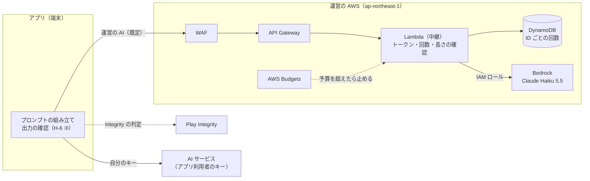

# ADR-AI-RELAY 運営が AI を中継し、1 日 30 回までは運営の負担で AI を使えるようにする

## 文書情報

| 項目 | 内容 |
|---|---|
| 文書ID | ADR-AI-RELAY |
| ドキュメント種別 | ADR |
| 対象システム/機能 | エコシステム全体。アプリが生成AI を呼ぶ経路、AI の費用の持ち主、運営の中継サーバー |
| 関連Skill | architecture-decision-record |
| 作成日 | 2026-10-19 |
| 作成者 | Claude（開発者との検討） |
| 承認者 | 開発者 |
| ステータス | 草案 |

## 目的・背景

アプリは、アプリ利用者が設定で入れた API キーで、端末から直接 AI を呼んでいる（[ADR-AI-ROLES](ADR-AI-ROLES.md) H-8）。この形には次の問題がある。

1. **始めるまでの敷居が高い**: AI の語りを聞くには、AI サービスに登録し、支払いを設定し、キーを作って入れる必要がある。キーがないと、地図のデータから作る簡易な解説と定型文だけになり、アプリの価値の中心である語りが届かない
2. **費用を決める人と払う人が別**: 頻度と解説の長さはチャンネル提供者が決め、払うのはアプリ利用者である（ADR-AI-ROLES 背景 3）
3. **運営が使うモデルを選べない**: 散策の語りに向いた、安くて速いモデルを既定にできない。アプリ利用者が高いモデルを選ぶと、同じ語りでも費用が大きく変わる

運営のキーをアプリに入れることはしない。APK は分解でき、入れたキーは取り出されて、運営の負担で誰でも AI を使える状態になる。運営のキーで AI を呼ぶには、キーを持つ中継のサーバーが要る。

ADR-AI-ROLES は、運営が AI を中継する案（案 D）を、位置や題材が運営に渡るため別の ADR で決めることにしていた。本書はそれを決める。開発者との検討で、次の 3 点が決まっている。

- 費用は運営が持ち、無料で使えるのは 1 日 30 回まで
- アプリ利用者が自分のキーを使う選択肢は残す
- 呼び先は Amazon Bedrock、既定のモデルは Claude Haiku 5.5

## スコープ・非スコープ

スコープ:
- 運営の中継（以下「運営の AI」）と、アプリ利用者のキー（以下「自分のキー」）の 2 つの経路
- 運営の AI の費用の持ち方と、無料の上限
- 中継のサーバーの置き場所、呼び先、悪用への備え
- 中継を通る情報の扱い

非スコープ（別の文書で決める）:
- 中継の API の形式（新しい API 契約 API-AI-RELAY。T-2）
- 有料プランなどの収益化（[エコシステム TODO](../work/ecosystem-todo.md)「収益化」）
- 管理システムで運営・チャンネル提供者が使う AI（審査の見本・一次審査。console ADR-001 D-4・A-14）。今のまま、使う人のキーでブラウザから呼ぶ

## 対応元ID（トレーサビリティ）

| 対応元ID | 内容 | 対応状況 |
|---|---|---|
| ADR-AI-ROLES H-8・制約 | 費用の持ち主はアプリ利用者のキーのまま。中継は別の ADR で決める | 本書で決める。運営の AI を足し、自分のキーも残す（R-1） |
| ADR-AI-ROLES H-9 | アプリ利用者が決める 1 日の上限 | 自分のキーでは今のまま。運営の AI では 30 回をサーバーで守る（R-2） |
| ADR-AI-ROLES H-6 ③ | 出力の機械の確認はアプリで行う | 変えない（R-8） |
| ADR-AI-ROLES 案 D・見直しの条件 | 運営のサーバーで AI を中継する | 中継は採る。出力の確認はサーバーに移さない |
| ADR-CHANNEL-CURATION 背景 1 | 第三者のプロンプトでアプリ利用者の費用が増える | 運営の AI では運営の費用になる。上限 30 回で抑える |
| [関係者の課題と対応案](../overview/stakeholder-needs.md) W-3 | 費用の見え方 | 運営の AI では残りの回数を見せる（R-11） |

## 方針・決定事項

### 経路と費用

| No. | 論点 | 決定 |
|---|---|---|
| R-1 | AI を呼ぶ経路 | 2 つの経路を持つ。**運営の AI**: アプリが運営の中継サーバーに送り、中継が運営の負担で AI を呼ぶ。**自分のキー**: 今と同じく、アプリ利用者のキーで端末から AI サービスを直接呼ぶ。運営を通らない |
| R-2 | 運営の AI の上限 | 1 台の端末につき **1 日 30 回まで**（日本時間の 0 時に戻す）。キャッシュ済みの解説は数えない（ADR-AI-ROLES H-9 と同じ数え方）。回数は中継のサーバーで数えて守る。アプリ利用者が設定した上限が 30 回より少なければ、そちらで止める。上限に達したら、ADR-AI-ROLES H-9 と同じく、固定の素材と定型文だけで続ける |
| R-3 | 自分のキーの上限 | ADR-AI-ROLES H-9 のまま（アプリ利用者が決める。既定 100 回） |
| R-4 | 既定の経路 | 新しく入れたアプリは運営の AI を使う。すでに自分のキーを入れているアプリ利用者は、更新しても自分のキーのまま（勝手に切り替えない） |

### 中継のサーバー

| No. | 論点 | 決定 |
|---|---|---|
| R-5 | 呼び先とモデル | **Amazon Bedrock** の **Claude Haiku 5.5**。ap-northeast-1 から、日本の中で処理する推論プロファイル `jp.anthropic.claude-haiku-5-5` で呼ぶ（Haiku 5.5 はリージョン単体では呼べず、推論プロファイルだけ）。AI サービスのキーを持たず、Lambda の IAM ロールで呼ぶ。請求は運営の AWS にまとまる。モデルは中継のサーバーで決め、アプリからは選ばせない |
| R-6 | 置き場所 | 運営の AWS アカウント（管理システムと同じ。開発用と本番用、ap-northeast-1。console ADR-001 A-2）に、管理システムとは別のスタックとして置く。管理システムが止まっても運営の AI は動き、運営の AI が止まっても管理システムは動くようにする。構成は API Gateway の HTTP API・Lambda・DynamoDB（回数）。コードと配備は yorisoi-console の `infra/` に置き、CDK と GitHub Actions の配備の仕組みを共用する |
| R-7 | 端末の確認 | **Play Integrity API** で、Play から入れた本物のアプリかを確かめる。アプリはインストールごとにランダムな ID を作り、Integrity の判定と一緒に送る。中継は判定を確かめてから、その ID に有効期限 24 時間のトークンを出す。以後の呼び出しはトークンで受け、回数は ID ごとに数える。開発用のスタックでは、開発者モードのアプリから判定なしで使えるようにする |
| R-8 | 出力の確認 | 今のままアプリで行う（ADR-AI-ROLES H-6 ③）。2 つの経路で同じ確認を通すため、サーバーには移さない |

### 悪用と費用への備え

| No. | 論点 | 決定 |
|---|---|---|
| R-9 | 汎用の AI として使わせない | ① 1 回の入力の長さと出力の上限（`max_tokens`）を中継で決める。出力の上限は、いちばん長い解説の長さ（`guide.length`）に収まる値にする ② 送られたプロンプトはそのまま AI に渡すが、R-2 の回数と ① の長さで、散策の語り以外に使っても得にならない量に抑える ③ AWS WAF で送信元ごとの要求の回数を制限する |
| R-10 | 全体の費用の上限 | 運営の AI 全体で 1 か月の予算を決める。AWS Budgets で予算の 80% で運営に知らせ、100% で中継を止める（Lambda の同時実行数を 0 にする）。止まっている間、アプリは AI を使えないときと同じく定型文で続け、設定で自分のキーに切り替えられることを知らせる |

### 情報の扱い

| No. | 論点 | 決定 |
|---|---|---|
| R-11 | アプリでの表示 | 運営の AI を使っているときは、今日の残りの回数と、上限に達したら定型文で続くことを出す。自分のキーへ切り替える入口を設定に置く |
| R-12 | 中継を通るもの | アプリは、今 AI サービスに送っているものと同じプロンプトを中継に送る。緯度経度と歩いた経路は、今と同じく、アプリ利用者が「AI に緯度経度と歩いた経路を送る」をオンにしたときだけ入る（既定はオフ） |
| R-13 | 中継が残すもの | プロンプトと AI の出力は保存せず、ログにも書かない。Bedrock のモデル呼び出しのログは有効にしない。残すのは、インストール ID のハッシュ・日付・回数・トークン数・応答時間・エラーの種類だけ。回数の記録は 7 日で消す（DynamoDB の TTL） |

## 判断テーマ

アプリ利用者がキーを用意しなくても AI の語りを聞けるようにするとき、だれが費用を持ち、運営のキーをどう守り、どこまでの情報が運営を通るか。

## 検討した代替案と比較軸

比較軸: ①始めるまでの敷居 ②運営の費用が限りなく増えないこと ③位置や題材が運営に渡らないこと ④運営の負荷（担当者 1 人） ⑤変更の費用

| 案 | 内容 | 評価 |
|---|---|---|
| 案 A | 今のまま。自分のキーだけ | ①× ②◎ ③◎ ④◎ ⑤◎ |
| 案 B | 運営のキーをアプリに入れる | ①◎ ②× キーが取り出されると止められない ③○ ④◎ ⑤◎ |
| 案 C | 運営の中継で、Anthropic API を運営のキーで呼ぶ（キーは Secrets Manager） | ①◎ ②○ ③△ 運営を通る ④△ キーの入れ替え・漏えいへの備えが要る ⑤△ |
| **案 D（採用）** | 運営の中継で、Bedrock を IAM ロールで呼ぶ。自分のキーも残す | ①◎ ②○ 端末ごとの上限と全体の予算で抑える ③△ 運営を通る。自分のキーを選べば通らない ④○ 管理するキーがない。管理システムと同じ AWS で運用できる ⑤△ |
| 案 E | 案 D で、自分のキーをなくす | ①◎ ②○ ③× 運営を通らない選び方がなくなる ④○ ⑤○ アプリの設定は簡単になる |

## 採用案と採否理由

案 D を採用する。

- キーを用意しなくても、入れてすぐ AI の語りを聞ける
- 運営のキーをどこにも持たない。Bedrock は IAM ロールで呼ぶので、漏れる・入れ替えるキーがない
- 運営の AWS アカウント・CDK・配備の仕組み（console ADR-001）をそのまま使える
- 運営を通したくないアプリ利用者・30 回より多く使いたいアプリ利用者は、自分のキーで今までどおり使える

却下した理由:
- 案 A: 語りが届くまでの敷居が下がらない
- 案 B: 取り出されたキーで、運営の費用が限りなく増える
- 案 C: 運営が AI サービスのキーを管理することになる。Bedrock なら同じことがキーなしでできる
- 案 E: 位置や題材を運営に渡さない選び方がなくなる。上限を超えて使いたいアプリ利用者の行き場もなくなる

利点:
- 既定のモデルを運営が選べる。散策の語りに向いた安いモデルで、費用と応答の速さをそろえられる
- 第三者のチャンネルが頻度を上げても、運営の AI では上限の 30 回を超えない

注意点:
- 位置（設定でオンにした人だけ）と題材が運営を通る。アプリの約束（「運営者がアプリ利用者の情報を受け取るサーバーはない」）を改める
- 費用は運営の持ち出しになる。目安は、1 回あたり入力 2,000・出力 300 トークンとして約 0.00035 ドル（Anthropic の公表価格での試算。Bedrock の価格は T-6 で確かめる）。毎日 30 回使い切るアプリ利用者 1 人で、1 か月約 0.3 ドル
- Play から入れていないアプリ（APK で入れたもの）は Integrity の判定を通らないので、自分のキーを使う

## 影響範囲・追従タスク

| 観点 | 影響 |
|---|---|
| 実装（共通基盤） | `kit-llm` に、中継を呼ぶ `LlmClient` と経路の選択を足す。中継のエラー（上限に達した・止まっている）を、アプリ利用者に見せる文に変える |
| 実装（アプリ） | 経路の設定（運営の AI / 自分のキー）、既定と更新時の扱い（R-4）、Play Integrity とトークンの取得、残りの回数の表示、止まっているときの案内 |
| 実装（中継） | WAF・API Gateway・Lambda・DynamoDB・Bedrock の権限・Budgets を CDK で作る。トークンの発行、回数、長さの確認、ログの方針（R-13） |
| 運用 | 予算の決定と見直し、予算の知らせを受けたときの判断、Bedrock のモデルの入れ替え |
| テスト | 上限に達したとき・中継が止まっているときに定型文で続くこと、Integrity を通らない端末の扱い、ログにプロンプトが残らないこと、自分のキーの経路が変わらないこと |
| 文書 | 下の T-1・T-5 |
| プライバシー | 運営が中継として題材（と、設定でオンにした人の位置）を受け取る。プライバシーポリシー・Play のデータ セーフティ（「収集」が「はい」になる）・ストアの説明を改める |

| ID | 追従タスク | 担当 | 時期 |
|---|---|---|---|
| T-1 | yorisoi-platform の文書を本書に合わせる: ADR-AI-ROLES（H-8・制約・案 D の評価）、[関係者と共通用語](../overview/roles-and-vocabulary.md)、[関係者の課題と対応案](../overview/stakeholder-needs.md) W-3、[SanpoGuide 手引き](../apps/sanpoguide/manual/README.md)（散策者・チャンネル提供者の手引きの API キーの説明）、[エコシステム TODO](../work/ecosystem-todo.md) | Claude | 本書の承認後 |
| T-2 | 中継の API 契約 API-AI-RELAY（トークンの発行、呼び出し、エラー、上限の返し方） | Claude | 本書の承認後 |
| T-3 | 中継の実装と配備（yorisoi-console の `infra/` に別スタック）。console ADR-001 に運営の AI を足す | Claude | T-2 の後 |
| T-4 | `kit-llm` とアプリの実装 | Claude | T-2 の後 |
| T-5 | SanpoGuide のプライバシーポリシー・Play のデータ セーフティ・ストアの説明・architecture.md を改める | Claude | T-4 と一緒に |
| T-6 | 開発用・本番用のアカウントで、Claude Haiku 5.5 のクロスリージョン推論のクォータ（1 分あたりのトークン数。初めは 0）の引き上げを Service Quotas で申請する。Anthropic のモデルのユースケースの申告を、アカウントごとに済ませる。Bedrock での価格を確かめる | 開発者 | T-3 の前 |
| T-7 | 運営の AI 全体の 1 か月の予算を決める（R-10） | 開発者 | 本番に出す前 |

見直しの条件:
- 全体の予算を超えて中継が止まることが続いたとき（上限の回数・予算・収益化を見直す）
- 散策の語り以外に使われていることが、回数やトークン数の偏りから見つかったとき（R-9 を厚くする。プロンプトを中継で組み立てる形を考える）
- Bedrock で Claude Haiku 5.5 が使えなくなった、または価格が大きく変わったとき
- 有料プランを始めるとき

## 制約

- 運営の AI は、運営の AWS アカウントの Bedrock だけを呼ぶ。運営は AI サービスのキーを持たない
- 中継はプロンプトと出力を保存しない（R-13）
- 安全に関わる決まり（固定の指示・出力の確認・止められない出来事）は、2 つの経路で同じ（ADR-AI-ROLES H-6）
- 運営の担当者は 1 人（ADR-CHANNEL-CURATION C-10）。運用は Budgets の知らせと自動の停止で回す

## 未決事項・リスク

| No. | 内容 | 決める時期 |
|---|---|---|
| 1 | Bedrock での価格と、クォータの引き上げが認められる量。認められるまで、または足りないときに、Claude Haiku 4.5（`jp.anthropic.claude-haiku-4-5-20251001-v1:0`）で代えるか | T-6 |
| 2 | 運営の AI 全体の 1 か月の予算 | T-7 |
| 3 | 1 回の入力の長さと出力の上限の値 | T-2 |

リスク:
- Play Integrity は、改造された端末やエミュレータでは通らないことがある。通らないアプリ利用者は自分のキーを使うしかない
- インストールし直すと ID が変わり、その日の回数が戻る。Integrity の判定に回数の上限があるので大量にはできないが、ゼロにはならない
- Integrity をすり抜けられた場合、全体の予算まで使われうる（R-10 で止まる）
- 運営の AI が止まると、自分のキーを入れていないアプリ利用者全員が定型文だけになる

## 関連ドキュメント・参照リンク

- [ADR-AI-ROLES](ADR-AI-ROLES.md)（H-6・H-8・H-9）
- [ADR-CHANNEL-CURATION](ADR-CHANNEL-CURATION.md)（C-10）
- [console ADR-001](https://github.com/duwenji/yorisoi-console/blob/main/docs/adr/ADR-001-aws-architecture.md)（AWS の構成・配備）
- [SanpoGuide プライバシーポリシー](https://github.com/duwenji/yorisoi-sanpoguide/blob/main/docs/privacy-policy.md)
- [SanpoGuide Play Console](https://github.com/duwenji/yorisoi-sanpoguide/blob/main/docs/play-console.md)
