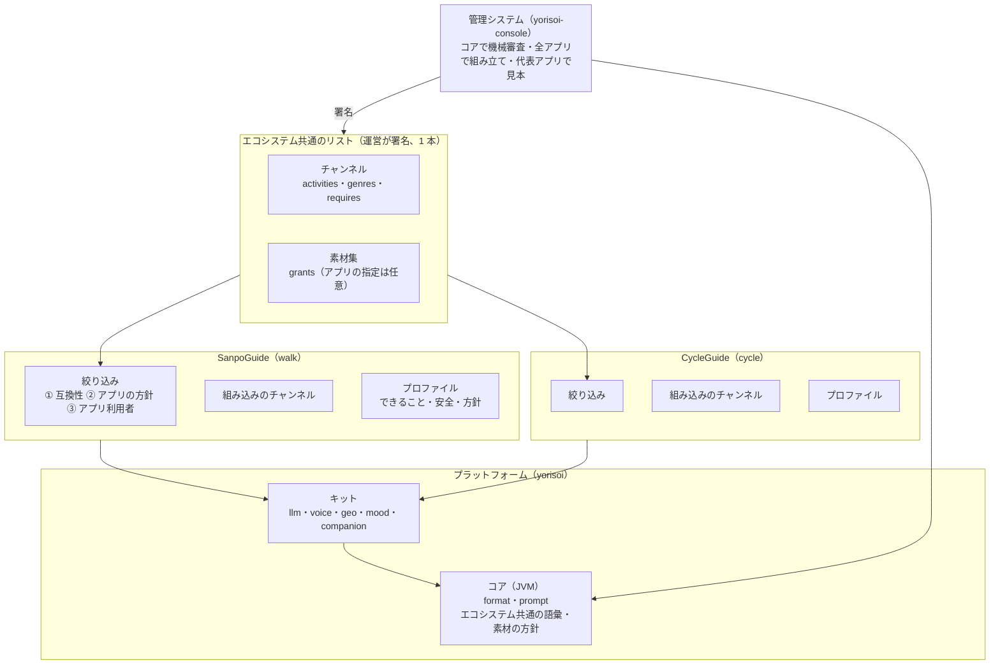

# ADR-ECOSYSTEM-PLATFORM 散策ガイドの共通部分を切り出し、付き添いアプリのエコシステムにする

## 文書情報

| 項目 | 内容 |
|---|---|
| 文書ID | ADR-ECOSYSTEM-PLATFORM |
| 旧文書ID | ADR-003 |
| ドキュメント種別 | ADR |
| 対象システム/機能 | SanpoGuide と yorisoi-console の全体。共通部分の切り出し、チャンネル・素材集のアプリをまたいだ扱い |
| 関連Skill | architecture-decision-record |
| 作成日 | 2026-10-12 |
| 作成者 | Claude（開発者との検討） |
| 承認者 | 開発者 |
| ステータス | 承認済（方針。詳細は契約書 API-CHANNEL-LIST〜004 で決める） |
| 版 | 1.0 |

## 目的・背景

SanpoGuide は散策向けのアプリだが、その仕組み（チャンネル・素材提供者・審査と署名・話しかけの判断・声・雰囲気）は、散歩に限らず「場所と状況に応じて AI が語りかける付き添いアプリ」（以下、付き添いアプリ）一般に使える。開発者から「要望に応じてアプリを作れるよう、共通部分を切り出して共通化し、エコシステムとして発展させたい」という方針が示された。

付き添いアプリを増やすには、次のことに対応する必要がある。

1. **形式に散歩の言葉が混ざりやすい**: 形式の仕組み（スロット、選択肢しか書けない `channel.json`、署名、ZIP の確認、素材・きっかけ、地域）は汎用だが、語彙（スポットの種類・出来事・止められない出来事・プロンプトの中身）は散歩に寄りやすい
2. **話す判断が散歩の判定と混ざりやすい**: 優先順位、頻度とチャンネルでは止められない安全の判定、話す間隔、読み上げ中は判定しないことは、どの付き添いアプリにも要る仕組み
3. **端末の部品はアプリをまたいで使える**: 声（TTS・オーディオフォーカス・背景音）、AI の接続、位置・地図・天気、雰囲気
4. **管理システムはアプリを区別する必要がある**: リスト（API-CHANNEL-LIST）と審査基準が、複数のアプリに対応しなければならない

本書は、共通部分の分け方と、チャンネル・素材集をアプリをまたいでどう扱うかの方針を記録する。

## スコープ・非スコープ

スコープ:
- 層の分け方（コア・Android キット・アプリ）と、各層に置くもの
- アプリのプロファイル（できることの宣言・安全・絞り込みの方針）
- チャンネル・素材集のアプリをまたいだ扱い、アプリによる絞り込み
- 語彙の置き場所と、知らない値の扱い
- 管理システム（リスト・審査）への影響の大枠
- リポジトリの構成と進め方

非スコープ（別の文書で決める）:
- `channel.json` の `activities`・`genres`・`requires` の項目・値の詳細（API-CHANNEL-PACKAGE）
- リスト・素材集の形式の詳細（API-CHANNEL-LIST・API-MATERIAL-PRODUCER）
- 話す判断のエンジンの詳細（`kit-companion` のコード）

## 対応元ID（トレーサビリティ）

| 対応元ID | 内容 | 対応状況 |
|---|---|---|
| ADR-CHANNEL-CURATION | C-4（チャンネル提供者の署名）、C-7（アプリが強制すること）、C-8（機械で確かめる項目） | 変えない。アプリが変わっても必ず守らせる（E-13） |
| ADR-MATERIAL-PRODUCERS | D-3（共通の IF）、D-4・D-5（属性と方針）、D-9（利用許諾）、D-25（タグ） | 素材集をアプリ共通にする（E-14〜E-16） |
| API-CHANNEL-LIST | 承認済みチャンネル・リスト | エコシステムで 1 本にし、互換性の宣言を載せる（E-17） |
| API-CHANNEL-PACKAGE | F-1〜F-7（スロット・選択肢・止められない出来事・ファイルの許可・署名） | `activities`・`genres`・`requires` を持ち、F-5 を E-12 のように当てる（E-8・E-12） |
| API-MATERIAL-PRODUCER | 題材・タグ・利用許諾 | 題材の「出来事」の扱い、タグの共通化、`grants` のアプリ指定 |
| yorisoi-console ADR-CHANNEL-CURATION | 管理システムの構成 | 互換性の判定・審査の見本の作り方（E-18・E-26） |

## 方針・決定事項

### 全体と層

| No. | 論点 | 決定 |
|---|---|---|
| E-1 | 目的 | 付き添いアプリを、要望に応じて作れるプラットフォームにする。SanpoGuide はその最初のアプリ。チャンネル提供者・素材提供者・運営はアプリをまたいで共通 |
| E-2 | 層 | 3 層に分ける。**コア**（JVM、Android に依存しない。アプリと管理システムが同じコードを使う）、**Android キット**（AAR）、**アプリ**。下の層は上の層を知らない |
| E-3 | コア | `core-format`（チャンネルの形式の骨格・スロット・署名・ZIP の確認・きっかけ・エコシステム共通の語彙。素材提供者の記述と方針・素材集・地域・タグの一覧と、リストの検証もパッケージとして含む）、`core-prompt`（`PromptTemplates`） |
| E-4 | キット | `kit-llm`（`LlmClient`・Claude／OpenAI 互換・`KeyCipher`・運営の AI の中継の `RelayClient`・`OperatorAi`・自分のキーの 1 日の呼び出しの数 `AiUsage`・使わない返事の判定 `OutputCheck`）、`kit-voice`（`Speaker`・オーディオフォーカス・`AmbientPlayer`・`Voices`）、`kit-geo`（運営のスポットのタイル `SpotTiles`・Overpass・`Poi`・`Shape`・`SpotFacts`・よく通る道 `FrequentWay`・ルート・`SpotPhotos`・地図・天気・日の入り）、`kit-mood`（`Mood`・`MoodSource`・`MoodTheme`・`MoodScene`）、`kit-companion`（話す判断のエンジンと、開発者モードの記録 `SessionRecorder`。JVM）、`kit-channel`（チャンネルの扱い: `Station`・スロットからのプロンプトの組み立て・組み込みのチャンネルの読み込み・第三者のチャンネルの取り込み・前もって取る素材の計画・素材提供者・通報）。アプリにあったコードは、2 本目のアプリ（CycleGuide）が使う段階の前に、使うものから移す。移すときに散歩だけの前提（間隔の値・散歩の記録・散歩の状態）を外し、値はアプリが持つ。画面はアプリに置く |
| E-5 | アプリが持つもの | プロファイル（E-6）、判定のルール（散歩なら施設の案内・スポットの選び方）、プロンプトの固定部分の中身と定型文、組み込みのチャンネル、画面と常駐サービスのつなぎ込み |
| E-6 | アプリのプロファイル | アプリごとに 1 つ持ち、次を宣言する。① **できること**: 過ごし方（`activities` の値）、実装している出来事・スロット・題材の種類・見せ方。② **安全**: 止められない出来事（散歩なら天気の急変・日の入り・施設の案内）と共通の指示。③ **絞り込みの方針**（E-10 の②）。④ **素材の方針**: コアの方針より厳しくするだけ（映像を出さない、など） |
| E-7 | 話す判断のエンジン | 判定を「ルールの並び」（優先順位・安全かどうか・どの間隔を守るか・判定）として表し、調停（読み上げ中は判定しない、1 件ずつ、切り替えの直後は控える、間隔）を `kit-companion` が受け持つ。アプリはルールを並べるだけにする。安全のルールは頻度とチャンネルを無視する |

### チャンネル

| No. | 論点 | 決定 |
|---|---|---|
| E-8 | チャンネルとアプリの関係 | チャンネルは**エコシステム共通**にし、特定のアプリには結びつけない（`channel.json` にアプリの ID を持たせない）。1 つのアプリは複数のチャンネルを並べる。チャンネルは何を前提にしているかを宣言する: `activities`（合う過ごし方。共通の一覧から選ぶ。例: walk・cycle）、`genres`（アプリ利用者が探すときの分類。共通の一覧から）、`requires`（これがないアプリでは成り立たないもの: スロット・題材の種類・見せ方） |
| E-9 | 語彙の置き場所 | 出来事・スロット・スポットの種類・過ごし方・ジャンルの語彙は、**エコシステム共通の一覧**としてコア（`core-format`）に置く。アプリはその一部を実装し、どこまで実装しているかをプロファイルで宣言する。値を足すときはコアの版を上げる |
| E-10 | アプリの絞り込み | 3 段で行う。① **互換性**（自動）: チャンネルの `activities` にアプリの過ごし方が入っていて、`requires` をアプリが満たす。② **アプリの方針**（プロファイル）: 言語・ジャンル、特定のチャンネルを除く・推す。③ **アプリ利用者の絞り込み**（画面）: ジャンル・チャンネル提供者 |
| E-11 | 組み込みのチャンネル | アプリごとに持つ（SanpoGuide は 6 本）。組み込みのチャンネルを、審査を経てエコシステムのリストに出すこともできる（任意） |
| E-12 | 知らない値の扱い（API-CHANNEL-PACKAGE F-5 の当て方） | 確かめる場所で分ける。**管理システム**: 厳しく確かめ、エコシステム共通の語彙にない値は拒む。**アプリ**: `requires` と制限の項目（`skip` など）に知らない値があれば、そのチャンネルを出さない（制限を読み落とすと、チャンネル提供者の意図より緩くなるため）。任意の項目（実装していない出来事のきっかけ・スロットなど）に知らない値があれば、その部分だけ使わない（使わなくても安全側に倒れるだけのため） |
| E-13 | 安全 | 止められない出来事、共通の指示（`shared/guard`）、見せ方の安全（API-CHANNEL-PACKAGE F-8）、素材の方針（API-MATERIAL-PRODUCER P-1・P-2）は、**アプリ側の固定部分**に置く。チャンネルにはこれらを書く項目がないので、どのアプリで使われても、そのアプリの安全の決まりが必ずかかる（ADR-CHANNEL-CURATION C-7 は変わらない） |

### 素材集

| No. | 論点 | 決定 |
|---|---|---|
| E-14 | 素材集とアプリの関係 | 素材集は**既定でどのアプリでも使える**。素材提供者は、利用許諾（`grants`）に使ってよいアプリを任意で書ける（書かなければ全アプリ）。素材集の審査はアプリをまたいで 1 回にする |
| E-15 | タグの一覧 | エコシステム共通の 1 つにし、コア（`core-material`）に置く。アプリごとの拡張は認めない（同じ素材集が、アプリによって当たったり当たらなかったりするのを避けるため） |
| E-16 | 素材の方針 | `ProducerPolicy`（第三者は前もって取得するだけ・題材を外に伝えない・生成しない）はコアに置き、アプリは緩められない（厳しくするだけ。E-6 ④）。素材提供者には「どのアプリに出しても扱いが同じ」こと、アプリ利用者には「どのアプリでも位置が漏れない」ことを保証する。素材の要求の文脈（`MaterialContext`）は汎用にし、散歩の情報（`WalkSession`・天気など）はアプリが組み込みの素材提供者に渡す。題材の「出来事」はプロファイルが実装する出来事に限る（素材集の `about` はスポット・地点だけなので、素材集の形式は変わらない） |

### 管理システム

| No. | 論点 | 決定 |
|---|---|---|
| E-17 | リスト | **エコシステムで 1 本**のままにし、チャンネルの `activities`・`genres`・`requires` を載せる。アプリが端末で絞り込む。取り下げ・鍵の移し替え（`publisherChange`・`producerChange`）もこの 1 本で扱う |
| E-18 | 審査 | 機械審査は、コアのエコシステム共通の語彙だけで確かめる（アプリごとのプロファイルを読まない）。審査の見本は 2 段に分ける（E-26）。そのため、各アプリはプロンプトの固定部分を「プロンプト・パック」として公開する。チャンネル提供者の画面には「このチャンネルが出るアプリ」を出す（互換性の判定はコアの同じコードで行う）。素材提供者の画面には、自分の素材集を使っているチャンネルとアプリを出す（ADR-MATERIAL-PRODUCERS D-18 の拡張） |

### 構成と進め方

| No. | 論点 | 決定 |
|---|---|---|
| E-19 | リポジトリ | 共通パッケージ（コアとキット）は `yorisoi-platform`、アプリはアプリごとのリポジトリ（SanpoGuide は `yorisoi-sanpoguide`）、管理システムは `yorisoi-console` に置く。アプリと管理システムは、`yorisoi-platform` が GitHub Packages に公開した版と、アプリが公開するプロンプト・パックを版で固定して使う。コアとアプリを同時に直すときは、手元の Gradle の設定で `yorisoi-platform` のソースに差し替える（composite build）。エコシステム全体の文書（本書・ADR-CHANNEL-CURATION・ADR-MATERIAL-PRODUCERS・API-CHANNEL-LIST・API-CHANNEL-PACKAGE・API-MATERIAL-PRODUCER・共通用語・関係者の課題）は `yorisoi-platform` に置く。理由: アプリごとに出す時期・権限・Play の設定が変わり、1 つのアプリの変更がほかのアプリの CI を壊すのを避ける。アプリが自分の都合で共通パッケージの版を上げられる |
| E-20 | 進め方 | 共通部分は、2 本目のアプリ（E-23）を作りながら直す。散歩だけに合わせた抽象を先に固めない |

### 名前・2 本目のアプリ・語彙

| No. | 論点 | 決定 |
|---|---|---|
| E-22 | エコシステムの名前 | **yorisoi**（寄り添い。移動のそばにいて支える相手）。プラットフォームの Kotlin のパッケージと公開の座標は `io.github.duwenji.yorisoi`（例: `io.github.duwenji.yorisoi.core.format`）。管理システムは `yorisoi-console`、チュートリアルは `yorisoi-tutorial`。アプリの `applicationId`・パッケージ名もこの下に置く（SanpoGuide は `io.github.duwenji.yorisoi.sanpoguide`）。github.com/Yorisoi は別の人のアカウントのため、`io.github.yorisoi` は使わない |
| E-23 | 2 本目のアプリ | **サイクリングの伴走**（`cycle`）。名前は **CycleGuide**（リポジトリ `yorisoi-cycleguide`、アプリの ID `cycleguide`）。地図・天気・日の入りの部品をそのまま使え、速度の違いで距離・間隔・判定の抽象を試せ、歴史探訪などのチャンネルを散歩と共有できるため。多くの都道府県で、周りの音が聞こえない状態での自転車の運転が規則で禁じられていることから、プロファイルは次を前提にする: イヤホンを前提にせず、周りの音が聞こえる状態で使うよう注意を促す（音の出先は端末に任せる。Bluetooth のイヤホンがつながると Android は音をそちらに出すため）、背景音は使わない、走行中は画面を出さない。この前提で成り立たないと分かったときの次点は、乗り物の車窓ガイド |
| E-24 | `activities` の最初の一覧 | `walk`・`cycle` の 2 つだけで始める。値は、そのアプリを作ると決めたときにコアのマイナー版で足す（実装しているアプリのない値は、どのアプリでも確かめられない宣言になるため） |
| E-25 | チャンネル提供者によるアプリの除外 | 入れない。出す範囲は `activities`・`requires` で絞る。アプリ単位の除外を認めると、互換性の判定と審査の見本がアプリごとに戻るため。要望が出たら `excludeApps` を足すことを検討する（見直しの条件） |
| E-26 | 審査の見本 | 2 段に分ける。① **組み立ての確認**は、互換性のあるすべてのアプリのプロンプト・パックで行う（AI を呼ばず、組み立てとスロット・上限の確認だけなので費用がかからない）。② **AI に話させる見本**は、`activities` の値ごとに代表のアプリ 1 つで作る（費用と運営の確認の量を、アプリの数ではなく過ごし方の数に比例させる）。最初の代表は `walk` が SanpoGuide、`cycle` が CycleGuide |
| E-27 | アプリ利用者の呼び方 | エコシステム全体の文書では「**アプリ利用者**」と呼び、各アプリの画面と文書ではアプリの呼び方を使う（SanpoGuide は「散策者」）。対応する共通語彙は [関係者と共通用語](../overview/roles-and-vocabulary.md) に記載する。チャンネル提供者・素材提供者・運営はアプリをまたいで同じ呼び方にする |

## 判断テーマ

付き添いアプリを要望に応じて作れるようにするために、何を共通にし、チャンネル・素材集をアプリとどう結びつけるか。

## 検討した代替案と比較軸

比較軸: ①新しいアプリを作る速さ ②チャンネル・素材集の再利用（チャンネル提供者・素材提供者にとっての届く範囲） ③安全の保証が崩れないか ④審査・運用の費用 ⑤変更の費用

| 案 | 内容 | 評価 |
|---|---|---|
| 案 A | 共通化しない。新しいアプリは SanpoGuide を写して作る | ①○ 最初は速い ②× ③△ 写したアプリごとに守り方がずれる ④× 管理システムもアプリごと ⑤◎ |
| 案 B | 共通部分をライブラリにする。チャンネルは 1 つのアプリに結びつけ（`channel.json` にアプリの ID）、リストもアプリごとに分ける。語彙はアプリのプロファイルが定める | ①◎ ②△ 素材集は共通にできるがチャンネルは共通にならない ③◎ ④△ リストと機械審査がアプリごとに要る ⑤○ |
| **案 C（採用）** | 共通部分をライブラリにする。チャンネルも素材集もエコシステム共通にし、チャンネルは前提を宣言、アプリが絞り込む。語彙はエコシステム共通 | ①◎ ②◎ ③◎ 安全はアプリの固定部分のまま ④○ リスト・機械審査は 1 つ、見本だけ過ごし方ごと ⑤△ 前提の宣言と知らない値の扱いが要る |
| 案 D | 1 つのアプリに「散歩」「サイクリング」などのモードを入れていく | ①△ 入れるたびにアプリが重くなる ②◎ ③○ ④◎ ⑤○ 要望ごとに別のアプリを出すことができない |

## 採用案と採否理由

案 C を採用する。

- 要望ごとに別のアプリを作れ（案 D ではできない）、作るたびに安全と信頼の仕組みを作り直さずに済む（案 A の問題）
- チャンネル提供者・素材提供者が一度申請すれば、合うすべてのアプリに届く。エコシステムが育つ理由になる
- 安全に関わることは、もともとチャンネルに書けない形（API-CHANNEL-PACKAGE F-4・ADR-CHANNEL-CURATION C-7）なので、チャンネルを共通にしても弱まらない
- リスト・機械審査がエコシステムで 1 つで済み、案 B より管理システムが単純になる

却下した理由:
- 案 A: 写したアプリが増えるほど、守り方と管理システムがばらばらになる
- 案 B: 同じチャンネルを別のアプリに出すには、申請し直しになる。開発者の方針（1 アプリが複数のチャンネルを持ち、アプリが絞り込む）と合わない
- 案 D: アプリごとに異なる要望（画面・常駐の仕方・権限）に応えにくい

利点:
- 新しいアプリは、プロファイル・ルール・プロンプト・組み込みのチャンネル・画面を書くだけで作れる。雛形と Claude Code のスキルで、要望から生成できる
- チャンネル・素材集の審査が、アプリが増えても増えない
- アプリ利用者は、どのアプリでも同じ安全とプライバシーの扱いを受ける

注意点:
- チャンネルの語り手の文章が、宣言した過ごし方に合っているかは人の審査に頼る（「一緒に歩きましょう」を cycle に宣言する、など）
- 語彙を足すたびにコアの版が上がり、古いアプリでは、その値を `requires` に書いたチャンネルが出なくなる
- AI に話させる見本は代表のアプリでしか作らないので、代表でないアプリの固定部分との組み合わせで、意図と違う話し方になるおそれがある（組み立ての確認は全アプリで行う。E-26）
- 共通部分を先に作り込みすぎると、散歩だけに合った抽象が固まる（E-20 で抑える）

## 影響範囲・追従タスク

| 観点 | 影響 |
|---|---|
| 実装（アプリ） | コアとキットを使う。話す判断をルールの並びにする。プロファイルを持ち、チャンネルを絞り込む |
| 実装（管理システム） | コアで確かめる。互換性の判定と「このチャンネルが出るアプリ」の表示、`activities` ごとの見本、`grants` のアプリ指定 |
| 運用 | 審査で、チャンネルの宣言した過ごし方と語り手の文章が合っているかを確かめる。アプリが増えるたびに代表のアプリを決める |
| テスト | プロンプトの組み立て結果、API-MATERIAL-PRODUCER の確認観点 W-01〜W-19、判定順の場面テスト、エミュレータでの散策 |
| 文書 | architecture.md・README・channels.md・関係者と共通用語・関係者の課題と対応案・yorisoi-tutorial |

| ID | 追従タスク | 担当 | 時期 |
|---|---|---|---|
| T-1 | 新しいアプリの雛形と、要望からプロファイル・ルール・プロンプト・組み込みのチャンネルを生成する Claude Code のスキル。SanpoGuide と CycleGuide の 2 本から共通の形を切り出す | Claude | T-2 の後 |
| T-2 | CycleGuide（E-23）を作り、合わなかった抽象を直す。代表のアプリとして `cycle` の見本に使う。要件は [yorisoi-cycleguide の要件定義](https://github.com/duwenji/yorisoi-cycleguide/blob/main/docs/requirements.md) | 開発者・Claude | 先に行う（見本が SanpoGuide だけのまま雛形を作ると、散歩向けの形が固まるため。E-20） |

見直しの条件:
- 2 本目のアプリで、プロファイル・エコシステム共通の語彙の形が合わなかったとき
- 屋内など、位置を使わない付き添いアプリの要望が出たとき（`kit-geo` と題材の前提が変わる）
- チャンネル提供者から、特定のアプリにだけ出したい・出したくないという要望が出たとき（E-25）
- 代表のアプリだけの見本では、審査で見落としが出たとき（E-26）
- サイクリングのアプリで、音の出し方の前提（E-23）が規則やアプリ利用者の使い方と合わなかったとき

## 制約

- 安全に関わる決まり（止められない出来事・共通の指示・見せ方の安全・素材の方針）は、チャンネル・素材集からは変えられない。アプリは厳しくすることだけできる
- コアは Android に依存しない（管理システムが同じコードで確かめるため）
- 運営の担当者は 1 人（ADR-CHANNEL-CURATION C-10）。アプリが増えても審査の単位を増やさない

## 未決事項・リスク

未決事項はない。

リスク:
- エコシステム共通の語彙が、アプリの数だけ膨らむ
- リポジトリを分けたので、コアとアプリを同時に直すときに公開の手順が 1 つ増える（E-19 の手元の差し替えで、試すことは同時にできる）
- サイクリング中の話しかけが、アプリ利用者の注意をそらすおそれがある（走行中は画面を出さず、話す間隔を散歩より長くする。T-2 で確かめる）

## 関連ドキュメント・参照リンク

- [ADR-CHANNEL-CURATION](ADR-CHANNEL-CURATION.md): 第三者のチャンネルの審査と署名
- [ADR-MATERIAL-PRODUCERS](ADR-MATERIAL-PRODUCERS.md): 素材提供者の切り出し
- [API-CHANNEL-PACKAGE](../contracts/API-CHANNEL-PACKAGE.md): チャンネル・パッケージの形式
- [API-CHANNEL-LIST](../contracts/API-CHANNEL-LIST.md): 承認済みチャンネル・リスト
- [API-MATERIAL-PRODUCER](../contracts/API-MATERIAL-PRODUCER.md): 素材提供者 IF と素材集の形式
- [architecture.md](https://github.com/duwenji/yorisoi-sanpoguide/blob/main/docs/architecture.md): SanpoGuide の構造
