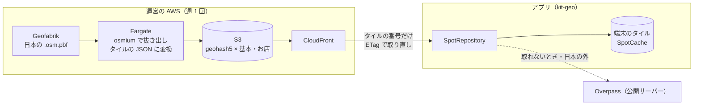

# ADR-SPOT-TILES 運営がスポットのタイルを前もって作って配り、アプリは Overpass の代わりにそれを使う

## 文書情報

| 項目 | 内容 |
|---|---|
| 文書ID | ADR-SPOT-TILES |
| ドキュメント種別 | ADR |
| 対象システム/機能 | エコシステム全体。アプリがスポット・施設・お店・信号を取る経路（`kit-geo`）、運営の配信の仕組み |
| 関連Skill | architecture-decision-record |
| 作成日 | 2026-10-29 |
| 作成者 | Claude（開発者との検討） |
| 承認者 | 開発者 |
| ステータス | 草案 |

## 目的・背景

SanpoGuide と CycleGuide は、周りのスポット・施設・お店・信号を、`kit-geo` の `SpotRepository` から OpenStreetMap の Overpass API（公開サーバー 3 か所）に問い合わせて取っている。処理は `kit-geo` で両アプリ共通になっているが、取り先が公開の Overpass であることに次の問題がある。

1. **遅くて落ちる**: 散歩の記録（2026-10-18、SanpoGuide）では、1 回の検索に成功しても 20〜28 秒かかり、3 つのサーバーのタイムアウト・500・504 が続いて、1 回の散歩で「すべてのサーバーで失敗」が 1〜3 回あった。前方の見どころが 23〜34 分空白になったこともある（[REQ-FREQUENT-WAYS](../requirements/REQ-FREQUENT-WAYS.md) 背景 1）
2. **端末ごとにしか残らない**: `SpotCache` は端末の中だけなので、初めて通る道ではまったく効かない。よく通る道の先読み（REQ-FREQUENT-WAYS F-6）も、1 回ずつ 10 秒空けて Overpass を呼ぶので時間がかかり、混んでいれば打ち切られる
3. **公開サーバーの負荷**: 利用者が増えると、公開サーバーの利用ポリシーに触れる（[エコシステム TODO](../work/ecosystem-todo.md)「公開サーバーの負荷」）
4. **正確な位置が第三者に届く**: 検索の中心の緯度経度を、運営の管理外の Overpass サーバーに送っている

スポットのもとになる OSM のデータは変化が遅く、どの利用者に対しても同じ答えになる。そのため、問い合わせのたびに検索するのでなく、運営が前もって地域ごとに切り出して、静的なファイルとして配れる。

### 実測（2026-10-29）

アプリと同じ条件（散歩用と自転車用の施設のすべて、すべての店の種類、信号）で、geohash 5 桁のタイル（約 4km × 5km）を 3 枚、Overpass から取って測った。「詰めた JSON」は、座標を小数 5 桁に丸め、輪郭を 5m で間引き、施設は名前だけ残したもの。スポットとお店の OSM タグはそのまま残している。

| タイル | スポット / 施設 / お店 / 信号 | Overpass の生 JSON | 詰めた JSON | gzip |
|---|---|---|---|---|
| 都心（東京駅、`xn76u`） | 543 / 1,227 / 1,617 / 848 | 1,146KB | 480KB | 134KB（お店 72KB・スポット 43KB・施設 16KB・信号 4KB） |
| 鎌倉・藤沢（`xn70z`） | 556 / 393 / 515 / 82 | 414KB | 180KB | 52KB（お店 17KB・スポット 30KB） |
| 郊外（千葉・印西、`xn7ev`） | 29 / 13 / 4 / 42 | 30KB | 8KB | 3KB |

日本全体は、中身のあるタイルが約 1.9 万枚で、gzip 後でおよそ 100MB（±50%）と見積もる。3 枚を取る間にも Overpass は 5 回失敗した（502 が 2 回、504 が 1 回、最長 114 秒待ち）。成功した回も 26〜107 秒かかった。

## スコープ・非スコープ

スコープ:
- スポット・施設・お店・信号の取り先（`OverpassClient` が今取っているもの）
- タイルの単位・中身・作り方・配り方・新しさ
- アプリでの取り方、端末に残すもの、取れないときの扱い
- 配信を通る情報と、OSM のライセンスの扱い

非スコープ:
- タイルのファイル形式の細部（新しい技術契約 API-SPOT-TILES。T-1）
- スポットの写真（`SpotPhotos`。Wikimedia Commons と Wikidata を端末から呼ぶ今のまま）
- 天気（Open-Meteo）。エコシステム TODO「公開サーバーの負荷」の残りとして別に考える
- 地図の画像（国土地理院のタイル）
- 経路（`RouteClient`）

## 対応元ID（トレーサビリティ）

| 対応元ID | 内容 | 対応状況 |
|---|---|---|
| エコシステム TODO「公開サーバーの負荷」 | Overpass・Open-Meteo の公開サーバーへの負荷 | Overpass の分を本書で決める。Open-Meteo は残る |
| [ADR-ECOSYSTEM-PLATFORM](ADR-ECOSYSTEM-PLATFORM.md) E-4 | `kit-geo` が Overpass を扱う | タイルの取得を足し、Overpass は取れないときの予備にする（S-9） |
| REQ-FREQUENT-WAYS F-6・N-1 | よく通る道に沿った先読み。Overpass に送るのは検索の中心の座標だけ | 先読みはタイルを取るだけになる（S-10）。運営に届くのはタイルの番号だけ（S-11） |
| [ADR-AI-RELAY](ADR-AI-RELAY.md) R-6 | 運営の AWS に、管理システムとは別のスタックとして置く | 同じ考え方で、配信も別のスタックにする（S-7） |

## 方針・決定事項

### タイル

| No. | 論点 | 決定 |
|---|---|---|
| S-1 | 取り先 | 運営が地域ごとのタイルを前もって作り、静的なファイルとして配る。アプリはまずタイルを使い、取れないときだけ今の Overpass に問い合わせる（S-9） |
| S-2 | タイルの単位 | geohash 5 桁（日本の緯度で約 4km × 5km）。1 枚に、その範囲に中心がある要素をすべて入れる。公園などの輪郭は、中心があるタイルに丸ごと入れる |
| S-3 | 層 | 1 枚のタイルを 2 つの層に分けて配る。**基本**: スポット・施設（`FacilityKind` のすべて）・信号。**お店**: 店の種類（API-CHANNEL-PACKAGE の `restaurant`〜`shop`）。お店の層は、チャンネルが店の種類を探すとき（`searchedKinds` が空でないとき）だけ取る。都心ではお店が約半分を占めるため |
| S-4 | 中身 | 今の `OverpassClient.query` と同じ条件で抜き出す（名前のあるスポットの種類、施設の種類と `access` の除外、チェーン店の除外）。ただし件数の上限（`out geom 80` など）はかけない。スポットとお店は OSM のタグをそのまま持つ（AI の根拠と写真の手がかりに使うため）。施設は種類・位置・名前だけ持つ。座標は小数 5 桁、輪郭は 5m で間引く。アプリの種類の判定（`categoryOf`・`FacilityKind.of`）は今のまま端末で行う |
| S-5 | 範囲と新しさ | 日本全体。週に 1 回作り直す。日本全体でも gzip 後で約 100MB なので、地域を絞らない |

### 作り方と配り方

| No. | 論点 | 決定 |
|---|---|---|
| S-6 | 作り方 | Geofabrik の日本の抽出（`.osm.pbf`）を週 1 回取り、osmium で S-4 の条件に合う要素を抜き出し、輪郭を組み立て、タイルごとの JSON に変える。Overpass は使わない（約 1.9 万枚を取ると、混雑と利用の制限で取りきれない）。バッチは EventBridge Scheduler から ECS Fargate で動かす。作り終えたら前の週のタイルと比べ、枚数や合計の大きさが大きく減っていれば差し替えずに運営に知らせる |
| S-7 | 置き場所 | 運営の AWS アカウント（ap-northeast-1、開発用と本番用）に、管理システムとも運営の AI とも別のスタックとして置く。S3 に置き、CloudFront で配る。誰でも読める（OSM のデータで、秘密がない）。コードと配備は yorisoi-console の `infra/` に置き、CDK と GitHub Actions の配備の仕組みを共用する |
| S-8 | 版と取り直し | タイルの URL は版を含まない固定の形にし、作り直しで中身が変わったタイルだけ `ETag` が変わる。アプリは残っているタイルを、`If-None-Match` で取り直す（変わっていなければ 304 で中身を送らない） |

### アプリ

| No. | 論点 | 決定 |
|---|---|---|
| S-9 | 取り方と予備 | `kit-geo` に、タイルからスポットを取る部品を足す。検索の中心から今の検索の半径（600m）の円にかかるタイル（1〜4 枚）を取り、端末で今と同じ距離（スポット 600m、近くだけの施設 250m、お店 400m）に絞って、今と同じ `NearbyResult` にする。タイルが取れず端末にも残っていないとき、またはタイルのない場所（日本の外。404）では、今の Overpass に問い合わせる |
| S-10 | 端末に残すもの | `SpotCache` は、Overpass の答えの代わりにタイルを残す。設定の「残す・期間・消す」の意味は変えない（期間を過ぎたタイルは S-8 で取り直し、取れなければ最長 90 日まで使う）。よく通る道の先読み（REQ-FREQUENT-WAYS F-6）は、道にかかるタイルを取るだけにする。間を 10 秒空ける必要はなくなる |
| S-11 | 新しさの表示 | 開発者モードの記録の `source` に、タイルから取ったことを足す（Overpass・残っていたタイル・取り直したタイルを分ける） |

### 情報とライセンス

| No. | 論点 | 決定 |
|---|---|---|
| S-12 | 配信に届く情報 | 運営に届くのは、取られたタイルの番号（約 4km × 5km の範囲）と IP アドレスだけ。CloudFront のアクセスログは有効にせず、要求の数などの集計（CloudWatch のメトリクス）だけ見る。今の Overpass には検索の中心の正確な緯度経度が第三者に届いているので、それよりも届く情報は少なくなる。Overpass に問い合わせる予備の経路（S-9）は今と同じ |
| S-13 | OSM のライセンス | タイルは OSM から作ったデータベースとして公開することになるので、ODbL 1.0 で配る。配信の入口に、ライセンスと出典（© OpenStreetMap contributors）を書いたファイルを置く。アプリの出典表示（設定画面）は今のまま |

## 判断テーマ

両アプリが共通で使うスポットの取り先を、遅くて落ちやすい公開の Overpass から、どの形に移すか。

## 検討した代替案と比較軸

比較軸: ①速さと落ちにくさ ②初めて通る道でも使えること ③正確な位置が運営や第三者に届かないこと ④運営の負荷と費用（担当者 1 人） ⑤変更の費用

| 案 | 内容 | 評価 |
|---|---|---|
| 案 A | 今のまま。`kit-geo` でクエリを軽くし、待ち時間を調整する | ①× 公開サーバーの混雑は変わらない ②× ③△ 第三者に届く ④◎ ⑤◎ |
| **案 B（採用）** | 運営がタイルを前もって作り、静的に配る | ①◎ 静的なファイルで 1 秒以内 ②◎ ③○ 約 4km × 5km の範囲だけ運営に届く ④○ 週 1 回のバッチと S3・CloudFront。費用は月数百円程度 ⑤△ バッチ・配信・`kit-geo` を作る |
| 案 C | 運営の中継が Overpass を呼び、答えを DynamoDB に残して利用者の間で共有する | ①△ 取り先は同じ公開サーバー。利用者の要求が中継の 1 つの IP に集まり、Overpass の IP ごとの制限にかかりやすくなる ②○ ③× 正確な位置が運営に届く ④△ 30 秒近い待ちが Lambda の作りと合わない ⑤○ |
| 案 D | 運営が自前の Overpass サーバーを動かす（EC2） | ①◎ ②◎ ③× 正確な位置が運営に届く ④× 常に動くサーバーとデータの更新の運用が要る。月 1 万円前後 ⑤○ アプリのクエリはそのまま使える |
| 案 E | 商用の場所の API（Google Places など）に替える | ①◎ ②◎ ③× ④△ 呼ぶたびに費用がかかる。残しておける期間や、生成 AI の入力に使うことに規約の制限がある ⑤× データの中身（史跡・自然・タグ）が今と違い、チャンネルとプロンプトの作りも変わる |

## 採用案と採否理由

案 B を採用する。

- 実測では、タイル 1 枚は都心でも gzip 後で約 130KB、日本全体で約 100MB で、静的に配るのに十分小さい
- 取り先が運営の管理する静的配信になり、Overpass の混雑に左右されない
- 一度作ったタイルを全利用者で共有するので、初めて通る道でもすぐ使える
- 運営に届くのはタイルの番号だけで、今よりも位置が外に出ない
- 運営の AWS アカウント・CDK・配備の仕組み（console ADR-001）をそのまま使える

却下した理由:
- 案 A: 遅さと失敗の原因（公開サーバーの混雑）が残る
- 案 C: 取り先が同じ公開サーバーで、IP が 1 つに集まるとかえって落ちやすい。正確な位置が運営に届く
- 案 D: 運営の負荷と費用が大きい。正確な位置が運営に届く
- 案 E: 費用と規約の制限があり、データの中身もアプリの作りも変わる

利点:
- 散歩 5km は今の約 15 回の検索（gzip で約 150KB）の代わりにタイル 1〜2 枚（50〜130KB）、自転車 50km は約 160 回（約 1.5MB）の代わりに 10〜15 枚（約 0.5MB）。同じ地域を 2 回目に通るときは、304 の確認だけで済む
- よく通る道の先読みが、少ない要求ですぐ終わる

注意点:
- データの新しさは最長 1 週間遅れる（OSM は変化が遅いので、散策の案内には十分）
- 件数の上限をなくすので、1 回の検索で扱うスポットが今より増えることがある。話す判断（`kit-companion`）が受け取る件数は、端末で今と同じ距離に絞ってから渡す

## 影響範囲・追従タスク

| 観点 | 影響 |
|---|---|
| 実装（共通基盤） | `kit-geo` にタイルの取得・読み込み・距離での絞り込みを足す。`SpotCache` がタイルを残すようにする。`OverpassClient` は予備として残す。抜き出しの条件を、端末（`OverpassClient.query`）とバッチで同じに保つ |
| 実装（アプリ） | 両アプリで有効にする。開発者モードの記録の `source`（S-11） |
| 実装（配信） | Fargate のバッチ（osmium と変換）、S3、CloudFront、EventBridge Scheduler、差し替えの判定と警報を CDK で作る |
| 運用 | バッチの失敗と差し替えの止まりの知らせを受けたときの判断。Geofabrik の取得元が変わったときの対応 |
| テスト | タイルから作った `NearbyResult` が、同じ地点の Overpass の答えと同じ種類・件数になること（上限を除く）。タイルの境目をまたぐ検索。タイルが取れないときに Overpass に戻ること。304 で取り直すこと |
| 文書 | 下の T-1・T-5 |
| プライバシー | 運営がタイルの番号（大まかな範囲）を受け取る。両アプリのプライバシーポリシーの送信先の表に運営の配信を足し、Play のデータ セーフティを見直す |

| ID | 追従タスク | 担当 | 時期 |
|---|---|---|---|
| T-1 | タイルの技術契約 API-SPOT-TILES（URL の形、層ごとの JSON の形、版、ETag、404 の意味、ライセンスのファイル）。形式を core-format に置くか `kit-geo` に置くかもここで決める | Claude | 本書の承認後 |
| T-2 | バッチと配信の実装と配備（yorisoi-console の `infra/` に別スタック）。console ADR-001 に足す | Claude | T-1 の後 |
| T-3 | `kit-geo` の実装と公開 | Claude | T-1 の後 |
| T-4 | 両アプリで有効にし、内部テストで速さと失敗の数を散歩・走行の記録で確かめる | Claude | T-2・T-3 の後 |
| T-5 | 文書を本書に合わせる: ADR-ECOSYSTEM-PLATFORM E-4、REQ-FREQUENT-WAYS（N-1・AC-4・AC-13・制約）、エコシステム TODO「公開サーバーの負荷」、両アプリのプライバシーポリシー・Play のデータ セーフティ・architecture.md、手引き | Claude | T-4 と一緒に |
| T-6 | 本番の配信を作る時期を決める | 開発者 | 本番に出す前 |

見直しの条件:
- 1 枚のタイルが大きすぎる地域が出たとき（都心で gzip 後 500KB を超えるなど。geohash 6 桁に細かくするか、層を分ける）
- 1 週間の遅れが散策の案内で問題になったとき
- Geofabrik の抽出が使えなくなったとき
- 日本の外でも使うことになったとき

## 制約

- バッチは公開の Overpass を使わない
- 配信はアクセスログを残さない（S-12）
- 抜き出しの条件はチャンネルの店の種類（API-CHANNEL-PACKAGE）と `FacilityKind` に従い、種類が増えたらバッチも合わせる
- 運営の担当者は 1 人（ADR-CHANNEL-CURATION C-10）。運用は警報の知らせと、前の週のタイルを残すことで回す

## 未決事項・リスク

| No. | 内容 | 決める時期 |
|---|---|---|
| 1 | タイルの形式の置き場所（core-format か `kit-geo` か） | T-1 |
| 2 | 本番の配信を作る時期 | T-6 |

リスク:
- 日本全体の pbf から輪郭を組み立てるには、数 GB のメモリが要る。Fargate の大きさと時間は T-2 で測って決める
- 日本全体の枚数と大きさは 3 枚の実測からの見積もりで、±50% ずれうる
- 端末とバッチで抜き出しの条件がずれると、予備の Overpass に落ちたときと答えが変わる。T-4 のテストで同じになることを確かめる
- 配信が止まると、端末にタイルが残っていない地域では今の Overpass に戻るので、今と同じ遅さと失敗になる

## 関連ドキュメント・参照リンク

- [ADR-ECOSYSTEM-PLATFORM](ADR-ECOSYSTEM-PLATFORM.md)（E-4）
- [ADR-AI-RELAY](ADR-AI-RELAY.md)（R-6）
- [REQ-FREQUENT-WAYS](../requirements/REQ-FREQUENT-WAYS.md)
- [API-CHANNEL-PACKAGE](../contracts/API-CHANNEL-PACKAGE.md)（店の種類）
- [console ADR-001](https://github.com/duwenji/yorisoi-console/blob/main/docs/adr/ADR-001-aws-architecture.md)（AWS の構成・配備）
- [SanpoGuide プライバシーポリシー](https://github.com/duwenji/yorisoi-sanpoguide/blob/main/docs/privacy-policy.md)
- [OpenStreetMap の著作権とライセンス](https://www.openstreetmap.org/copyright)
- [Geofabrik の抽出](https://download.geofabrik.de/asia/japan.html)
