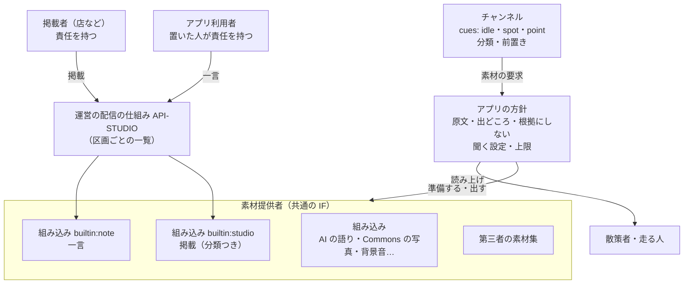

# ADR-STUDIO-MATERIAL スタジオ（店などの掲載）と一言（利用者の投稿）を組み込みの素材提供者にし、チャンネルが出し方を決める

## 文書情報

| 項目 | 内容 |
|---|---|
| 文書ID | ADR-STUDIO-MATERIAL |
| ドキュメント種別 | ADR |
| 対象システム/機能 | エコシステム全体。スタジオ（店などの掲載者が出す掲載）と一言（アプリ利用者の投稿）（[REQ-STUDIO](../requirements/REQ-STUDIO.md)）と、チャンネル・素材提供者（[ADR-MATERIAL-PRODUCERS](ADR-MATERIAL-PRODUCERS.md)）の関係。両者の用語の切り分け |
| 関連Skill | architecture-decision-record |
| 作成日 | 2026-11-01 |
| 作成者 | Claude（開発者との検討） |
| 承認者 | 開発者 |
| ステータス | 提案（承認待ち） |

## 目的・背景

[ADR-STUDIO](ADR-STUDIO.md) は、一言と掲載を「人の発言」の層としてチャンネル・素材集の外に置いた（S-1・S-6）。アプリは、語りの合間に、近くの一言と掲載をチャンネルにかかわらず読み上げる。

開発者から「スタジオをチャンネルの中に組み込んで使いたい。スタジオを素材の一種と考えられないか」という方針が示された。あわせて、**スタジオは店などが出す素材、一言はアプリ利用者の投稿で、互いに直接の関係はない**という整理が示された。一言もチャンネルに組み込む。外に置いたままだと、次のことができない。

1. **チャンネルに合わせた出し方**: 歴史のチャンネルは寺社の催しだけ、走行のチャンネルは短いお知らせだけ、というように、チャンネルの雰囲気に合わせて選べない
2. **出すきっかけ**: 合間に出すだけで、「このスポットに近づいたら、その辺りのお知らせを出す」のように、チャンネルのきっかけと組み合わせられない
3. **仕組みの数**: アプリの中で、掲載と一言だけが素材提供者の IF の外の別の道を通る
4. **用語**: これまでの文書は、一言と掲載を載せる仕組みをまとめて「スタジオ」と呼んでいた。作る人も責任も違う 2 つが、1 つの機能のように見える

一方で、ADR-STUDIO の決めごとのうち、だれの発言かが分かること（S-1）、運営が掲載者を承認し、中身の責任は掲載者が持つこと（S-2）、今のお知らせがすぐに届くこと（案 H・案 J を退けた理由）は守る必要がある。

## スコープ・非スコープ

スコープ:
- 一言と掲載を、素材提供者のどの種類として扱うか
- チャンネルが決められること・決められないこと
- スタジオ・一言を書かないチャンネルでの扱い
- 「スタジオ」と「一言」の用語
- 前置きの言葉
- チャンネルの審査と、掲載者・チャンネル提供者の責任

非スコープ:
- `channel.json` の書き方の詳細（API-CHANNEL-PACKAGE で決める）
- 組み込みの素材提供者の記述の値と方針の詳細（API-MATERIAL-PRODUCER で決める）
- 掲載の分類の一覧（core-format の語彙で決める）
- 掲載の有料化（REQ-STUDIO U-9）

## 対応元ID（トレーサビリティ）

| 対応元ID | 内容 | 対応状況 |
|---|---|---|
| [ADR-STUDIO](ADR-STUDIO.md) S-1・S-2・S-6 | 人の発言の層、掲載者の承認と責任、宣伝との関係 | S-1・S-2 は変えない（M-3・M-7）。S-6 の「チャンネル・素材集の外」を M-1 に改める |
| [ADR-MATERIAL-PRODUCERS](ADR-MATERIAL-PRODUCERS.md) D-2・D-4・D-6・D-15・D-27 | 素材提供者の種類、属性と方針、組み込みの増やし方、省略形、基準で選ぶときの審査 | M-1・M-3・M-5・M-7 |
| [REQ-STUDIO](../requirements/REQ-STUDIO.md) D-8・D-10・D-12・D-21・D-22 | 区画の一覧、読み上げ方、聞く設定、上限、音声の取得 | M-3・M-4 でアプリの方針として守る |
| [API-CHANNEL-PACKAGE](../contracts/API-CHANNEL-PACKAGE.md) F-10・M-3 | 取得の時期、素材を出すきっかけ | M-2・M-4 |

## 方針・決定事項

| No. | テーマ | 決定 |
|---|---|---|
| M-1 | 素材提供者の種類 | 一言と掲載を、**組み込みの素材提供者**にする。`builtin:note`（一言）と `builtin:studio`（掲載）。中身は運営の配信の仕組み（API-STUDIO）から取る。第三者の素材集にはしない（案 Q）。「組み込み」は IF の上の種類（アプリのコードが取りに行く）を表すだけで、中身を作る人・責任を持つ人ではない（ADR-MATERIAL-PRODUCERS D-2 で、AI の語りが IF の上では組み込みでも、役割は実演の層であるのと同じ）。中身を作り責任を持つのは M-7 のとおり |
| M-2 | きっかけ | チャンネルは、ほかの素材と同じく `cues` で出し方を書く。新しい出来事 **`idle`**（語りの合間。アプリが、話すことがないと決めたとき）を足す。`idle` では、端末がいる区画とその周りの一言・掲載から選ぶ。`spot`・`point` のきっかけでは、そのスポット・地点の区画の一言・掲載から選ぶ |
| M-3 | チャンネルが決められること | 出すかどうか、どのきっかけで出すか、どれを出すか（一言か掲載か、掲載の**分類**）、前置き（M-6）。掲載には分類を足す（掲載者が選ぶ。決まった一覧から） |
| M-4 | チャンネルが変えられないこと（アプリの方針） | ①原文を出どころとともに読み上げる（「この辺りを通った人の一言です。」「〇〇からのお知らせです。」）②AI の根拠にしない・言い換えない・要約しない ③散策者・走る人の設定（一言を聞くか・掲載を聞くか。REQ-STUDIO D-12）④上限（1 時間に一言 10 件・掲載 2 件、同じ掲載は 1 日 1 回。D-21）はアプリ全体で数え、チャンネルが緩めることはできない ⑤取得は区画の一覧だけ（D-8・D-22）。どれもチャンネルに書く項目がない（API-CHANNEL-PACKAGE G-5 と同じ考え方） |
| M-5 | スタジオ・一言を書かないチャンネル | **省略形として、`idle` で一言と掲載を出すことに展開する**（ADR-MATERIAL-PRODUCERS D-15 と同じ考え方）。これまでと同じく届く。チャンネルは、止める・絞る・別のきっかけで出すを書ける。組み込みのチャンネルも同じ |
| M-6 | 前置き | チャンネルは、出どころの紹介の前に置く**前置き**を、アプリが決めた文の一覧から選べる（例「ところで、近くでお知らせがあるみたい。」）。AI に作らせない。出どころの紹介（M-4 ①）は省けない |
| M-7 | 責任と審査 | 一言と掲載は、作る人と責任が違い、本書でも変えない。**一言**はアプリ利用者の投稿で、中身の責任は置いた人が持つ。運営は場を用意する者として、置く前の自動の確認・通報・消す・締め出すで守る（ADR-STUDIO S-3）。**掲載**は、運営が承認した提供者（チャンネル提供者・素材提供者）が出すもので、中身の責任は掲載者が持ち、名前を必ず出す（ADR-STUDIO S-2）。チャンネル提供者は、どちらの中身にも責任を持たない（自分が掲載者として出した掲載を除く）。チャンネル提供者は、一言・掲載を 1 件ずつ選ばず、出す条件だけを決める。チャンネルの審査では、出す条件（きっかけ・分類・前置き）を確かめ、どの一言・掲載が出るかは確かめない（ADR-MATERIAL-PRODUCERS D-27 と同じ考え方）。聞いた人の通報は、チャンネルではなく運営に届く（一言は一言の通報、掲載は掲載の通報） |
| M-8 | 属性 | `trust=builtin`・`generated=false`。取得は区画（geohash6、約 1.2 km × 0.6 km）ごとの一覧で、取りに行く要求から区画が運営に伝わる。これを表す `exposure` の値を足す（`area`）。区画の粒度で伝わることは、ADR-STUDIO と REQ-STUDIO D-8 ですでに受け入れている |
| M-9 | 宣伝との関係 | 掲載は、チャンネルが使える組み込みの素材のうち、**掲載者の名前を必ず出す**もの。ADR-AI-ROLES H-16（チャンネル・素材の宣伝を区別しない）は変えない。無料の間は「広告」と出さない。有料にするときは「広告」と出し、本書と ADR-STUDIO を改める（REQ-STUDIO U-9） |
| M-10 | 用語と関係 | **スタジオ**は、店などの掲載者が出す掲載（素材）を指す。**一言**は、アプリ利用者がその場所に置く投稿を指し、スタジオには含めない。2 つは作る人・責任（M-7）・確認の仕方・設定（REQ-STUDIO D-12）が別で、互いに直接の関係はない。チャンネルからも、別の素材提供者（`builtin:studio`・`builtin:note`）として指す。配る仕組み（契約 API-STUDIO、yorisoi-console のスタック、platform の kit-studio）は、作る量を抑えるため 2 つで共有し、名前は今のままにする（U-4） |

## 判断テーマ

一言と掲載をチャンネルの中で使えるようにするか。使えるようにするなら、素材提供者のどの種類として扱い、チャンネルにどこまで決めさせ、ADR-STUDIO の決めごと（人の発言の層、掲載者の責任、すぐ届くこと）をどう守るか。

## 検討した代替案と比較軸

比較軸: ①チャンネルに合わせて出せる ②だれの発言かが聞く人に分かる（ADR-STUDIO S-1） ③今のお知らせがすぐ届く ④掲載が届く範囲（掲載者にとっての価値） ⑤運営 1 人で回る ⑥変更の量

### 素材提供者の種類

| 案 | 内容 | 評価 |
|---|---|---|
| 案 P | 外に置いたまま（ADR-STUDIO のまま） | ①× ②◎ ③◎ ④◎ ⑤◎ ⑥◎ |
| **案 Q（採用）** | 組み込みの素材提供者にする。中身は運営の配信の仕組みから取る | ①◎ ②◎ アプリの方針で守る ③◎ ⑤◎ ⑥○ 契約 3 本とアプリの道の付け替え |
| 案 R | 第三者の素材集にする（掲載者が署名し、運営が素材集として審査） | ①◎ ②○ ③× 審査の目安 5 日、前もっての取得だけ（ADR-MATERIAL-PRODUCERS D-5・D-7） ⑤× 掲載ごとの審査になる（ADR-STUDIO 案 H と同じ） |

### スタジオ・一言を書かないチャンネル

| 案 | 内容 | 評価 |
|---|---|---|
| **案 S（採用）** | 省略形として、`idle` で出すことに展開する | ①○ 書けば変えられる ④◎ これまでと同じ ⑥◎ 今あるチャンネルを直さずに済む |
| 案 T | 書いたチャンネルだけで出す | ①◎ ④× 第三者のチャンネルが増えるほど届きにくくなる。掲載者には、どのチャンネルで出るかが分からない |

### 前置き

| 案 | 内容 | 評価 |
|---|---|---|
| **案 U（採用）** | アプリが決めた文の一覧から選ぶ | ①○ ②◎ |
| 案 V | チャンネルが自由に書く | ①◎ ②△ 前置きで掲載を持ち上げたり、出どころをぼかしたりできる。審査で文を見る必要がある |
| 案 W | AI がチャンネルの口調で作る | ①◎ ②× 掲載の中身に触れて言い換え・感想を足しうる（ADR-STUDIO S-1 に反する）。AI の呼び出しも増える |

## 採用案と採否理由

案 Q・案 S・案 U を採用する。

- 組み込みの素材提供者は、アプリのコードが中身の扱いを決める（ADR-MATERIAL-PRODUCERS D-6）。原文を出どころとともに読み上げること、根拠にしないことを、チャンネルから変えられない方針として守れる。チャンネルに許すのは出し方だけになる
- 中身はこれまでどおり運営の配信の仕組みから取るので、掲載はすぐ届き、運営が確かめるのは掲載者の承認の 1 回だけのまま
- 書かないチャンネルを省略形で展開すれば、今あるチャンネルも掲載者もこれまでどおりで、書いたチャンネルだけが出し方を変えられる
- 前置きを決まった文にすれば、チャンネルの雰囲気を少し出しつつ、中身に触れない

却下した理由:
- 案 P: チャンネルに合わせて出せない（開発者の方針に合わない）
- 案 R: 今のお知らせが間に合わず、掲載ごとの審査で運営が回らない
- 案 T: 掲載の届く範囲が、チャンネルの書き方しだいで狭くなる
- 案 V: 前置きで出どころをぼかせる。チャンネルの審査で文を見る手間が増える
- 案 W: 人の発言を AI が言い換えることになり、ADR-STUDIO S-1 に反する

注意点:
- チャンネルは「出さない」とも書けるので、そのチャンネルを使う人には掲載が届かない。掲載者の掲載者ガイドには、チャンネルによっては出ないことを書く
- 分類で選べるのは掲載だけで、一言には分類がない。一言は出す・出さない・きっかけだけを決められる
- `idle` は、上限（M-4 ④）と語りの後に置く間の中で出す。チャンネルが `idle` を何度書いても、上限より多くは出ない

## 影響範囲・追従タスク

| 観点 | 影響 |
|---|---|
| 文書 | ADR-STUDIO・REQ-STUDIO の用語を M-10 に合わせ、「スタジオ」は掲載、一言は別の機能として書き分ける。ADR-STUDIO の S-6 と注意点を本書に合わせる。ADR-MATERIAL-PRODUCERS D-2 の図と一覧に 2 つを足す。REQ-STUDIO の D-10・D-21・F-7 に、チャンネルが出し方を決めることを書く。ADR 一覧に足す |
| 契約 | API-MATERIAL-PRODUCER（組み込みの表に 2 つ、`exposure=area`、M-4 の方針）、API-CHANNEL-PACKAGE（出来事 `idle`、スタジオと一言の指示、前置き、省略形の展開）、API-STUDIO（掲載の分類）、core-format（掲載の分類の語彙・前置きの一覧） |
| 方針 | チャンネルの審査基準に、スタジオと一言の出し方の確かめを足す。掲載の決まりに分類の選び方を足す |
| 実装 | platform の kit-studio・kit-channel（素材提供者の IF の裏に置く、`idle` の展開）、両アプリ（掲載と一言の別の道をやめ、きっかけで出す。画面・設定の言葉を M-10 に合わせる）、yorisoi-console（掲載の分類、チャンネルの機械審査） |
| 利用者への説明 | 掲載者ガイド（チャンネルによっては出ない、分類）、チャンネル提供者ガイド（スタジオと一言の書き方）、運用操作説明書・管理システムのガイドの用語（M-10）、tutorial |

| ID | 追従タスク | 担当 | 時期 |
|---|---|---|---|
| T-1 | ADR-STUDIO・ADR-MATERIAL-PRODUCERS・REQ-STUDIO を本書に合わせる | Claude | 本書の承認の後 |
| T-2 | 契約: API-MATERIAL-PRODUCER・API-CHANNEL-PACKAGE・API-STUDIO と core-format の語彙（掲載の分類・前置きの一覧） | Claude（案）、開発者 | T-1 の後 |
| T-3 | 方針: チャンネルの審査基準、掲載の決まり | Claude（案）、開発者 | T-2 と一緒に |
| T-4 | 実装: platform の部品、yorisoi-console、両アプリ | Claude | 契約の承認の後 |
| T-5 | 利用者向けの文書と tutorial の追従 | Claude | 実装の後 |

## 制約

- 運営は当面 1 人（ADR-CHANNEL-CURATION C-10）
- 一言と掲載は AI の根拠にしない（ADR-STUDIO S-1、ADR-AI-ROLES H-3〜H-5）
- 知らない値で制限が緩まない（API-CHANNEL-PACKAGE G-5）。`idle` や `builtin:studio`・`builtin:note` を知らないアプリは、そのきっかけ・候補を使わない

## 未決事項・リスク

| ID | 内容 | 決める時期 |
|---|---|---|
| U-1 | 掲載の分類の一覧（寺社・催し・飲食・買い物・観光案内・交通 など）。掲載者が選び間違えたときの扱い（自動の確認で見るか、通報で直すか） | T-2 のとき |
| U-2 | チャンネルが「自分の掲載だけ」を選べるようにするか（観光協会のチャンネルが自分のお知らせだけを出す）。選べると、チャンネル提供者が掲載の出し先を握ることになる | T-2 のとき |
| U-3 | 前置きの文の一覧（数と言い回し）。SanpoGuide と CycleGuide で分けるか | T-2 のとき |
| U-4 | 共有している配る仕組みの名前（API-STUDIO・kit-studio・スタックの名前）を、掲載と一言に分けた名前に改めるか。改めると契約・部品・配備の名前が変わる | T-4 のとき |
| R-1 | 多くのチャンネルが掲載を止めると、掲載者にとっての価値が下がる。チャンネルごとの止めた割合を見て、掲載者に知らせるかを決める | 運用のとき |

## 関連ドキュメント・参照リンク
- [ADR-STUDIO](ADR-STUDIO.md)
- [ADR-MATERIAL-PRODUCERS](ADR-MATERIAL-PRODUCERS.md)（素材提供者の種類 D-2、属性と方針 D-4、組み込みの増やし方 D-6、省略形 D-15、基準で選ぶときの審査 D-27）
- [ADR-AI-ROLES](ADR-AI-ROLES.md)（根拠 H-3〜H-5、宣伝 H-16）
- [REQ-STUDIO](../requirements/REQ-STUDIO.md)
- [API-MATERIAL-PRODUCER](../contracts/API-MATERIAL-PRODUCER.md)、[API-CHANNEL-PACKAGE](../contracts/API-CHANNEL-PACKAGE.md)、[API-STUDIO](../contracts/API-STUDIO.md)
