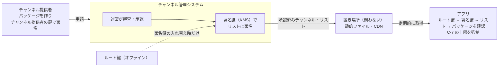

# チャンネルの決まり

| 項目 | 内容 |
|---|---|
| 文書ID | CHANNELS |
| ステータス | 承認済 |

チャンネルの役割と、第三者のチャンネルを取り込む条件（審査・署名・更新・取り下げ）の決まりです。パッケージの形式は [API-CHANNEL-PACKAGE](../contracts/API-CHANNEL-PACKAGE.md)、リストは [API-CHANNEL-LIST](../contracts/API-CHANNEL-LIST.md)、審査の基準は[審査基準](../policies/channel-review.md)が定めます。

## 決まり

| No. | 論点 | 決定 |
|---|---|---|
| C-15 | チャンネルの役割 | チャンネルは、語り手・話題・話す量・雰囲気をまとめて決め、素材（どの種類も）を出すかどうか・いつ・どのように出すかを決める。素材の中身は作らない（同梱の素材を除く）。決められるのは、アプリの方針とアプリ利用者の設定の内側だけ（[ADR-MATERIALS](materials.md) D-37） |
| C-1 | 取り込んでよいチャンネル | システム運営が審査し、基準を満たしたチャンネルだけ。審査に通ったことは運営の署名で示す |
| C-2 | 署名の対象と鍵 | 運営は、承認済みチャンネル・リスト（各パッケージの SHA-256 を含む）に Ed25519 で署名する。パッケージごとの運営の署名は要らない。鍵は 2 段で、オフラインのルート鍵が、管理システムの使う署名鍵（有効期限付き）に署名する。アプリが信用するのはルート鍵だけ（[API-CHANNEL-LIST](../contracts/API-CHANNEL-LIST.md) P-1・P-4） |
| C-3 | 更新 | パッケージの中身が変わればハッシュが変わるので、更新のたびに審査と署名をやり直す。審査後に中身を差し替えても、アプリは取り込まない |
| C-4 | チャンネル提供者の身元 | パッケージにチャンネル提供者のアカウントID（API-SECRET-MESSAGES と同じ `sg1…`）を入れ、チャンネル提供者も署名する。同じチャンネルの更新は、同じチャンネル提供者の署名があるときだけ受け付ける（管理システムが申請時に確かめる）。例外は C-11 の移し替えだけ |
| C-5 | 置き場所と取り込み方 | アプリは承認済みチャンネル・リストを取得して取り込む。リストとパッケージの置き場所は問わない（静的ファイル・CDN で足りる）。リストの取得先は設定で変えられ、既定はアプリに内蔵したリスト。ほかに、チャンネル提供者が審査前に自分の端末で試す試用チケット（開発者モードのときだけ）がある |
| C-6 | 取り下げ | リストに載っていないチャンネルは使わない。問題があって止めたものはリストの `revoked` に理由とともに載せる。リストには通し番号と有効期限（最大 14 日）を付け、古いリストへの差し戻しを防ぐ。別の失効リストは作らない（API-CHANNEL-LIST P-5・P-6） |
| C-7 | アプリが必ず強制すること（審査の結果にかかわらず） | 安全の案内（天気の急変・雷雨の通知・日の入り）は止められない。共通ルール（`prompts/shared/`）は必ず付ける。話しかけの頻度・プロンプトの長さ・背景音の音量に上限を設ける。第三者が差し替えられるのは語り手と話題の部分だけ |
| C-8 | 審査基準 | 文書にして公開する。機械で確かめる項目（形式・長さ・上限・使ってはいけない変数や指示）と、人が確かめる項目（プロンプトの内容、いくつかの場面で実際に話させた結果、事実の正確さ）に分ける |
| C-9 | 審査と公開の場所 | アプリとは別の **チャンネル管理システム** で行う。アプリ利用者は運営（審査・承認・取り下げ）とチャンネル提供者（申請・更新・審査状況の確認・試用チケットの発行）。承認すると管理システムがリストを作り、KMS の署名鍵で自動で署名して公開する。管理システムの実装方法・置き場所は、API-CHANNEL-LIST に準拠していれば問わない |
| C-10 | システム運営 | 当面は開発者本人が務める（内蔵のリストの運用、審査・承認・取り下げ、ルート鍵の保管）。外部に任せる・複数にするときは[見直しの条件](#影響範囲追従タスク)にあたる |
| C-11 | チャンネル提供者の鍵をなくした・漏れたとき | 運営が本人確認のうえで、チャンネルを新しい鍵（新しいアカウントID）に移せる。本人確認は、管理システムのアカウント（Cognito）と、登録済みの連絡先など鍵とは別の経路で行う。移したあとの最初の版は通常どおり審査する。漏れたときは、古い鍵で署名された承認待ちの版を差し戻し、必要なら公開中の版を取り下げる。リストには `publisherChange` で移し替えを示し、アプリはアプリ利用者に一度知らせる（[API-CHANNEL-LIST](../contracts/API-CHANNEL-LIST.md) P-9） |
| C-12 | 管理システムの実装 | 別リポジトリ yorisoi-console で、AWS（API Gateway・Lambda・DynamoDB・S3/CloudFront・KMS・Cognito）に作る。詳細は yorisoi-console の ADR-001。KMS の署名の大きさの制限から、リストは要約に署名する（API-CHANNEL-LIST P-8） |
| C-14 | 審査の費用と期間 | 審査は無料にする（チャンネルも素材集も）。判定までの期間の目安は、機械の確認に合格してから 5 日（審査基準「判定」）。運営の担当者が 1 人のため、約束ではなく目安とする |

## 制約

- 対応端末は Android 8.0（API 26）以上。Ed25519 は Android Keystore では扱えないため、署名の確認は Tink で行う（API-SECRET-MESSAGES と同じ）
- 運営の公開鍵はアプリに内蔵するため、入れ替えにはアプリの更新が要る

## 見直しの条件

- 運営を複数にする、または審査を外部に任せることになったとき（鍵の持ち方と審査の分担を見直す）
- 審査待ちが長くなり、チャンネル提供者の不満や運営の負担が問題になったとき
- AI の費用の持ち方が変わったとき（例: チャンネル提供者や運営が AI の費用を持つ）。C-7 の上限と、アプリ利用者が決める上限（[ADR-AI-ROLES](ai-roles.md) H-9）を見直す
- 運営の鍵が漏れた、またはなくしたとき
- Google Play の AI 生成コンテンツ・アプリ利用者が作るコンテンツの規約が変わったとき

## 未決事項・リスク

| No. | 内容 | 決める時期 |
|---|---|---|
| 2 | 第三者のチャンネルをアプリ利用者がカスタマイズできるか（今はチャンネル提供者に任せ、アプリ利用者は使う・使わないだけを選ぶ） | 第三者のチャンネルの公開の前 |

リスク:
- 審査で見落とした問題が、取り下げまでの間にアプリ利用者に届く。リストの取得の間隔（24 時間）と有効期限（最大 14 日）で被害の大きさが決まる
- 管理システムが乗っ取られると、署名鍵を失効させるまで偽のリストが出せる
- 運営の担当者が 1 人だと、不在の間は審査も取り下げもできない

## 関連する文書

- [TODO.md「チャンネル」](https://github.com/duwenji/yorisoi-sanpoguide/blob/main/docs/TODO.md#チャンネル)
- [API-CHANNEL-LIST](../contracts/API-CHANNEL-LIST.md): 承認済みチャンネル・リストの形式
- [API-SECRET-MESSAGES](../contracts/API-SECRET-MESSAGES.md): 鍵とアカウントID、D-5
- [prompts.md](https://github.com/duwenji/yorisoi-sanpoguide/blob/main/docs/design/prompts.md): プロンプトの構成（第三者が差し替える範囲を決める元）
