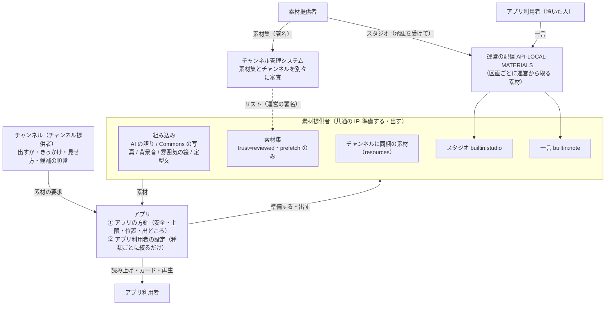

# 素材の決まり

| 項目 | 内容 |
|---|---|
| 文書ID | MATERIALS |
| ステータス | 承認済 |

アプリ利用者に届く中身（素材）の種類、種類ごとに作る人と責任、出し方を決める順番の決まりです。素材のインタフェースと素材集の形式は [API-MATERIALS](../contracts/API-MATERIALS.md)、スタジオと一言の配信は [API-LOCAL-MATERIALS](../contracts/API-LOCAL-MATERIALS.md)、運用の基準は[スタジオの決まり](../policies/studio-rules.md)と[一言の利用規約](../policies/notes-terms.md)が定めます。

## 決まり

### 素材とチャンネル

| No. | 論点 | 決定 |
|---|---|---|
| D-1 | 役割の分担 | **素材を作る人**は素材を作る（何を: 中身・出典・書き起こし・代替テキスト・何についての素材か・誰に使わせるか）。**チャンネル**は素材を使って見せる（出すかどうか・いつ・どう見せるか: きっかけ・見せ方・候補の順番）。**アプリ**は見せ方の安全の決まり（API-CHANNEL-PACKAGE F-8）と取得の時期（F-10）を強制し、読み上げ・カード・再生を行う。**アプリ利用者**は、設定で受け取る素材を絞る |
| D-2 | 素材の種類 | 5 つ。**組み込み**（アプリのコードで動く。AI の語り・Commons の写真・合成の背景音・雰囲気の絵・定型文）、**素材集**（素材提供者が署名して出す）、**チャンネルに同梱の素材**（`resources`。そのチャンネル専用の素材集として扱う）、**スタジオ**（素材提供者が、決めた区画と期間に出す短いお知らせ）、**一言**（アプリ利用者がその場所に置く投稿）。種類どうしは独立していて、種類ごとの作る人・責任・確かめ方・届き方と、持つ性質は下の表のとおり。役割と責任の上では、AI の語りは素材提供者ではなく実演の層として扱う（AI-ROLES H-2）。IF 上は組み込みの素材提供者のまま |
| D-37 | 出し方を決める順番 | 素材（どの種類も）を出すかどうか・いつ・どのように出すかは、**チャンネル**が決める。ただし次の内側に限る。① **アプリの方針**: 見せ方の安全（F-8）、止められない出来事（F-4）、上限（AI の 1 日の上限、種類ごとの読み上げの上限）、取得の時期と位置の扱い（F-10）、出どころの表示、根拠にしないこと（D-38）。だれも緩められない。② **アプリ利用者の設定**: 受け取る素材を種類ごとに絞るだけで、広げられない（写真を取る回線、スタジオを聞くか、一言を聞くか など）。チャンネルが出さないと決めた素材を、アプリ利用者の設定で出すことはしない。チャンネルに①を書く項目はない（API-CHANNEL-PACKAGE G-5） |
| D-52 | 用語 | 素材の種類の名前は、組み込み・素材集・同梱の素材・**スタジオ**・**一言**。スタジオは 1 件ずつも「スタジオ」と呼ぶ（「スタジオを出す」）。一言はスタジオに含めず、互いに直接の関係はない。2 つを組にした呼び名は作らない。スタジオを出すのは素材提供者で、別の役割の名前は作らない（関係者は、アプリ利用者・チャンネル提供者・素材提供者・アプリ開発者・運営のまま）。アプリ利用者に向けた読み上げと画面では、中身が分かる言い方を添える（「〇〇からのお知らせです」、設定の「スタジオ（店や地域のお知らせ）」） |
| D-3 | 共通の IF | すべての種類の素材提供者を同じ IF で扱う。IF は 3 つの型（素材提供者の記述・素材の要求・素材）と 2 つの操作（準備する・出す）。詳細は [API-MATERIALS](../contracts/API-MATERIALS.md) |
| D-4 | 違いの表し方 | IF の形は分けず、素材提供者の記述の属性（`trust`・`fetch`・`exposure`・`generated`）で表す。何を許すかは、属性を見てアプリの方針が決める。方針はチャンネルからも素材提供者からも変えられない |
| D-16 | 契約と型の置き場所 | IF と素材集の形式は API-MATERIALS に置く。型（記述・要求・素材・参照）は `core-format` に入れ、アプリと管理システムの機械審査で同じ定義を使う |

| 種類 | 素材提供者の ID | 作る人 | 中身の責任 | 運営の確かめ方 | 届き方 | 人の言葉をそのまま出す（D-38） | 区画ごとに運営から取る（D-44） |
|---|---|---|---|---|---|---|---|
| 組み込み | `builtin:<名前>` | アプリ開発者 | アプリ開発者（AI の語りは実演の層。AI-ROLES） | アプリのコードと固定の指示（D-6） | その場で取得・生成 | — | — |
| 素材集 | `collection:<素材集のID>` | 素材提供者 | 素材提供者 | 素材集ごとの審査（D-7） | 署名したリストに載せ、前もって取得（D-5） | — | — |
| チャンネルに同梱の素材 | `self` | チャンネル提供者 | チャンネル提供者 | チャンネルと一緒に審査（CHANNELS C-3） | チャンネルのパッケージ | — | — |
| スタジオ | `builtin:studio` | 素材提供者（スタジオを出す承認を受けた人） | 素材提供者 | 素材提供者の承認と、載せるたびの自動の確認（D-39） | 載せてすぐ | ○ | ○ |
| 一言 | `builtin:note` | アプリ利用者 | 置いた人 | 置く前の自動の確認と、通報（D-41） | 置いてすぐ | ○ | ○ |

### 素材の性質ごとの決まり

| No. | 論点 | 決定 |
|---|---|---|
| D-38 | 人の言葉をそのまま出す素材 | 人が書いた・話した言葉を、そのまま出す性質の素材（D-2 の表）は、「**人の発言**」の層とし、AI-ROLES の根拠・演出・実演・枠・考査のどれにも入れない。AI の語りの根拠にしない。AI は言い換え・要約・感想を足さず、語り手が出どころを紹介して原文を読み上げる。紹介の言い方は種類ごとに決める（スタジオは「〇〇からのお知らせです。」、一言は「この辺りを通った人の一言です。」）。アプリの画面でも、AI の発言と分けて出す |
| D-49 | 前置き | 人の言葉をそのまま出す素材では、チャンネルは、出どころの紹介の前に置く**前置き**を、アプリが決めた文の一覧から選べる。一覧は、なし（既定）・「ところで、」・「ちなみに、」・「ちょっとひと息。」の 4 つで、アプリをまたいで同じ（API-MATERIALS「前置き」）。AI に作らせない。出どころの紹介（D-38）は省けない |
| D-44 | 区画ごとに運営から取る素材 | 運営が置き場を持ち、アプリが区画（geohash6、約 1.2 km × 0.6 km）ごとの一覧で取る性質の素材（D-2 の表）は、**組み込みの素材提供者**にする（`builtin:<名前>`）。素材集にはしない。「組み込み」は IF の上の種類（アプリのコードが取りに行く）を表すだけで、作る人・責任を持つ人ではない（D-2 の表のとおり。AI の語りが IF の上では組み込みでも、役割は実演の層であるのと同じ）。属性は `trust=builtin`・`generated=false`。取りに行く要求から区画が運営に伝わる。これを表す `exposure` の値 `area` を足す |
| D-51 | 配信の契約と置き場所 | 区画ごとに運営から取る素材を置く・配る契約は **API-LOCAL-MATERIALS**（その場の素材）にする。区画ごとに 1 回の要求で、この性質を持つすべての種類を返す。要求の回数と、区画から伝わる情報を少なくするためで、種類どうしに関係があるからではない。アプリ利用者の設定で絞った種類は、要求に入れない。認証は API-AI-RELAY のセッション（同じトークン）を使い、サーバーは yorisoi-console のスタックに置く。API-SECRET-MESSAGES 第 2 版の `public` は使わない |

### チャンネルが出し方を決める

| No. | 論点 | 決定 |
|---|---|---|
| D-45 | きっかけ | チャンネルは、どの種類の素材も `cues` で出し方を書く。出来事 **`idle`**（語りの合間。アプリが、話すことがないと決めたとき）を足す。区画ごとに運営から取る素材では、`idle` のとき端末がいる区画とその周りから選び、`spot`・`point` のきっかけではそのスポット・地点の区画から選んで、AI の解説の後に出す |
| D-46 | チャンネルが決められること | 出すかどうか、どのきっかけで出すか、どれを出すか（素材集は ID・題材・基準 D-10・D-23、スタジオは分類 D-55 など、種類ごとの選び方）、候補の順番（D-11）、前置き（D-49）。書き方は API-CHANNEL-PACKAGE（`cues`・`present[].params`・`shorthands`） |
| D-47 | チャンネルが変えられないこと | D-37 ①のとおり。人の言葉をそのまま出す素材では、原文を出どころとともに読み上げること、根拠にしない・言い換えない・要約しないこと（D-38）。読み上げの上限は種類ごとに要件で決め（REQ-STUDIO D-21、REQ-NOTES D-21）、アプリ全体で数える。区画ごとに運営から取る素材の取得は、区画の一覧だけ |
| D-48 | 書いていない種類 | チャンネルが書いていない種類の素材は、種類ごとに決めた省略形に展開する（AI の語り・背景音は D-15、スタジオは D-53、一言は D-54）。チャンネルは、止める・絞る・別のきっかけで出すを書ける。組み込みのチャンネルも同じ |
| D-50 | 条件で選ぶ素材の責任と審査 | チャンネル提供者が 1 件ずつではなく条件で選ぶ素材（基準で選ぶ素材集、区画ごとに運営から取る素材）では、チャンネル提供者は中身に責任を持たない（自分が素材提供者として出したものを除く）。チャンネルの審査では、出す条件（きっかけ・選び方・前置き）を確かめ、どれが出るかは確かめない（D-27 と同じ考え方）。聞いた人の通報は、チャンネルではなく運営に届く |

### 組み込みの素材

| No. | 論点 | 決定 |
|---|---|---|
| D-6 | 組み込みの素材提供者の増やし方 | アプリの更新だけで増やす。その場で外部の API を呼ぶもの・AI で生成するものの安全（回線の条件、共通の指示、出典の表示）は、アプリのコードと固定の指示で守る |
| D-15 | `channel.json` の省略形 | プロンプトのスロット・`guide.length`・`mood.sound` などは**省略形として残す**。アプリは読み込むときに、組み込みの素材提供者（AI の語り・背景音）への指示に展開する |

### 素材集

| No. | 論点 | 決定 |
|---|---|---|
| D-5 | 素材集に許すこと | `fetch` は前もっての取得（`prefetch`）だけ、`exposure`（外部に題材が伝わること）はなしだけ。素材提供者が自分の API をその場で呼ばせる形（動的な第三者の素材提供者）は、IF では書けるが方針で禁止する。理由は、その場で取得するとアプリ利用者の位置が相手に伝わること（F-10）と、中身が毎回変わり審査できないこと |
| D-7 | 素材集の審査と公開 | 素材集は、素材提供者が自分の鍵で署名し、チャンネル管理システムに申請する。運営はチャンネルとは別の単位として審査・承認し、承認済みのリスト（API-CHANNEL-LIST）に載せる。素材集を更新したときは、素材集だけを審査し直す（チャンネルは申請し直さない）。審査は無料で、期間の目安はチャンネルと同じ 5 日（CHANNELS C-14） |
| D-8 | チャンネルが参照する版 | チャンネルは素材集の ID と、使える最低の版を書く。実際に使う版は、運営が署名するリストが決める。公開中のチャンネルが使っている素材の ID を消す・種類を変える更新は、管理システムが受け付けない |
| D-9 | 利用許諾 | 素材提供者は素材集に、使ってよいチャンネルの範囲（誰でも／指定のチャンネル提供者だけ）を書いて署名する。管理システムはチャンネルの申請時に、アプリは取り込み時に、機械で確かめる |
| D-10 | 何についての素材か | 素材には題材（スポット・地点）を付けられる。チャンネルは、素材の ID で選ぶほかに、題材で選ぶこともできる（「このスポットについての素材があれば出す」）。出すきっかけと見せ方は常にチャンネルが決める |
| D-11 | 候補の順番 | チャンネルは 1 つの見せ方に複数の素材提供者を並べられ、アプリは最初に出せたものを使う（例: 観光協会の解説 → なければ AI の解説）。API-CHANNEL-PACKAGE F-12 の `replace`／`add` はこの書き方で表せる |
| D-12 | 素材集が取り下げられたとき | その素材集は「出せない」として扱い、次の候補に進む。候補がなければ、そのきっかけは出さない。チャンネル（語り）はそのまま続ける |
| D-13 | 組み込みのチャンネル | 組み込みのチャンネルも、内蔵のリストに載っていて利用許諾が合う素材集を使える |
| D-14 | アカウント | 素材提供者はチャンネル提供者と同じ鍵とアカウントID（`sg1…`）を使う。1 つのアカウントでチャンネル提供者と素材提供者を兼ねられる。登録・鍵の紐づけ・停止（申請を止めるだけで、公開中のものはそのまま）・操作の記録・メールでの通知は、管理システムのチャンネル提供者の仕組みをそのまま使う |
| D-17 | 素材集の参照と鍵の移し替え | チャンネルは素材集を**素材集の ID だけ**で参照する（素材提供者のアカウントIDを書かない）。素材集の ID はリストの中で一意で、最初に登録した素材提供者が持ち、取り下げ・退会のあとも再利用させない（チャンネルの ID と同じ）。素材提供者が誰かはリストの `collections[].producer` で分かる。鍵の移し替えはアカウント単位で、チャンネルと素材集が一緒に移る。リストには `producerChange` を載せる（API-CHANNEL-LIST P-9 の `publisherChange` と同じ考え方）。参照は ID だけなので、移し替えでチャンネルの参照は壊れない |
| D-18 | 依存の把握と知らせ | 管理システムは、チャンネルの承認時に、どの素材集のどの版・どの素材を参照しているかを記録する。素材集の取り下げ・更新・利用許諾の縮小のときは、使っているチャンネル提供者にメールで知らせる。素材提供者には、自分の素材集を使っているチャンネル（リストに載っているもの）を見せる |
| D-19 | 素材提供者の退会 | 公開中の素材集を自動で取り下げる。使っているチャンネルは次の候補に進むので壊れない（D-12）。権利を持つ人がいない素材を配り続けないため。出しているスタジオも止める |
| D-20 | なりすまし | 誰でも登録できる（CHANNELS）ため、素材提供者の表示名と素材の出典（`credit`）は名乗りにすぎない。初めての素材集の審査で、運営が、名乗っている団体・個人であることと素材の権利を、登録した連絡先など鍵とは別の経路で確かめる。表示名を変えたときも確かめ直す |
| D-21 | 権利の申し立て | 権利者からの申し立て（無断の利用・なりすまし）を、リストの運営の連絡先（案内文書の `contact`）でメールで受け付ける。管理システムに受け付けの画面は作らない（担当者 1 人で件数が少ないうちは、メールで足りるため）。受け付け → 運営の確認（提供者の言い分も聞く）→ 取り下げ・置き換え・退ける、の流れと目安は審査基準「権利の申し立て」に置く。明らかなときは確認を待たずに取り下げ、繰り返し・なりすましは提供者を停止する。チャンネルにも同じ窓口を使う |
| D-22 | 外部の素材の確認 | 管理システムは毎日の公開の処理で、公開中の素材集の外部の素材（URL）を確かめ、取得できない・ハッシュが合わないときは素材提供者に知らせる。アプリ側では、その素材が「今は出せない」になるだけで、次の候補に進む |
| D-23 | 基準で選ぶ素材提供者 | チャンネルは、具体的な素材集・素材を指す代わりに、選ぶ基準（素材の種類・タグ・言語・長さ）を書ける。基準は「選択の素材提供者」として共通の IF で動き、リストに載っている素材集から基準と題材に合う素材を出す。題材を問わないきっかけ（「寺社・史跡に近づいたら」）と組み合わせて使う |
| D-24 | 基準で選ぶときの前もっての取得 | 素材集に地域（`regions`、geohash の 3 文字。約 150km 四方。管理システムが素材の題材から計算する）を載せ、端末が今いる地域とその隣の地域（9 つ）の素材集だけを、従量制でない回線のときに前もって取得する。地域を持たない素材集（場所に結びつかない素材）は地域を問わない。**F-10 を緩める判断**: 取得の要求から 150km 四方ほどの地域が運営に伝わる。IP アドレスから分かる粗さと同じ程度で、近づいてから取得すること（素材の場所が伝わること）はしない |
| D-25 | タグ | 基準に使うタグは、API-MATERIALS に置く決まった一覧から選ぶ（自由に書けない）。素材提供者が素材に付け、素材集の審査で正しいかを確かめる |
| D-26 | 複数の素材が当たったとき | チャンネルが優先する素材提供者の順番を書ける。書かないときは、確認済みの素材提供者（未決事項 No.4 で印を付ける場合）→ 承認日の新しい素材集の順。同じ散歩では、同じスポットで出す素材を変えない |
| D-27 | 基準で選ぶときの審査 | チャンネルの審査では、どの素材が出るかではなく、基準（タグ・種類・長さ）と、どのスポットで出すかを確かめる。素材は素材集の審査、見せ方の安全はアプリの強制で守る（AI の語りと同じ考え方）。利用許諾（`grants`）がチャンネル提供者を含まない素材集は、基準に合っても使わない |

### スタジオ

スタジオは、人の言葉をそのまま出す（D-38・D-49）、区画ごとに運営から取る（D-44・D-51）性質を持つ。

| No. | 論点 | 決定 |
|---|---|---|
| D-39 | スタジオを出す人と責任 | 運営は、スタジオ 1 件ずつではなく、スタジオを出す**素材提供者**を審査・承認する。運営は、本人確認、どんな団体・人か、何を出したいか、スタジオの決まりへの同意を見て承認し、違反があれば承認を取り消す。中身の責任は素材提供者が持ち、素材提供者の名前（個人は屋号・活動名でもよい）を必ず出す。載せる前に自動の確認（音声は文字に起こし、運営の AI で確かめる）をし、当たったスタジオは載せずに素材提供者に返す。運営が関わるのは、確認の誤りの申し出、通報、承認の取り消しなどの事後の対応だけ（AI-ROLES H-12 と同じく、AI の指摘だけでは止めない） |
| D-40 | 宣伝との関係 | AI-ROLES H-16（チャンネル・素材の宣伝を区別しない）は変えない。スタジオは、**素材提供者の名前を必ず出す**ことで、事業者の表示であることが分かるようにする。無料の間は「広告」とは出さない。有料にするときは「広告」と出し、本書を改める（REQ-STUDIO U-9） |
| D-55 | 分類 | スタジオには分類を 1 つ付ける（素材提供者が、決まった一覧から選ぶ）。一覧は 9 つ（寺社・その行事、催し、飲食、買い物、観光の案内、自然・季節、展示・文化、交通・通行、地域のお知らせ。API-MATERIALS「スタジオの分類」）。分類が中身と合わないスタジオは、載せる前の自動の確認で素材提供者に返す。チャンネルは分類で出すスタジオを選べる（D-46）。自分（チャンネル提供者と同じアカウント）が出したスタジオだけを選ぶことはできない（チャンネル提供者がスタジオの出し先を握らないため） |
| D-53 | 省略形 | スタジオを書いていないチャンネルでは、`idle` でスタジオを出すことに展開する（D-48） |

### 一言

一言は、人の言葉をそのまま出す（D-38・D-49）、区画ごとに運営から取る（D-44・D-51）性質を持つ。

| No. | 論点 | 決定 |
|---|---|---|
| D-41 | 置いた人の責任と運営の役割 | 一言はアプリ利用者の投稿で、中身の責任は置いた人が持つ。初めて置く前に利用規約に同意してもらい、置いてはいけない一言と、消すこと・締め出すことを示す。運営は場を用意する者として、置く前の自動の確認、通報、自動で隠す、消す、締め出すで守る（AI-ROLES H-11 の事後の対応と同じ考え方）。事前に人が審査することはしない。宣伝は置く前の確認で止める（REQ-NOTES D-6） |
| D-42 | 置いた人の識別 | 置いた人は、運営の AI の中継と同じインストール ID（Play Integrity で確かめた端末。API-AI-RELAY AR-2・AR-3）で識別し、サーバーには HMAC でだけ持つ。名前・アカウント・連絡先は集めない。権利を侵す一言について発信者の情報を求められたとき、出せるのはサーバーにある情報（インストール ID の HMAC、置いた日時、区画）だけで、そのために新しく集めることはしない |
| D-43 | 配る一覧とブロック | 区画の一覧で配る一言には、置いた人を表す値を入れない（一言の ID・文・区画・期限・スポットの名前だけ）。同じ人の一言を場所をまたいでつなげられないようにするため。ブロックと自分の一言の判定はサーバーで行う。聞いた人がブロックすると、サーバーは「ブロックした人の HMAC → 置いた人の HMAC」の組を持ち、一覧を返すときにその人の一言を外す。自分の一言には印を付けて返す。ブロックの組は、解くまで、最長 1 年持つ |
| D-54 | 省略形 | 一言を書いていないチャンネルでは、`idle` で一言を出すことに展開する（D-48） |

## 制約

- F-8（見せ方の安全）・F-10（取得の時期）・F-11（出典と代替）・F-13（話す順番）は、素材の種類にかかわらず変えない。ただし基準で選ぶ素材提供者の前もっての取得は地域単位（D-24）、区画ごとに運営から取る素材の取得は区画単位（D-44）にする
- 組み込みの素材提供者が外部の API を呼ぶとき（Commons の写真、AI）は、題材（スポットの名前・ID）が外部に伝わる。回線の条件とアプリ利用者の設定で抑える
- 素材集の中身は機械では確かめられず、人の審査に頼る（API-CHANNEL-PACKAGE の制約と同じ）
- 運営は当面 1 人（CHANNELS C-10）
- 位置は区画より細かく送らない（API-CHANNEL-PACKAGE F-10 の考え方）
- 運営の AI は Bedrock を東京で使う（API-AI-RELAY R-5）
- 知らない値で制限が緩まない（API-CHANNEL-PACKAGE G-5）。`idle` や知らない `builtin:` を知らないアプリは、そのきっかけ・候補を使わない

## 見直しの条件

- 権利の申し立てが増え、メールでは受け付けと記録が追いつかなくなったとき（管理システムに受け付けの画面を作る。D-21）
- 動的な第三者の素材提供者（その場で取得する素材）の要望が出たとき（D-5。位置を伝えずに取得する方法と、審査の方法を考える）
- 素材集の取り下げ・更新でチャンネルが壊れる問題が実際に起きたとき（D-8・D-12）
- 素材集の利用に対価が生じる、または素材提供者とチャンネル提供者の取り決めをシステムで扱う必要が出たとき
- 基準で選ぶ素材集が増え、地域ごとの前もっての取得（D-24）が通信量・保存の量の上限に収まらなくなったとき。また、地域が伝わることへの懸念が出たとき
- スタジオを有料にするとき（D-40）
- 多くのチャンネルがスタジオを止め、素材提供者にとっての価値が下がったとき（D-53）
- 自分が出したスタジオだけを選びたいという要望が、チャンネル提供者から出たとき（D-55）

## 未決事項・リスク

| No. | 内容 | 決める時期 |
|---|---|---|
| 3 | 利用許諾を「指定のチャンネル提供者」より細かく（チャンネル単位、期間付き）できるようにするか | 素材提供者の要望が出たとき |
| 4 | 身元を確かめた素材提供者に「確認済み」の印を付け、アプリに表示するか（D-20） | 第三者の公開の前 |
| 5 | 有料のスタジオで「広告」と出すときの表示と、H-16 との関係 | REQ-STUDIO U-9 のとき |
| 6 | API-SECRET-MESSAGES 第 2 版の `public` を残すか | 秘密メッセージを実装するとき |

リスク:
- 素材集の更新で、素材の ID と種類は同じでも中身が変わり、チャンネルの意図と合わなくなる
- 管理システムの仕組みが大きくなり、運営の担当者 1 人（CHANNELS C-10）の審査の負担が増える
- 身元の確認（D-20）は運営の手作業で、確かめた後のなりすまし（アカウントの乗っ取り）は防げない。取り下げ（D-21）で補う
- 一言は名前を出さないので、つきまといの手がかりに使われうる（REQ-NOTES）。置く前の確認と通報で足りるかを検証で見る
- 多くのチャンネルがスタジオを止めると、素材提供者にとっての価値が下がる。チャンネルごとの止めた割合を見て、素材提供者に知らせるかを決める

## 関連する文書

- [API-MATERIALS](../contracts/API-MATERIALS.md): 素材提供者の IF と素材集の形式
- [API-LOCAL-MATERIALS](../contracts/API-LOCAL-MATERIALS.md): 区画ごとに運営から取る素材を置く・配る契約
- [API-CHANNEL-PACKAGE](../contracts/API-CHANNEL-PACKAGE.md): 素材・きっかけ・見せ方
- [API-CHANNEL-LIST](../contracts/API-CHANNEL-LIST.md): 承認済みチャンネル・リスト
- [CHANNELS](channels.md): チャンネルと、その審査と署名
- [AI-ROLES](ai-roles.md)（根拠 H-3〜H-5、事後の対応 H-11、審査の補助 H-12、宣伝 H-16）
- [API-AI-RELAY](../contracts/API-AI-RELAY.md)（インストール ID、Play Integrity、セッション）
- [REQ-STUDIO](../requirements/REQ-STUDIO.md)（スタジオ）、[REQ-NOTES](../requirements/REQ-NOTES.md)（一言）
- [スタジオの決まり](../policies/studio-rules.md)、[一言の利用規約](../policies/notes-terms.md)
- [API-SECRET-MESSAGES](../contracts/API-SECRET-MESSAGES.md)（公開メッセージ）
- [Google Play のユーザー生成コンテンツのポリシー](https://support.google.com/googleplay/android-developer/answer/9876937)
- [channels.md](https://github.com/duwenji/yorisoi-sanpoguide/blob/main/docs/design/channels.md): アプリ側の設計
