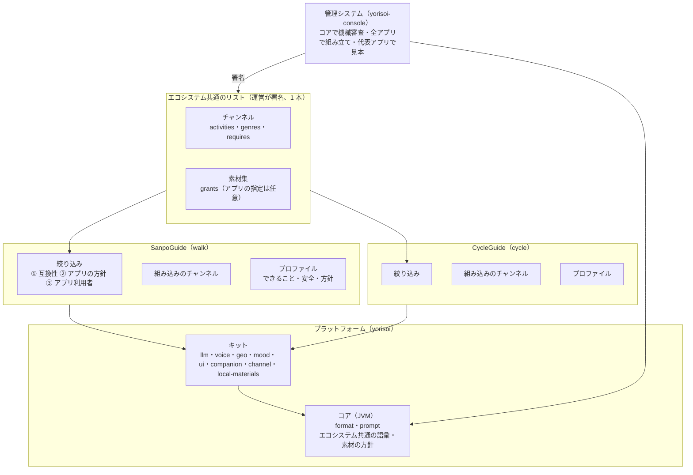

# yorisoi エコシステム

| 項目 | 内容 |
|---|---|
| 文書ID | ECOSYSTEM |
| 対象 | yorisoi のエコシステムと共通基盤 |
| 読む人 | アプリ開発者、チャンネル提供者、素材提供者、運営、学習者 |
| ステータス | 承認済 |
| 関連 | [関係者と用語](roles-and-vocabulary.md)、[方針](#決まり)、[技術契約](../contracts/README.md) |

**yorisoi** は、場所や状況に応じてアプリ利用者に語りかける付き添いアプリと、それらが共通に使う仕組みからなるエコシステムです。アプリは、散策を支援する **SanpoGuide** と、自転車の走行に付き添う **CycleGuide** です。

## 構成

| 名前 | 役割 | 文書の置き場所 |
|---|---|---|
| **yorisoi-platform** | 付き添いアプリ間で共有するライブラリ、形式、語彙を提供する | このリポジトリの [共通文書](../README.md) と実装 |
| **アプリ** | 共通基盤を使い、対象の過ごし方に合った体験を提供する | 各アプリのリポジトリ（[yorisoi-sanpoguide](https://github.com/duwenji/yorisoi-sanpoguide)・[yorisoi-cycleguide](https://github.com/duwenji/yorisoi-cycleguide)）。SanpoGuide は[アプリ別手引き](https://github.com/duwenji/yorisoi-sanpoguide/blob/main/docs/manual/README.md)も参照 |
| **yorisoi-console** | チャンネルや素材集の申請・審査・配信を扱う管理システム。運営の AI の中継、スポットのタイルの配信、その場の素材（スタジオと一言）の配信も置く | [yorisoi-console の文書](https://github.com/duwenji/yorisoi-console/tree/main/docs) |
| **yorisoi-tutorial** | 仕組みを学ぶための説明を提供する。規範や契約の正本にはしない | [yorisoi-tutorial](https://github.com/duwenji/yorisoi-tutorial) |

## 決まり

共通部分の分け方と、チャンネル・素材集をアプリをまたいでどう扱うかの決まりです。

### 全体と層

| No. | 論点 | 決定 |
|---|---|---|
| E-1 | 目的 | 付き添いアプリを、要望に応じて作れるプラットフォームにする。SanpoGuide はその最初のアプリ。チャンネル提供者・素材提供者・運営はアプリをまたいで共通 |
| E-2 | 層 | 3 層に分ける。**コア**（JVM、Android に依存しない。アプリと管理システムが同じコードを使う）、**キット**（Android の AAR。Android に依存しない `kit-companion`・`kit-channel` は JVM）、**アプリ**。下の層は上の層を知らない |
| E-3 | コア | `core-format`（チャンネルの形式の骨格・スロット・署名・ZIP の確認・きっかけ・エコシステム共通の語彙。素材提供者の記述と方針・素材集・地域・タグの一覧と、リストの検証もパッケージとして含む）、`core-prompt`（`PromptTemplates`） |
| E-4 | キット | `kit-llm`（`LlmClient`・Claude／OpenAI 互換・`KeyCipher`・運営の AI の中継の `RelayClient`・`OperatorAi`・自分のキーの 1 日の呼び出しの数 `AiUsage`・使わない返事の判定 `OutputCheck`）、`kit-voice`（`Speaker`・オーディオフォーカス・`AmbientPlayer`・`Voices`）、`kit-geo`（運営のスポットのタイル `SpotTiles`・Overpass・`Poi`・`Shape`・`SpotFacts`・よく通る道 `FrequentWay`・ルート・`SpotPhotos`・地図・天気・日の入り）、`kit-mood`（`Mood`・`MoodSource`・`MoodTheme`・`MoodScene`）、`kit-ui`（どのアプリにも共通の見た目: よりそいの緑の配色 `YorisoiTheme`・画面の上部のバー `ScreenBar`・ホーム画面のアイコンの緑の背景。アプリどうしは同じ緑にし、見分けはアイコンの絵に任せる）、`kit-companion`（話す判断のエンジンと、開発者モードの記録 `SessionRecorder`。JVM）、`kit-channel`（チャンネルの扱い: `Station`・スロットからのプロンプトの組み立て・組み込みのチャンネルの読み込み・第三者のチャンネルの取り込み・前もって取る素材の計画・素材提供者・通報）、`kit-local-materials`（区画ごとに運営から取る素材のアプリ側: 組み込みの素材提供者 `builtin:studio`・`builtin:note`・`LocalFeed`・API-LOCAL-MATERIALS の `LocalClient`・スタジオの音声・一言を声で置く）。アプリにあったコードは、2 本目のアプリ（CycleGuide）が使う段階の前に、使うものから移す。移すときに散歩だけの前提（間隔の値・散歩の記録・散歩の状態）を外し、値はアプリが持つ。画面はアプリに置く（共通の見た目の部品は `kit-ui`） |
| E-5 | アプリが持つもの | プロファイル（E-6）、判定のルール（散歩なら施設の案内・スポットの選び方）、プロンプトの固定部分の中身と定型文、組み込みのチャンネル、画面と常駐サービスのつなぎ込み |
| E-6 | アプリのプロファイル | アプリごとに 1 つ持ち、次を宣言する。① **できること**: 過ごし方（`activities` の値）、実装している出来事・スロット・題材の種類・見せ方。② **安全**: 止められない出来事（散歩なら天気の急変・日の入り・施設の案内）と共通の指示。③ **絞り込みの方針**（E-10 の②）。④ **素材の方針**: コアの方針より厳しくするだけ（映像を出さない、など） |
| E-7 | 話す判断のエンジン | 判定を「ルールの並び」（優先順位・安全かどうか・どの間隔を守るか・判定）として表し、調停（読み上げ中は判定しない、1 件ずつ、切り替えの直後は控える、間隔）を `kit-companion` が受け持つ。アプリはルールを並べるだけにする。安全のルールは頻度とチャンネルを無視する |
| E-28 | チャンネルと素材 | エコシステムは**チャンネル**と**素材**の 2 つで組み立てる。チャンネルは、素材を出すかどうか・いつ・どのように出すかを決める（[CHANNELS](channels.md)）。素材はアプリ利用者に届く中身で、組み込み・素材集・チャンネルに同梱の素材・スタジオ・一言の種類があり、種類ごとに作る人と責任が決まっている（[MATERIALS](materials.md) D-2）。出し方は、アプリの方針 ＞ アプリ利用者の設定（絞るだけ）＞ チャンネルの順に決まる（MATERIALS D-37）。責任の層（[AI-ROLES](ai-roles.md)）では、チャンネルが演出、素材集が根拠、AI が実演、アプリが枠、運営が考査に当たり、人の言葉をそのまま出す素材（スタジオ、一言）は人の発言の層に当たる（MATERIALS D-38） |

### チャンネル

| No. | 論点 | 決定 |
|---|---|---|
| E-8 | チャンネルとアプリの関係 | チャンネルは**エコシステム共通**にし、特定のアプリには結びつけない（`channel.json` にアプリの ID を持たせない）。1 つのアプリは複数のチャンネルを並べる。チャンネルは何を前提にしているかを宣言する: `activities`（合う過ごし方。共通の一覧から選ぶ。例: walk・cycle）、`genres`（アプリ利用者が探すときの分類。共通の一覧から）、`requires`（これがないアプリでは成り立たないもの: スロット・題材の種類・見せ方） |
| E-9 | 語彙の置き場所 | 出来事・スロット・スポットの種類・過ごし方・ジャンルの語彙は、**エコシステム共通の一覧**としてコア（`core-format`）に置く。アプリはその一部を実装し、どこまで実装しているかをプロファイルで宣言する。値を足すときはコアの版を上げる |
| E-10 | アプリの絞り込み | 3 段で行う。① **互換性**（自動）: チャンネルの `activities` にアプリの過ごし方が入っていて、`requires` をアプリが満たす。② **アプリの方針**（プロファイル）: 言語・ジャンル、特定のチャンネルを除く・推す。③ **アプリ利用者の絞り込み**（画面）: ジャンル・チャンネル提供者 |
| E-11 | 組み込みのチャンネル | アプリごとに持つ（SanpoGuide は 6 本）。組み込みのチャンネルを、審査を経てエコシステムのリストに出すこともできる（任意） |
| E-12 | 知らない値の扱い（API-CHANNEL-PACKAGE F-5 の当て方） | 確かめる場所で分ける。**管理システム**: 厳しく確かめ、エコシステム共通の語彙にない値は拒む。**アプリ**: `requires` と制限の項目（`skip` など）に知らない値があれば、そのチャンネルを出さない（制限を読み落とすと、チャンネル提供者の意図より緩くなるため）。任意の項目（実装していない出来事のきっかけ・スロットなど）に知らない値があれば、その部分だけ使わない（使わなくても安全側に倒れるだけのため） |
| E-13 | 安全 | 止められない出来事、共通の指示（`shared/guard`）、見せ方の安全（API-CHANNEL-PACKAGE F-8）、素材の方針（API-MATERIALS P-1・P-2）は、**アプリ側の固定部分**に置く。素材を出す順番は MATERIALS D-37。チャンネルにはこれらを書く項目がないので、どのアプリで使われても、そのアプリの安全の決まりが必ずかかる（CHANNELS C-7 は変わらない） |

### 素材集

| No. | 論点 | 決定 |
|---|---|---|
| E-14 | 素材集とアプリの関係 | 素材集は**既定でどのアプリでも使える**。素材提供者は、利用許諾（`grants`）に使ってよいアプリを任意で書ける（書かなければ全アプリ）。素材集の審査はアプリをまたいで 1 回にする |
| E-15 | タグの一覧 | エコシステム共通の 1 つにし、コア（`core-format`）に置く。アプリごとの拡張は認めない（同じ素材集が、アプリによって当たったり当たらなかったりするのを避けるため） |
| E-16 | 素材の方針 | `ProducerPolicy`（第三者は前もって取得するだけ・題材を外に伝えない・生成しない）はコアに置き、アプリは緩められない（厳しくするだけ。E-6 ④）。素材提供者には「どのアプリに出しても扱いが同じ」こと、アプリ利用者には「どのアプリでも位置が漏れない」ことを保証する。素材の要求の文脈（`MaterialContext`）は汎用にし、散歩の情報（`WalkSession`・天気など）はアプリが組み込みの素材提供者に渡す。題材の「出来事」はプロファイルが実装する出来事に限る（素材集の `about` はスポット・地点だけなので、素材集の形式は変わらない） |

### 管理システム

| No. | 論点 | 決定 |
|---|---|---|
| E-17 | リスト | **エコシステムで 1 本**のままにし、チャンネルの `activities`・`genres`・`requires` を載せる。アプリが端末で絞り込む。取り下げ・鍵の移し替え（`publisherChange`・`producerChange`）もこの 1 本で扱う |
| E-18 | 審査 | 機械審査は、コアのエコシステム共通の語彙だけで確かめる（アプリごとのプロファイルを読まない）。審査の見本は 2 段に分ける（E-26）。そのため、各アプリはプロンプトの固定部分を「プロンプト・パック」として公開する。チャンネル提供者の画面には「このチャンネルが出るアプリ」を出す（互換性の判定はコアの同じコードで行う）。素材提供者の画面には、自分の素材集を使っているチャンネルとアプリを出す（MATERIALS D-18 の拡張） |

### 構成と進め方

| No. | 論点 | 決定 |
|---|---|---|
| E-19 | リポジトリ | 共通パッケージ（コアとキット）は `yorisoi-platform`、アプリはアプリごとのリポジトリ（SanpoGuide は `yorisoi-sanpoguide`）、管理システムは `yorisoi-console` に置く。アプリと管理システムは、`yorisoi-platform` が GitHub Packages に公開した版と、アプリが公開するプロンプト・パックを版で固定して使う。コアとアプリを同時に直すときは、手元の Gradle の設定で `yorisoi-platform` のソースに差し替える（composite build）。エコシステム全体の文書（方針・要件・契約・規程・共通用語・関係者の課題。[docs の案内](../README.md#文書の置き場所)）は `yorisoi-platform` に置く。理由: アプリごとに出す時期・権限・Play の設定が変わり、1 つのアプリの変更がほかのアプリの CI を壊すのを避ける。アプリが自分の都合で共通パッケージの版を上げられる |
| E-20 | 進め方 | 共通部分は、2 本目のアプリ（E-23）を作りながら直す。散歩だけに合わせた抽象を先に固めない |

### 名前・2 本目のアプリ・語彙

| No. | 論点 | 決定 |
|---|---|---|
| E-22 | エコシステムの名前 | **yorisoi**（寄り添い。移動のそばにいて支える相手）。プラットフォームの Kotlin のパッケージと公開の座標は `io.github.duwenji.yorisoi`（例: `io.github.duwenji.yorisoi.core.format`）。管理システムは `yorisoi-console`、チュートリアルは `yorisoi-tutorial`。アプリの `applicationId`・パッケージ名もこの下に置く（SanpoGuide は `io.github.duwenji.yorisoi.sanpoguide`）。github.com/Yorisoi は別の人のアカウントのため、`io.github.yorisoi` は使わない |
| E-23 | 2 本目のアプリ | **サイクリングの伴走**（`cycle`）。名前は **CycleGuide**（リポジトリ `yorisoi-cycleguide`、アプリの ID `cycleguide`）。地図・天気・日の入りの部品をそのまま使え、速度の違いで距離・間隔・判定の抽象を試せ、歴史探訪などのチャンネルを散歩と共有できるため。多くの都道府県で、周りの音が聞こえない状態での自転車の運転が規則で禁じられていることから、プロファイルは次を前提にする: イヤホンを前提にせず、周りの音が聞こえる状態で使うよう注意を促す（音の出先は端末に任せる。Bluetooth のイヤホンがつながると Android は音をそちらに出すため）、背景音は使わない、走行中は画面を出さない。この前提で成り立たないと分かったときの次点は、乗り物の車窓ガイド |
| E-24 | `activities` の最初の一覧 | `walk`・`cycle` の 2 つだけで始める。値は、そのアプリを作ると決めたときにコアのマイナー版で足す（実装しているアプリのない値は、どのアプリでも確かめられない宣言になるため） |
| E-25 | チャンネル提供者によるアプリの除外 | 入れない。出す範囲は `activities`・`requires` で絞る。アプリ単位の除外を認めると、互換性の判定と審査の見本がアプリごとに戻るため。要望が出たら `excludeApps` を足すことを検討する（見直しの条件） |
| E-26 | 審査の見本 | 2 段に分ける。① **組み立ての確認**は、互換性のあるすべてのアプリのプロンプト・パックで行う（AI を呼ばず、組み立てとスロット・上限の確認だけなので費用がかからない）。② **AI に話させる見本**は、`activities` の値ごとに代表のアプリ 1 つで作る（費用と運営の確認の量を、アプリの数ではなく過ごし方の数に比例させる）。最初の代表は `walk` が SanpoGuide、`cycle` が CycleGuide |
| E-27 | アプリ利用者の呼び方 | エコシステム全体の文書では「**アプリ利用者**」と呼び、各アプリの画面と文書ではアプリの呼び方を使う（SanpoGuide は「散策者」）。対応する共通語彙は [関係者と共通用語](roles-and-vocabulary.md) に記載する。チャンネル提供者・素材提供者・運営はアプリをまたいで同じ呼び方にする |

## 制約

- 安全に関わる決まり（止められない出来事・共通の指示・見せ方の安全・素材の方針）は、チャンネル・素材集からは変えられない。アプリは厳しくすることだけできる
- コアは Android に依存しない（管理システムが同じコードで確かめるため）
- 運営の担当者は 1 人（CHANNELS C-10）。アプリが増えても審査の単位を増やさない

## 見直しの条件

- 2 本目のアプリで、プロファイル・エコシステム共通の語彙の形が合わなかったとき
- 屋内など、位置を使わない付き添いアプリの要望が出たとき（`kit-geo` と題材の前提が変わる）
- チャンネル提供者から、特定のアプリにだけ出したい・出したくないという要望が出たとき（E-25）
- 代表のアプリだけの見本では、審査で見落としが出たとき（E-26）
- サイクリングのアプリで、音の出し方の前提（E-23）が規則やアプリ利用者の使い方と合わなかったとき

## 未決事項・リスク

未決事項はない。

リスク:
- エコシステム共通の語彙が、アプリの数だけ膨らむ
- リポジトリを分けたので、コアとアプリを同時に直すときに公開の手順が 1 つ増える（E-19 の手元の差し替えで、試すことは同時にできる）
- サイクリング中の話しかけが、アプリ利用者の注意をそらすおそれがある（走行中は画面を出さず、話す間隔を散歩より長くする。T-2 で確かめる）

## 文書の正本と置き場所

このリポジトリは、複数のリポジトリが従う決まりを扱います。画面や配備など特定アプリ・システムだけの実装手順は、そのリポジトリの文書を正本にします。

| 文書の種類 | 用途 | 正本 |
|---|---|---|
| 方針（決まり） | エコシステムの方針と設計判断 | [エコシステム](yorisoi-ecosystem.md#決まり)・[チャンネル](channels.md)・[素材](materials.md)・[生成 AI の役割](ai-roles.md)。運営の AI とスポットのタイルの方針は各契約 |
| 技術契約（API） | 形式、境界、相互運用上の振る舞い | [技術契約一覧](../contracts/README.md) |
| ポリシー | 合意した方針に基づく審査・運用基準 | [チャンネル審査基準](../policies/channel-review.md)、[一言の利用規約](../policies/notes-terms.md)、[スタジオの決まり](../policies/studio-rules.md) |
| 用語・関係者 | エコシステムの共通概念と呼び方 | [関係者と用語](roles-and-vocabulary.md) |
| アプリ別手順 | 個別アプリの操作・試用・運用 | [SanpoGuide 手引き](https://github.com/duwenji/yorisoi-sanpoguide/blob/main/docs/manual/README.md) |
| 未完了の作業 | エコシステムに関する未完了事項と検討項目 | [エコシステム TODO](../TODO.md) |

### 文書の権威

方針の文書は決まり、API 契約はシステム境界の形式・振る舞いを定めます。ポリシーは承認済みの決定に沿った運用基準、ガイドは読者が手順を実行するための説明です。TODO や未承認の提案は、決定済みの仕様を上書きしません。文書間に矛盾があれば、矛盾を解消するまでは関連する決定や契約を確認し、未決であることを明示します。

## 変更の境界

- このリポジトリの契約や語彙を変えるときは、利用するアプリと管理システムへの影響を確認します。
- 特定アプリの挙動・画面・公開状態は、そのアプリ固有の情報として扱います。現在の SanpoGuide の手順や公開状態を、他のアプリにも当てはまる仕様として読まないでください。
- 学習用の説明は、対応する方針・契約・ポリシーを正本として参照します。

### 判断を検討するとき

方針を新しく決める・変えるときは、検討している間だけ `docs/decisions/` に ADR（案と比べた理由を書く）を置きます。承認したら、決まりを上の方針の文書や契約に移し、ADR は消します。比べた案と理由は、その変更のプルリクエストに残ります。

SanpoGuide 固有の現在の状態は、[SanpoGuide 手引きの案内](https://github.com/duwenji/yorisoi-sanpoguide/blob/main/docs/manual/README.md)で確認できます。
