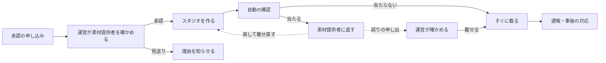

# スタジオの決まりと素材提供者の承認の基準

| 項目 | 内容 |
|---|---|
| 版 | 2 |
| 状態 | 承認済み |
| 根拠 | [MATERIALS](../overview/materials.md) D-37・D-39・D-40・D-48、[REQ-STUDIO](../requirements/REQ-STUDIO.md) D-14〜D-19・F-13・F-14・F-19・F-24、[API-LOCAL-MATERIALS](../contracts/API-LOCAL-MATERIALS.md) |
| 読む人 | スタジオを出したい素材提供者（承認の申し込みの前に）と、承認し事後に対応する運営 |
| 問い合わせ先 | duwenji@gmail.com |

## 適用範囲

本書は、スタジオに適用します。スタジオは素材の種類の 1 つで、運営が承認した素材提供者が、場所と期間を決めて載せるお知らせです。その場所に来たアプリ利用者に、「〇〇からのお知らせです。」に続けて読み上げられます。いつ・どのように読み上げるかは、アプリ利用者が使っているチャンネルが決めます。チャンネルによっては、分類を絞ったり、読み上げなかったりします（MATERIALS D-37・D-48）。

運営は、スタジオを一つずつ確かめません。スタジオを出す**素材提供者**を承認し、スタジオの中身は素材提供者の責任で載せます（MATERIALS D-39）。運営は、載せる前の自動の確認と、通報などを受けての事後の対応で守ります。

チャンネルと素材集の審査は、[第三者のチャンネル 審査基準](channel-review.md) に従います。スタジオは AI の語りの根拠にならず、チャンネルの審査とは別です。

## 1. 素材提供者の承認

### 1.1 申し込める人

素材提供者です。管理システムのアカウントで素材提供者として始めれば、素材集を出していなくても申し込めます。チャンネル提供者がスタジオを出したいときも、同じアカウントで素材提供者として申し込みます。店・神社やお寺・商店街・観光協会・博物館・郷土史家・イベントの主催者・ガイドなど、団体でも個人でもかまいません。

### 1.2 申し込むときに出すもの

| 項目 | 内容 |
|---|---|
| 本人確認 | 団体は、公式サイト・公式 SNS に載っている連絡先から運営に届くメールなど、その団体であることが分かるもの。個人は、運営が本人と連絡が取れることが分かるもの |
| 団体・人の説明 | どんな団体・人か、どこで活動しているか |
| 載せたいもの | どんなお知らせを、どの辺りで、どれくらいの頻度で載せたいか |
| 出す名前 | スタジオの読み上げに使う名前（40 字まで）。個人は、本名の代わりに屋号・活動名でもよい |
| 同意 | 本書の「2. スタジオの決まり」に同意すること |

### 1.3 運営が確かめること

| No. | 確かめること |
|---|---|
| 1.3.1 | 本人確認ができる。名乗っている団体・人と、申し込んだ人が同じである |
| 1.3.2 | 出す名前が、ほかの団体・人と紛らわしくない。ほかの団体・人の名前を使っていない |
| 1.3.3 | 載せたいものが、主に「2.2 載せないスタジオ」に当たらない |
| 1.3.4 | 過去にスタジオの承認を取り消されていない（取り消しの期間が過ぎたものを除く） |

### 1.4 判定

| 判定 | 意味 | 素材提供者への連絡 |
|---|---|---|
| 承認 | スタジオを作れるようになる | 承認した日と、出す名前 |
| 見送り | 今は承認しない | 理由（本書の項目番号を付ける）。直せるものは、直して申し込み直せる |

- 承認は無料です
- 申し込みが届いてから **5 日以内** に判定するのを目安にします。担当者 1 人で確かめているため、目安です
- 出す名前を変えるときは、申し込み直してください

## 2. スタジオの決まり

承認を受けた素材提供者は、次の決まりを守ってください。

### 2.1 素材提供者の責任

- スタジオの中身の責任は、素材提供者が持ちます。スタジオによってほかの人や店に損害を与えたときは、素材提供者がその責任を負います
- スタジオには、必ず素材提供者の名前が出ます。自分のお知らせであることを隠さないでください（景品表示法の、事業者の表示であることを隠さない考え方）
- 事実と違うこと、誤解させることを載せないでください
- 場所と期間は、そのお知らせに関係する範囲にしてください（店の周り、催しの会場の周り、催しの期間など）
- 音声は、素材提供者が使ってよいものだけにしてください。曲・効果音の権利、ほかの人の声を使うときはその人の同意を、素材提供者が確かめてください

### 2.2 載せないスタジオ

散歩・走行の最中に、知らない人に聞かせるものとして合わないため、次のスタジオは載せられません。

| No. | 載せないもの | 例 |
|---|---|---|
| 2.2.1 | 安全を損なう誘い | 私有地・線路・立入禁止の場所に入らせる、走行中に画面を見させる |
| 2.2.2 | 連絡先 | URL・電話番号・メールアドレス・SNS のアカウント（文字にも音声にも入れない）。場所と名前で探せるようにしてください |
| 2.2.3 | 人を傷つけるもの・個人の情報 | ほかの人や店への攻撃、比べて悪く言うこと、個人を特定できる情報 |
| 2.2.4 | 政治・宗教 | 選挙運動、政党・政治団体の宣伝、宗教の勧誘。神社やお寺の祭り・行事・拝観のお知らせは載せられます |
| 2.2.5 | お金にかかわる勧誘 | 投資・金融商品・暗号資産、貸金、ネットワークビジネス |
| 2.2.6 | 出会い・交際 | 出会いの場の宣伝、交際の相手探し |
| 2.2.7 | 賭け事 | 公営競技・ぱちんこなどを含む |
| 2.2.8 | 酒類・たばこ | 酒類・たばこの宣伝。酒類を出す店の、料理や催しのお知らせは載せられます（飲酒をすすめない） |
| 2.2.9 | 健康・医療の効き目 | 医薬品・健康食品・施術の効き目をうたうもの |
| 2.2.10 | 成人向け・暴力的なもの | 性的な内容、暴力的な内容 |
| 2.2.11 | 違法なもの・権利を侵すもの | 法律に反するもの、許可なく使った文章・写真・音声・曲 |
| 2.2.12 | なりすまし | ほかの団体・人のふりをすること |

### 2.3 一言で宣伝しない

素材提供者や、素材提供者に頼まれた人・従業員が、一言で客を装って宣伝しないでください（[一言の利用規約](notes-terms.md) 2-5）。景品表示法のステルスマーケティングの告示に当たることがあります。

### 2.4 料金

スタジオは、今は無料です。料金を決めるときは、本書の版を上げ、前もって知らせます。

### 2.5 分類

スタジオには、中身に合う分類を 1 つ選んでください（[API-MATERIALS](../contracts/API-MATERIALS.md)「スタジオの分類」）。チャンネルは分類で出すスタジオを選ぶので、中身と違う分類を選ぶと、合わない場面で読み上げられます。

| 分類 | 例 |
|---|---|
| 寺社・その行事 | 祭り、拝観、御朱印の案内 |
| 催し | 豆まき、朝市、ライブ |
| 飲食 | 新しい料理、季節のメニュー |
| 買い物 | 売り出し、新しい品 |
| 観光の案内 | 見どころ、案内所、ガイドツアー |
| 自然・季節 | 花の見ごろ、紅葉 |
| 展示・文化 | 展覧会、講演 |
| 交通・通行 | 通行止め、臨時の駐輪場 |
| 地域のお知らせ | 清掃の日、町内の行事 |

## 3. 載せる前の自動の確認

スタジオは、載せる前に自動で確かめます（REQ-STUDIO D-18）。

1. 長さ・大きさ・形式を確かめます（文字 200 字まで、音声 30 秒まで、区画 9 つまで、期間 30 日まで）
2. 音声を文字に起こし、文字と起こした文を、運営の AI で「2.2 載せないスタジオ」の 2.2.1〜2.2.3 などに当たるか、選んだ分類が中身と合わないか（2.5）を確かめます
3. 当たらなければ、すぐに載ります。当たれば載せず、当たった項目を素材提供者に返します

返されたスタジオは、直して載せ直してください。確認が誤っていると思うときは、管理システムから運営に申し出てください。運営は **7 日以内** に確かめ、載せるか載せないかを理由とともに知らせます。AI の指摘だけで載せないと決めることはしません。

## 4. 通報と事後の対応

### 4.1 届けるのを止めるとき

| 場合 | 扱い |
|---|---|
| 3 台以上の端末から通報されたとき | 運営が確かめるまで届けない |
| 安全（`danger`）・権利（`rights`）の通報があったとき | 1 件でも、運営が確かめるまで届けない |
| そのほかの通報 | 運営に知らせ、届けるのは続ける |

止めたときは、素材提供者に知らせます。

### 4.2 運営が判断するまでの目安

| 通報 | 判断までの目安 |
|---|---|
| 重い（2.2.1・2.2.3・2.2.11・2.2.12 に当たるもの） | 受け取ってから 24 時間以内 |
| 軽い（そのほか） | 7 日以内 |

### 4.3 判断

| 判断 | 当てはまるとき | 扱い |
|---|---|---|
| 戻す | 決まりに反していない | 届けるのを再開し、素材提供者に知らせる |
| 消す | 決まりに反している | そのスタジオを消し、理由を素材提供者に知らせる |
| 承認を期間を決めて止める | 軽い違反を直さない、軽い違反を繰り返す | 1〜3 か月、スタジオを作れなくする。載っているスタジオも届けない |
| 承認を取り消す | 重い違反、なりすまし、権利侵害の繰り返し、期間を決めて止めたあとの違反 | スタジオを作れなくし、載っているスタジオを消す。申し込み直しは 1 年たってから |

- 理由には本書の項目番号を付け、管理システムの操作の記録に残します
- 通報した人には、受け取りの返信をしません

### 4.4 権利の申し立て

写真・文章・音声・曲などの権利を持つ人は、[第三者のチャンネル 審査基準](channel-review.md) の「権利の申し立て」と同じ窓口と流れで申し立てられます。明らかなときは、確かめる前に届けるのを止めます。

## 未決事項

| No. | 内容 | 関係 |
|---|---|---|
| 1 | 個人の本人確認の方法（運営が本人と連絡が取れることで足りるか） | 素材提供者の受け付けを始める前 |
| 2 | 判定・判断への異議の申し立て | 運営の担当者が増えたとき（審査基準の未決事項 2 と同じ） |
| 3 | スタジオの料金と「広告」の表示 | REQ-STUDIO U-9 |
