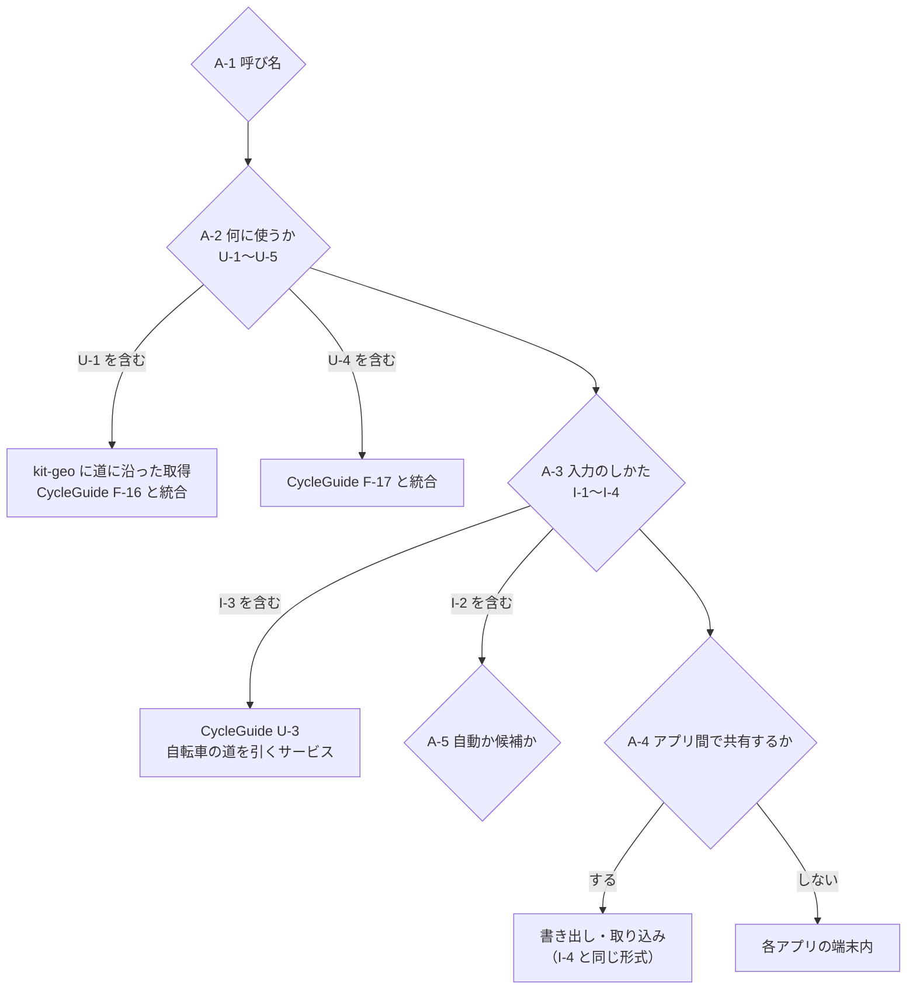

# requirements-refinement 記録: 散策・サイクルの道（区間）

## 基本情報
| 項目 | 内容 |
|------|------|
| テーマ | 散策・サイクルでよく通る道（区間）を洗い出して使う。区間を入力できるようにする |
| 記録日 | 2026-10-28 |
| 承認者 | 開発者（duwenji） |
| 実行モード | balance |
| 関わるもの | platform kit-geo、yorisoi-sanpoguide、yorisoi-cycleguide |

## 段階1〜2: 準備・詳細化

### 背景（記録から分かったこと）
- CycleGuide の走行の記録（2026-10-26〜28 の 5 回）では、後半の 3 回の道の 98〜100% が、前に走った 300 m 四方の区画の中だった。同じ道を朝夕に走っている
- それでも、2026-10-28 には前方の見どころが 23〜34 分空白になった。Overpass がすべてのサーバーで失敗した区間で、端末に残っている答え（`SpotCache`）がなかった。同じ道なのに、前の走行でも取れていなかったところだった
- 同じ見どころを毎回同じように話している（亀有リリオパーク・東和親水公園・曳舟川親水公園などが、朝と夕方の両方で出た）
- 失敗後の待ちを短くする対策は別にした（platform #44・cycleguide #37）。空白は縮むが、サーバーが混んでいる間は取れないままになる

### 今ある近いもの
| もの | どこ | 中身 | 区間との関係 |
|---|---|---|---|
| 散策プラン | SanpoGuide | テーマ・時間・距離・立ち寄るスポット。道は持たない | 立ち寄り先は区間の上の点として使える |
| チャンネルの区間 | SanpoGuide の記録（`WalkRecord.stations`） | チャンネルを使った時間の範囲 | **言葉がぶつかる**（段階4 A-1） |
| 再訪の判定 | SanpoGuide `HistoryStore` | 前に行ったスポットか | 「同じ道」の判定の考え方は近い |
| ルート（F-15〜17） | CycleGuide 要件・段階 3 | 行き先までのルート、ルートに沿った前もっての取得、外れたら知らせる | **前もっての取得（F-16）は同じ仕組みになる** |
| 走行・散歩の履歴 | 両アプリ（端末内） | 走った道の点の列 | 洗い出しの材料 |
| `RouteClient` | kit-geo | FOSSGIS の OSRM（歩きだけ。自転車は U-3） | 入力で始点・終点から道を引くのに使える |

## 段階3: 開発者の入力

### 開発者の入力（2026-10-28）
- 散策・サイクルの区間を洗い出して使いたい
- 区間を入力できるようにしてほしい

### 期待成果（案。段階7 で確定する）
- よく通る道では、サーバーが混んでいても前方の見どころが空白にならない
- よく通る道ならではの話ができる（毎回同じ話を繰り返さない、など）
- 自分で決めた道（通勤の道・好きな川沿いなど）を、アプリに覚えさせられる

### スコープ（案）
- 区間の洗い出し（履歴から）と、区間の入力・一覧・名前の変更・削除
- 区間を使う機能（段階4 の U-1〜U-5 から段階7 で選ぶ）
- 区間の形と保存を、kit-geo（両アプリ共通）に置く

### 非スコープ（案）
- 曲がる方向の案内（ナビゲーション）。CycleGuide 要件の非スコープと同じ
- 区間を他の人と共有する・サーバーに上げる（チャンネルとして配るなら別の検討）
- iOS

### 非機能要件（案）
- プライバシー: 区間は自宅や通勤の道になりやすい。端末の中だけに置き、外に出さない。記録を消す操作で一緒に消せる
- 通信・電池: 前もっての取得は Wi-Fi のときに限る、などの上限を置く
- 公開サーバーへの負荷: 前もっての取得は、区間の長さに比例して問い合わせが増える（600 m ごとに 1 回）。1 回の取得の量と間隔に上限を置く
- 安全: 区間の入力・選択は止まっているときだけ（CycleGuide S-2）

### 主要ドメイン概念
- エンティティ候補: 区間（名前・道の点の列・長さ・種類〔散策／サイクル〕・作り方〔洗い出し／入力〕・通った回数・最後に通った日）、区間の見どころ（区間に沿ったスポットの答え）、履歴の走行・散歩
- 関係候補: 区間 1 — 多 通った記録、区間 1 — 多 見どころ、区間 多 — 1 アプリ（SanpoGuide と CycleGuide は別のアプリなので、データは分かれる）

## 段階4: 曖昧点と依存の分析

### 曖昧点（開発者に確かめること）
| ID | 論点 | なぜ決める必要があるか |
|---|---|---|
| A-1 | 呼び名。「区間」は SanpoGuide でチャンネルの区間に使っている | 画面・文書・コードの名前がぶつかる。「よく通る道」「マイコース」「道」などにするか |
| A-2 | 「活用」で何をしたいか（下の U-1〜U-5） | 範囲と段階が大きく変わる |
| A-3 | 入力のしかた（下の I-1〜I-4） | 画面の作りと kit-geo の依存（ルートを引くサービス）が決まる |
| A-4 | 散策とサイクルで区間を共有したいか | 別のアプリなので、共有には書き出し・取り込みか、共通の置き場所が要る |
| A-5 | 洗い出しは自動で区間にするか、候補を見せて選んでもらうか | 勝手に覚えるとプライバシーの印象が悪い |

### 使い方の候補（A-2）
| ID | 使い方 | 効くこと | 重さ |
|---|---|---|---|
| U-1 | 区間に沿ったスポットを前もって取っておく（Wi-Fi のとき、走る前） | 今日の空白がなくなる。CycleGuide F-16 と同じ仕組み | 中（kit-geo に区間に沿った取得） |
| U-2 | よく通る区間では、同じ見どころを同じように話さない（間を空ける・別の切り口で話す・話さない） | 毎日の通勤で飽きない | 小〜中（回数を数える。プロンプトに「前にも話した」を渡す） |
| U-3 | 区間に入ったとき・出たときの一言、区間の名前やメモを話に使う | 自分の道らしさ | 中 |
| U-4 | 区間から外れたら知らせる | CycleGuide F-17 と同じ | 中 |
| U-5 | 区間ごとの振り返り（通った回数・時間・季節の変化） | 記録の楽しみ | 小〜中 |

### 入力のしかたの候補（A-3）
| ID | 入力 | 良いところ | 気になるところ |
|---|---|---|---|
| I-1 | 履歴の走行・散歩を選び、そのまま（または始点・終点を選んで一部を）区間として保存 | 道を引くサービスが要らない。実際に通った道になる | 一度通らないと作れない |
| I-2 | 洗い出しの候補（何度も通った道）から選んで保存 | 手間が少ない | 洗い出しの作りが要る |
| I-3 | 地図で始点・終点（と経由点）を置き、道を引いて保存 | 通ったことのない道も作れる | 自転車の道を引くサービスが未決（CycleGuide U-3） |
| I-4 | GPX ファイルの取り込み | ほかのアプリの道を使える | ファイルの扱いの画面が要る |

### 依存
- I-3 は CycleGuide U-3（自転車のルートを引くサービス）に依存する
- U-1 は kit-geo の「道に沿った取得」が要る。CycleGuide F-16 と同じなので、まとめて作れば段階 3 の一部を前倒しできる
- 区間の形と保存を kit-geo に置くと、platform の版上げと両アプリの追従が要る

### 矛盾・注意
- CycleGuide 要件では、ルート（F-15〜17）は段階 3。区間を先にやるなら、要件の段階を見直す
- 洗い出しを自動で行うと「自宅の場所が分かる」データが増える。SanpoGuide・CycleGuide のプライバシーポリシーの「端末内の記録」の説明に足す必要がある

## 段階5: 論点フロー

## 段階6: 要件整理案

| 項目 | 案1 小さく始める | 案2 標準（推奨） | 案3 広く |
|---|---|---|---|
| 使い方 | U-1（前もっての取得） | U-1 ＋ U-2（同じ話を繰り返さない） ＋ U-5（区間の振り返り） | 案2 ＋ U-3（区間の一言・メモ） ＋ U-4（外れたら知らせる） |
| 入力 | I-1（履歴から保存） | I-1 ＋ I-2（洗い出しの候補から選ぶ） | 案2 ＋ I-3（地図で引く） ＋ I-4（GPX） |
| 洗い出し | なし | 候補を見せて選ぶ（自動では保存しない） | 案2 と同じ |
| アプリ間 | 共有しない | 共有しない（形式は共通にしておく） | GPX で書き出し・取り込み |
| 置き場所 | kit-geo（形・保存・道に沿った取得）、各アプリ（画面・使い方） | 同じ | 同じ |
| 先に決めること | A-1 | A-1・A-5 | A-1・A-5・CycleGuide U-3 |
| CycleGuide の要件 | F-16 を区間に沿った取得として前倒し | 案1 と同じ | F-15〜17 を区間に置き換える |
| 今日の空白への効き目 | 効く | 効く | 効く |

推奨は案2。今日の問題（よく通る道での空白）にすぐ効き、道を引くサービス（U-3）の結論を待たずに作れる。I-3・I-4・U-3・U-4 は、案2 を使ってみてから足せる。

## 段階記録
- 実施内容: 段階1〜6（走行の記録の重なりと空白の分析、今ある近いものの洗い出し、曖昧点・使い方・入力の候補、論点フロー、整理案 3 つ）
- 判断根拠: 2026-10-26〜28 の CycleGuide の記録（後半 3 回の道の 98〜100% が既に通った区画、空白は 23〜34 分）
- 承認ステータス: 段階7（要件案の決定）待ち

## 段階7: 要件案の決定（ゲート #1）

### 開発者の決定（2026-10-28）
| 論点 | 決定 |
|---|---|
| 整理案 | 案2（U-1 前もっての取得・U-2 同じ話を繰り返さない・U-5 振り返り。入力は I-1 履歴から・I-2 洗い出し） |
| A-1 呼び名 | よく通る道 |
| A-5 洗い出し | 自動でよく通る道にする（候補を見せて選ぶ案ではなく） |
| A-4 アプリ間 | 共有しない |

- ゲート #1 判定: 背景・スコープ・制約が整理され、案が比較でき、受入条件の方向が見えている → 通過

## 段階8: 仕様化

- 成果物: [REQ-FREQUENT-WAYS](../requirements/REQ-FREQUENT-WAYS.md)
- 自動で作ることにしたので、I-2（候補から選ぶ）は「自動の道を保存する・消す」に置き換えた（D-7・F-15）
- 開発者の決定にない、Claude が置いた案（段階9 で確認してもらう）
  - D-5 出発・到着から 200 m を使わない（自動にしたことでプライバシーの重みが増したため）
  - D-6 同じ話を繰り返さないのは、道の上に限らない
  - D-7 自動の道の寿命（60 日）と、消した道を作り直さないこと
  - F-10・F-11 の 24 時間の線引き、F-3〜F-4 の値（U-1 で実機の記録から直す）
  - N-6 1 アプリ 50 本まで

## 段階10: 検証観点

| 観点 | 受入条件 |
|---|---|
| 見つけ方の正しさ（回数・長さ・出発到着の除外） | AC-1・AC-2 |
| 空白の解消（本件のきっかけ） | AC-3・AC-4 |
| 通信・負荷の上限 | AC-3・AC-5・AC-13 |
| 話の繰り返し | AC-6・AC-7 |
| 振り返り・画面 | AC-8・AC-10 |
| 利用者の意思（消す・保存・設定） | AC-9・AC-11・AC-12 |
| プライバシー | AC-12・AC-13、N-2 はポリシーの差分で確認 |

## 段階12: 整合性と未確定事項

- REQ-CYCLEGUIDE F-16（段階 3）と F-6 は同じ仕組み。CycleGuide の要件を書き直す追従が要る（X-3）
- REQ-CYCLEGUIDE S-2（走行中に操作を求めない）と F-18 は整合
- SanpoGuide の再訪の判定と F-9〜F-11 の関係は未確定（U-4）
- 見つけ方の値は未確定（U-1）。受入条件は今の案の値で書き、値を直したら受入条件も直す
- 承認ステータス: 段階9・11・13（仕様・検証観点・要件確定）の承認待ち

## 段階9・11・13: 仕様・検証観点・要件確定の承認

- 開発者が承認（2026-10-28）。段階8 で Claude が置いた案（D-5〜D-7、24 時間の線引き、見つけ方の値、50 本まで）を含む
- ゲート #2・#3 判定: 受入条件が機能・非機能を覆い判定できる。未確定事項は U-1〜U-4・R-1〜R-2 で管理。スコープ外を明示 → 通過

## 段階14: 報告

- 確定した要件: [REQ-FREQUENT-WAYS](../requirements/REQ-FREQUENT-WAYS.md)（F-1〜F-18、N-1〜N-6、AC-1〜AC-13）
- 前提: 公開の Overpass を使う。アプリ間・外部にデータを出さない
- 残課題: U-1〜U-4（設計で決める）、REQ-CYCLEGUIDE F-16 の書き直し（X-3）、両アプリのプライバシーポリシー（N-2）
- 次: 設計（kit-geo の `FrequentWay` の形・保存・見つけ方・前もっての取得、各アプリの画面と話の使い方）
