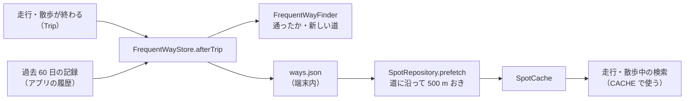

# kit-geo

スポット・ルート・写真・天気・地図の部品です（Android）。

## スポット検索のキャッシュ

スポットと施設は、OpenStreetMap の公開の Overpass サーバーに問い合わせて探します（`OverpassClient`）。公開のサーバーはよく混んでいて、成功しても 20〜30 秒かかり、3 つのサーバーすべてで失敗することもあります。そこで `SpotRepository` に `SpotCache` を渡すと、近くで取った答えを端末に残して使い回します。OpenStreetMap のデータはゆっくりとしか変わらないので、数日前の答えでも散歩には十分です。

```kotlin
val spots = SpotRepository(
    OverpassClient(),
    shops = { /* いまのチャンネルが探すお店の種類 */ },
    cache = SpotCache(File(context.cacheDir, "spots")),
)
```

`cache` を渡さないと、キャッシュを使わずに検索します（失敗したあとに待つのは同じ）。

使う人が設定で変えられるように、次の 2 つを関数で渡せます。検索のたびに読みます。

| 引数 | 既定 | 意味 |
|---|---|---|
| `useCache` | `{ true }` | `false` のあいだは、残した答えを使わず、新しい答えも残さない。残っている答えは消さない（消すのは `SpotCache.clear()`） |
| `freshMs` | `{ SpotCache.FRESH_MS }`（7 日） | そのまま使う答えの新しさ。90 日（`SpotCache.MAX_AGE_MS`）までに切り詰める |

### 検索のしかた

位置が届くたびに、次の順に決めます。

1. 表示中の答えの中心から 300m 以内で、お店の種類が同じなら、何もしない
2. 300m 以内に、同じお店の種類で 7 日（`freshMs`）以内の答えが残っていれば、それを表示する。サーバーには問い合わせない
3. 失敗したあとの待ち時間の間なら、600m 以内に残っている答えを表示して終わる
4. 300m 以内に `freshMs` より古い答えが残っていれば、それをすぐに表示しておき、サーバーに問い合わせる
5. 問い合わせが成功したら、その答えを表示して残す
6. すべてのサーバーで失敗したら、600m 以内に残っている答えを表示し、例外を投げる

1 回の検索は、中心から 600m（お店は 400m、ベンチと自動販売機は 250m）を探します。600m を超えて離れた答えは、その場所のスポットを含まないので使いません。

`onLocation(location, forceRefresh = true)`（画面の「再検索」）は、2 と 3 を飛ばして必ず問い合わせます。

### 速く動くアプリ（自転車など）

作るときに次の 3 つを渡せます。どれも既定は散歩のときと同じです。

| 引数 | 既定 | 意味 |
|---|---|---|
| `searchCenter` | 位置そのもの | 位置から、検索の中心を決める。速く動くアプリは、進む向きの少し先の点にする（`RouteGeometry.destination`・`bearingDeg`）。上の「中心から 300m」も、この中心で数える |
| `signals` | `false` | `true` なら、信号（OSM の `highway=traffic_signals`）の位置も 600m 以内で探し、`trafficSignals` に出す。信号の近くで話さないアプリ用。信号ありの答えと信号なしの答えは、別のものとして残す |
| `facilityKinds` | `FacilityKind.WALK` | 探す施設の種類。散歩はトイレ・水飲み場・自動販売機・休憩所・ベンチ（ベンチと自動販売機は 250m 以内だけ）。自転車のアプリは、駐輪場・コンビニ・自転車店・空気入れ（`bicycle_repair_station` で `service:bicycle:pump=yes` のもの、`compressed_air`）も選べる。散歩の種類のときだけ、選べるようになる前に残した答えをそのまま使う。ほかの種類の答えは別のものとして残す |

### 失敗したあとに待つ

すべてのサーバーで失敗したら、次の問い合わせまで待ちます。待つ時間は、続けて失敗した回数で延ばします。

| 続けて失敗した回数 | 次に問い合わせるまで |
|---|---|
| 1 | 30 秒 |
| 2 | 1 分 |
| 3 | 2 分 |
| 4 以上 | 5 分 |

成功すると、回数は 0 に戻ります。待つのは、混んでいるサーバーに、位置が届くたびに問い合わせ直して負荷をかけないためです。

上の表は既定の値（`SpotRepository.RETRY_DELAYS_MS`）です。速く動くアプリは `retryDelaysMs` で短くできます。5 分待つと自転車は 1 km ほど進み、残っている答えの範囲（600m）を出てしまうためです。

### 残す答え

| 項目 | 値 |
|---|---|
| 1 件 | 1 回の検索の答え（Overpass の JSON そのまま）。ファイル名に、検索の中心・取った時刻・お店の種類・信号を含むか |
| そのまま使う | 7 日以内（`freshMs`。既定は `SpotCache.FRESH_MS`） |
| 残す期間 | 90 日（`SpotCache.MAX_AGE_MS`）。過ぎたものは、次に残すときに消す |
| 大きさ | 合計 10MB まで（`SpotCache.MAX_BYTES`）。超えたら古い順に消す |
| 重なり | 新しい答えを残すとき、同じお店の種類で中心が 150m 以内の古い答えは消す |

お店の種類はチャンネルによって違うので、種類の組が同じ答えだけを使います。信号を含むかどうかも同じものだけを使います。

残した答えから、使った人がおおよそどこを歩いたかが分かります。アプリは、散歩の記録を消すときに `SpotCache.clear()` で一緒に消してください。置き場所は `cacheDir` にして、端末の空きが少ないときは OS が消せるようにします。

### 記録

`SpotRepository.source` は、表示中のスポットをどこから得たかです。

| 値 | 意味 |
|---|---|
| `NETWORK` | いま Overpass から |
| `CACHE` | 7 日（`freshMs`）以内に残した答え |
| `STALE` | `freshMs` より古い答え（問い合わせ中） |
| `FALLBACK` | 問い合わせの失敗、または待ち時間の間に使った、残っている答え |

`onLocation` は、その呼び出しで表示するスポットを入れ替えたときに true を返します。位置が続けて届くと、呼び出しは前の問い合わせが終わるのを待ちます。`SpotRepository.updates`（入れ替えた回数）を前後で比べると、ほかの呼び出しの入れ替えまで数えてしまうので、記録には戻り値を使ってください。

`SpotRepository.searchedAt` は、最後に Overpass に問い合わせた中心です（答えがあったかどうかに関わらない）。すべてのサーバーで失敗したときの `IOException` のメッセージには、サーバーごとの失敗（ホスト名・HTTP の状態または例外の名前・かかった時間）が並びます。

## よく通る道

要件は [REQ-FREQUENT-WAYS](../docs/requirements/REQ-FREQUENT-WAYS.md)。散歩や走行で何度も通る道を見つけて残し、その道のスポットを前もって取っておきます。



### 見つけ方（`FrequentWayFinder`）

1. 記録の道を、出発と到着から `trimM`（200 m）切り、25 m おきの点にする。自宅や職場の場所を道に残さないため
2. いちばん新しい記録の点ごとに、30 m 以内を通った記録の数を数える（新しい記録を含む）。点は 30 m 四方の格子に入れて、近くの格子だけを見る
3. `times`（3）回以上の点が `minLengthM` 以上続くところを、新しい道にする。GPS のぶれで 3 点（75 m）までは途切れてもつなぐ
4. 半分以上が既にある道か、利用者が消した道に重なるものは作らない

道の 7 割以上を 30 m 以内で通ったら、その道を「通った」とします（`passes`）。

| 値 | サイクル | 散策 | 根拠 |
|---|---|---|---|
| `minLengthM` | 500 m | 300 m | CycleGuide の 2026-10-26〜28 の 5 回の走行で、3 回目以降の 14〜15 km のうち 12〜14 km が道になった。20 m にすると細切れになり、2 回にすると最初の通勤だけで道ができる。散策の値は記録が少なく仮 |
| `times` | 3 | 3 | 同上 |
| `nearM` | 30 m | 30 m | 同上 |

### 残し方（`FrequentWayStore`）

- 1 つのファイル（アプリが渡す。`filesDir` の下に置き、バックアップしない）に、道と、利用者が消した自動の道を残す
- `afterTrip` は記録が終わるたびに呼ぶ。通った道の回数を増やし、保存していない自動の道で 60 日通っていないものを消し、`find` なら新しい道を探す。返り値は通った道（新しい道を含む）と何回目か
- 道は 50 本まで。超えたら、保存していない自動の道を、最後に通った日の古い順に消す
- `clearFound` は履歴を消すときに呼ぶ。保存していない自動の道と、消した道の記録を消す。保存した道と利用者が作った道は残す
- 名前は `FrequentWayFinder.nameFrom` で、道の真ん中にいちばん近いスポット（道から 100 m 以内）から付ける（「曳舟川親水公園のあたりの道」）。なければ「よく通る道 3」のように番号にする

### 前もっての取得（`SpotRepository.prefetch`）

- 渡した道ごとに、道に沿って 500 m おきの点を中心に、表示を変えずに問い合わせて `SpotCache` に残す（道と道の間は問い合わせない）。残っている答えは中心から 300 m 以内で使うので、500 m おきなら道の上に隙間はない
- 新しい答え（`freshMs` 以内）が 300 m 以内にある点は飛ばす
- 1 回で 20 問い合わせまで、間は 10 秒空ける。失敗したらその回はやめる（混んでいるサーバーに続けて問い合わせない）
- 問い合わせの種類（お店・信号・施設）は、そのアプリの `SpotRepository` と同じ。走行・散歩中の検索でそのまま使える
- いつ呼ぶかはアプリが決める。走行・散歩をしていないときに、従量制でないネットワークで呼ぶ（REQ-FREQUENT-WAYS F-7）

### 画面（`map/FrequentWaysScreen`）

両アプリで同じ画面を使います。言葉の違い（歩く・走る、散歩・走行）は `WayWords.WALK`・`WayWords.RIDE` で渡します。

- `FrequentWaysScreen`: 一覧（名前・長さ・回数・最後に通った日・作り方）と 1 件の画面（地図・名前の変更・保存・削除・その道で話した見どころ）。道の操作と、その道で話した見どころの読み出しは `WayActions` でアプリが渡す
- `NewWayFromTrip`: 履歴の 1 件の道から、範囲のつまみで始まりと終わりを選び（最初は両端の 200 m を除く）、名前を付けて保存する。範囲は `FrequentWayFinder.section` で切り出す

## 地図の印

`SpotMap` は、スポットを丸、施設（トイレ・水飲み場など）を角の丸い四角で描きます。形が違うので、色が近くても見分けられます。施設が進む向きのどちらにあるかを言うときは `relativeDirection`（進む向きに対して前方・右手・左手・後ろ）を使います。

`fitWalked` を付けると、現在地を追わずに、歩いた道（`walked`）の全体が収まる範囲を出します。終わった散歩や走行を振り返るときに使います。

`up` に向き（北から時計回りの度）を渡すと、その向きが上になるように地図を回し、右上に北を指す矢印を出します。渡さなければ北が上です。現在地の向きのビームは地図と一緒に回るので、どちらでも向いている方を指します。

スポットの丸の色は `SpotGroup` で決まります。種類（`SpotKind`）を 5 つのまとまりに分けたもので、アプリの一覧の絞り込みにも同じまとまりを使えます。

| まとまり | 種類 |
|---|---|
| 寺社 | 神社・寺院・教会・礼拝所 |
| 史跡 | 史跡・名所 |
| 文化 | 博物館・ギャラリー・アート |
| 自然 | 展望スポット・公園・庭園・海辺・水辺・自然 |
| お店ほか | 飲食店・カフェ・菓子・パン・食品店・市場・工芸・土産・専門店、どの種類でもないもの |

`selected` に渡したスポットは大きく描いていちばん上に重ね、ほかのスポットは薄くします。`selected` が変わると、地図はそのスポットへ動きます。`recenterRequests` を変えるたびに、地図は現在地へ戻ります。
