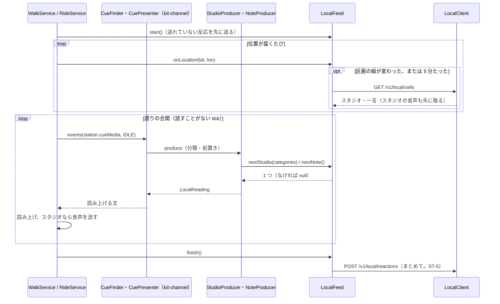

# kit-local-materials

その場の素材（区画ごとに運営から取る素材。今はスタジオと一言。[MATERIALS](../docs/overview/materials.md) D-44・D-51、[API-LOCAL-MATERIALS](../docs/contracts/API-LOCAL-MATERIALS.md)）のアプリ側の部品です（Android）。散歩・走行の間に近くのスタジオと一言を取り、チャンネルのきっかけから組み込みの素材提供者 `builtin:studio`・`builtin:note` として出し、一言を声で置きます。SanpoGuide と CycleGuide が使います。スタジオの要件は [REQ-STUDIO](../docs/requirements/REQ-STUDIO.md)、一言の要件は [REQ-NOTES](../docs/requirements/REQ-NOTES.md) です。

## 部品

| 部品 | 受け持つこと |
|---|---|
| `LocalClient` | API-LOCAL-MATERIALS の HTTP。トークンは kit-llm の `RelayClient` から借りる（API-LOCAL-MATERIALS ST-2）。`token_invalid` で 1 回だけセッションを作り直して送り直す |
| `LocalFeed` | 散歩・走行 1 回分の頭脳。位置を受け取り、区画の一覧を取り、種類ごとに上限と順番に従って 1 つずつ渡す（`nextStudio`・`nextNote`）。聞いた・開いた・いいねをためる |
| `StudioProducer`・`NoteProducer` | `builtin:studio`・`builtin:note`（kit-channel の `Producer`）。きっかけの場所（`idle` なら端末の位置）で `LocalFeed` から 1 つ選び、前置きと出どころの紹介を付けて返す。素材の中身は `LocalReading`（読み上げる文と、もとのスタジオ・一言） |
| `LocalMemory` | 端末に残すもの（読み上げた一言・今日読み上げたスタジオ・送れていない反応・ブロックしたときの一言の文）。ファイル 1 つ、バックアップしない |
| `ClipPlayer` | スタジオの音声（M4A）を、読み上げが終わってから流す。音声は一覧を取ったときに先に取っておく（REQ-STUDIO D-22） |
| `NoteRecognizer` | 一言を声で話して、端末の中で文字にする（Android 12 以上の端末内の音声認識。REQ-NOTES F-2・U-4） |
| `LocalSettings` | 一言を聞く・スタジオを聞くの設定（種類ごと）、初めての説明を済ませたか、同意した一言の利用規約の版 |

## 散歩・走行の間の流れ

- チャンネルが `cues` で `builtin:studio`・`builtin:note` を書いていなければ、kit-channel の `Station.cueMedia` が省略形の `idle` のきっかけを足す（スタジオ、一言の順）。`shorthands` で止めた種類は足さない（API-MATERIALS「省略形の展開」）
- アプリは、語りの合間の 1 回の tick で、`idle` のきっかけを上から試し、最初に出せた 1 つだけを読み上げる
- `spot`・`point` のきっかけに書かれていれば、そのスポット・地点の区画から選び、AI の解説の後に出す

### 取る（API-LOCAL-MATERIALS）

- 区画は、今いる位置の geohash6 と、その周りの 8 区画（kit-geo `Geohash`）
- 取るのは、区画の組が変わったときと、前に取ってから `refetchAfterSec`（300 秒）たったとき。`too_many_requests` のときは次の機会まで待つ。`local_paused` のときは一覧を空にする
- `kinds` には、設定で聞くとしたものだけを入れる。どちらも聞かない設定なら取らない
- スタジオの音声は、一覧を取ったときに取ってキャッシュ（アプリの cache 下、`sha256` の名前）に置く。従量制のネットワークでも取る（音声は 30 秒・512 KB まで）。`sha256` が合わなければ使わない

### 近づいたか

| もの | 近づいたとする範囲 |
|---|---|
| スタジオ | スタジオの区画（geohash6）のどれかに、選ぶ場所が入っている |
| 一言 | 一言の区画（geohash7、約 150 m 四方）か、その周りの 8 区画に、選ぶ場所が入っている |

選ぶ場所は、`idle` なら端末の位置、`spot`・`point` ならそのスポット・地点。一言は周りの区画まで広げる。一言の区画はとても小さく、歩く向きによっては中に入らずに通り過ぎるため。

### 選ぶ（REQ-STUDIO・REQ-NOTES D-21・F-8・F-9）

- `nextStudio(categories, near)`: 期間・`hours` の中、今日まだ読み上げていない、チャンネルの分類に入る（分類の指定がなければすべて）、この 1 時間のスタジオが 2 件未満。区画の数の少ないもの、終わりの近いもの
- `nextNote(near)`: まだ読み上げていない、自分のものでない、この 1 時間の一言が 10 件未満。サーバーの並び（いいねの多い順・新しい順）

上限は「直近の 60 分」で、チャンネルにかかわらずアプリ全体で数える。読み上げた一言の ID は 7 日、スタジオは日付と一緒に残し、同じものを読み上げない。

### 読み上げる（MATERIALS D-38・D-49、API-MATERIALS P-8）

- 前置き（チャンネルが選んだもの。なければなし）、出どころの紹介、原文の順。AI に渡さず、言い換えない。AI の呼び出しには数えない
  - スタジオ: 「〇〇（素材提供者）からのお知らせです。」に続けて文。音声があれば、読み上げが終わってから流す
  - 一言: 「この辺りを通った人の一言です。」に続けて文。スポットの名前があれば「〇〇のそばで、」を前に足す
- 画面の会話の一覧には、AI の発言と分けて「一言」「お知らせ」の印を付けて出す

### 反応（API-LOCAL-MATERIALS ST-5・ST-6）

- 読み上げたら `heard`、画面で開いたら `opened`、いいねは `liked` としてためる。散歩・走行を終えたときにまとめて送り、送れなかった分は残して次の開始のときに送る
- 通報とブロックはその場で送る

## 一言を置く（REQ-NOTES F-1〜F-5）

1. マイクのボタンを押して話す（`NoteRecognizer`。端末内の音声認識が使えない端末では、ボタンを出さない）
2. 文字にしたものと、期限（1 時間・24 時間・7 日。既定は 24 時間）、近くのスポットの名前を付けるかを出す。何もしなければ 3 秒で送る。送る前は取り消せる
3. 初めて置くときは、送る前に一言の利用規約（`GET /v1/local/terms` の URL）を見せて同意を得る。版が上がったときも同じ
4. 置いた位置は geohash7 に丸めて送る。結果（置けた・置けなかった・今日の上限・締め出し・置けない場所・今は置けない）を短く知らせる
5. 自分の一言の一覧（残りの時間・聞いた人・いいねの概数）と、期限の前に消すことは、設定の画面から

## アプリごとの違い

| | SanpoGuide | CycleGuide |
|---|---|---|
| つなぐ場所 | `WalkService` | `RideService` |
| 置く・反応 | 歩きながらでもできる | 止まっているときだけ（走り出すと置きかけの一言をやめる） |
| 語りの合間 | `TalkDecider` の `Nothing` | `RideDecider` の `Nothing` で、話さない場面（`QuietZones`）でもないとき |
| 一言に付けるスポットの名前 | 案内しているスポット | 150 m 以内でいちばん近い見どころ |

CycleGuide では、走行中は一言を置く・いいね・通報・ブロック・スタジオを開くことはできない。読み上げとスタジオの音声は走行中も行う（REQ-STUDIO・REQ-NOTES D-13・F-16）。

## 接続先

接続先の URL はアプリに組み込む（API-LOCAL-MATERIALS ST-1）。中継と同じく、今はどのビルドも開発用の配信（`YorisoiLocalMaterials-dev`）を使う。

## 未決事項

| No. | 内容 | 決める時期 |
|---|---|---|
| 1 | 端末内の音声認識の精度（屋外・風）。悪ければ決まった言葉から選ぶ形に替える（REQ-NOTES U-4） | 実機の確認のとき |
| 2 | 一言の近づいた範囲（周りの 8 区画まで広げる）が広すぎないか | 実機の確認のとき |
