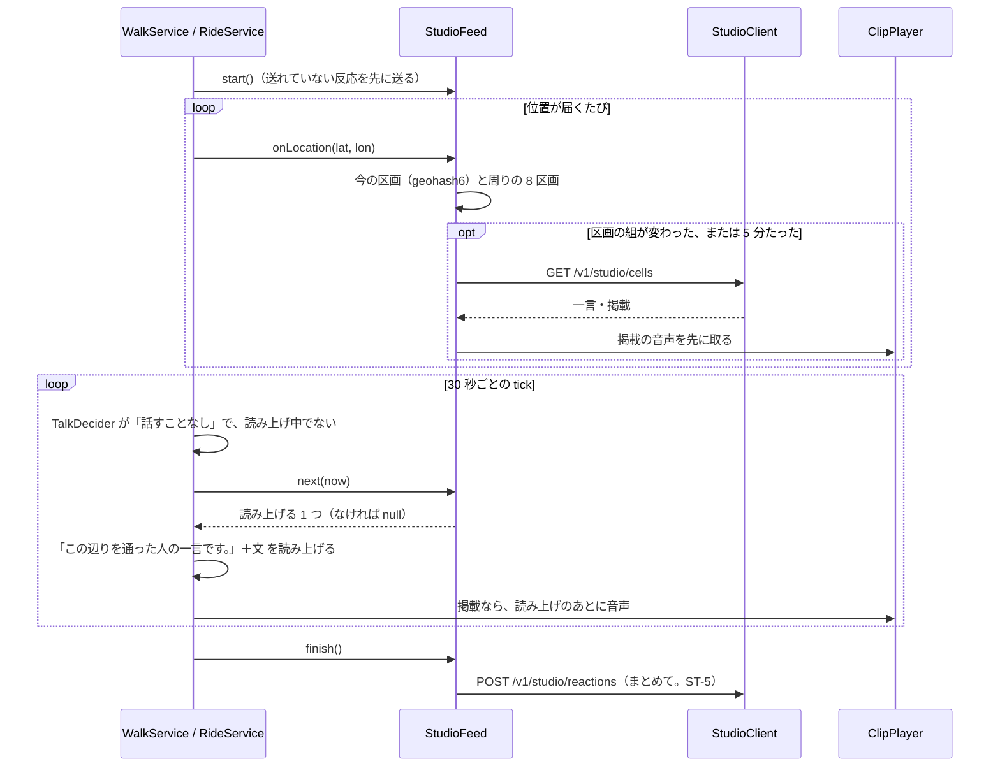

# kit-studio

スタジオ（[REQ-STUDIO](../docs/requirements/REQ-STUDIO.md)・[ADR-STUDIO](../docs/decisions/ADR-STUDIO.md)・[API-STUDIO](../docs/contracts/API-STUDIO.md)）のアプリ側の部品です（Android）。散歩・走行の間に近くの一言と掲載を取り、語りの合間に読み上げ、一言を声で置きます。SanpoGuide と CycleGuide が使います。

> 状態: 設計の草案（未承認）。承認のあとに実装する。

## 部品

| 部品 | 受け持つこと |
|---|---|
| `StudioClient` | API-STUDIO の HTTP。トークンは kit-llm の `RelayClient` から借りる（API-STUDIO ST-2）。`token_invalid` で 1 回だけセッションを作り直して送り直す |
| `StudioFeed` | 散歩・走行 1 回分の頭脳。位置を受け取り、区画の一覧を取り、近づいたものを上限と順番に従って 1 つずつ渡す。聞いた・開いた・いいねをためる |
| `StudioMemory` | 端末に残すもの（読み上げた一言・今日読み上げた掲載・送れていない反応・ブロックしたときの一言の文）。ファイル 1 つ、バックアップしない |
| `ClipPlayer` | 掲載の音声（M4A）を、読み上げが終わってから流す。音声は一覧を取ったときに先に取っておく（API-STUDIO D-22） |
| `NoteRecognizer` | 一言を声で話して、端末の中で文字にする（Android 12 以上の端末内の音声認識。REQ-STUDIO F-2・U-4） |
| `StudioSettings` | 一言を聞く・掲載を聞くの設定、初めての説明を済ませたか、同意した利用規約の版 |

kit-llm の `RelayClient` に、ほかの部品がトークンを使うための `suspend fun token(): String` と `fun forgetToken()` を足す（今は中で使っているだけ）。

## 散歩・走行の間の流れ

### 取る（REQ-STUDIO D-8、API-STUDIO）

- 区画は、今いる位置の geohash6 と、その周りの 8 区画（kit-geo `Geohash`）
- 取るのは、区画の組が変わったときと、前に取ってから `refetchAfterSec`（300 秒）たったとき。`too_many_requests` のときは次の機会まで待つ
- `kinds` には、設定で聞くとしたものだけを入れる。どちらも聞かない設定なら取らない
- 掲載の音声は、一覧を取ったときに取ってキャッシュ（アプリの cache 下、`sha256` の名前）に置く。従量制のネットワークでも取る（音声は 30 秒・512 KB まで）。`sha256` が合わなければ使わない

### 近づいたか

| もの | 近づいたとする範囲 |
|---|---|
| 一言 | 一言の区画（geohash7、約 150 m 四方）か、その周りの 8 区画にいる |
| 掲載 | 掲載の区画（geohash6）のどれかにいる |

一言は周りの区画まで広げる。一言の区画はとても小さく、歩く向きによっては中に入らずに通り過ぎるため。掲載は区画が大きいので広げない。

### 選ぶ（REQ-STUDIO D-21・F-8・F-9）

`next(now)` は、近づいたものから次の順に 1 つ選ぶ。

1. 掲載を先にする（期間・`hours` の中、今日まだ読み上げていない、この 1 時間の掲載が 2 件未満）。区画の数の少ないもの、終わりの近いもの
2. なければ一言（まだ読み上げていない、自分のものでない、この 1 時間の一言が 10 件未満）。サーバーの並び（いいねの多い順・新しい順）

上限は「直近の 60 分」で数える。読み上げた一言の ID は 7 日、掲載は日付と一緒に残し、同じものを読み上げない。

### 読み上げる（REQ-STUDIO D-10）

- 一言: 「この辺りを通った人の一言です。」に続けて文。スポットの名前があれば「〇〇のそばで。」を前に足す
- 掲載: 「〇〇（掲載者）からのお知らせです。」に続けて文。音声があれば、読み上げが終わってから流す
- 読み上げるのは、`TalkDecider` が「話すことなし」と決め、読み上げ中でないときだけ（語りと語りの間）。AI の呼び出しには数えない
- 画面の会話の一覧には、AI の発言と分けて「一言」「お知らせ」の印を付けて出す（ADR-STUDIO S-1）

### 反応（API-STUDIO ST-5・ST-6）

- 読み上げたら `heard`、画面で開いたら `opened`、いいねは `liked` としてためる。散歩・走行を終えたときにまとめて送り、送れなかった分は残して次の開始のときに送る
- 通報とブロックはその場で送る

## 一言を置く（REQ-STUDIO F-1〜F-5）

1. マイクのボタンを押して話す（`NoteRecognizer`。端末内の音声認識が使えない端末では、ボタンを出さない）
2. 文字にしたものと、期限（1 時間・24 時間・7 日。既定は 24 時間）、近くのスポットの名前を付けるかを出す。何もしなければ 3 秒で送る。送る前は取り消せる
3. 初めて置くときは、送る前に利用規約（`GET /v1/studio/terms` の URL）を見せて同意を得る。版が上がったときも同じ
4. 置いた位置は geohash7 に丸めて送る。結果（置けた・置けなかった・今日の上限・締め出し・置けない場所・今は置けない）を短く知らせる
5. 自分の一言の一覧（残りの時間・聞いた人・いいねの概数）と、期限の前に消すことは、設定の画面から

## 画面

| 場所 | 足すもの |
|---|---|
| 散歩・走行中の画面 | 一言を置くマイクのボタン。会話の一覧の一言・お知らせに、いいね・通報・ブロック（一言だけ）。掲載を押すと文と音声を開き、`opened` を数える |
| 設定 | 「スタジオ」の欄: 一言を聞く・掲載を聞く、自分の一言、ブロックした人（ブロックしたときの一言の文で示し、解ける）、利用規約 |
| 初めて | 設定で聞くを初めてオンにしたとき、知らない人の一言と店や地域のお知らせが読み上げられることを説明する（説明の前は聞かない。D-12） |

CycleGuide では、走行中は一言を置く・いいね・通報・ブロック・掲載を開くことはできない。止まっているときはできる。読み上げと掲載の音声は走行中も行う（REQ-STUDIO D-13・F-16）。

## アプリごとの違い

| | SanpoGuide | CycleGuide |
|---|---|---|
| つなぐ場所 | `WalkService` | `RideService` |
| 置く・反応 | 歩きながらでもできる | 止まっているときだけ（`Motion` が止まっている） |
| 読み上げの合間 | `TalkDecider` の `Nothing` | 走行の判定で話すことがないとき |

## 接続先と版

- 接続先の URL はアプリに組み込む（API-STUDIO ST-1）。中継と同じく、今はどのビルドも開発用のスタジオを使う
- platform は kit-studio を足した版を出し、両アプリはそれに上げる。一言・掲載の送り先と保存を、各アプリのプライバシーポリシーとデータ セーフティに書き足す（REQ-STUDIO N-3）

## 実装の順番

| 段 | 中身 |
|---|---|
| A1 | platform: `RelayClient` のトークン、kit-studio（`StudioClient`・`StudioFeed`・`StudioMemory`・`ClipPlayer`・`NoteRecognizer`・`StudioSettings`）と単体テスト。版を出す |
| A2 | SanpoGuide: 散歩のサービスとのつなぎ、画面、設定、プライバシーポリシー。エミュレータで、開発用のスタジオに置いた一言と掲載が読み上げられることを確かめる |
| A3 | CycleGuide: 同じく。走行中の制限 |
| A4 | 両アプリの内部テストへの送信 |

## 未決事項

| No. | 内容 | 決める時期 |
|---|---|---|
| 1 | 端末内の音声認識の精度（屋外・風）。悪ければ決まった言葉から選ぶ形に替える（REQ-STUDIO U-4） | A2 の試験のとき |
| 2 | 一言の近づいた範囲（周りの 8 区画まで広げる）が広すぎないか | 実機の確認のとき |
| 3 | 読み上げの合間の間隔。語りの直後にすぐ読み上げると詰まって聞こえるなら、語りから 1 分あける | A2 の試験のとき |
